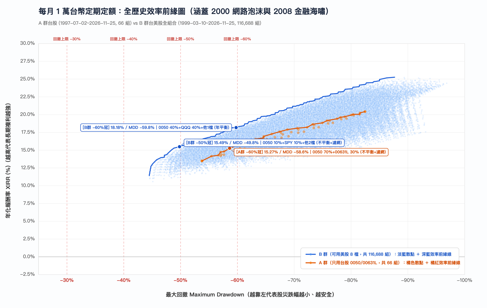
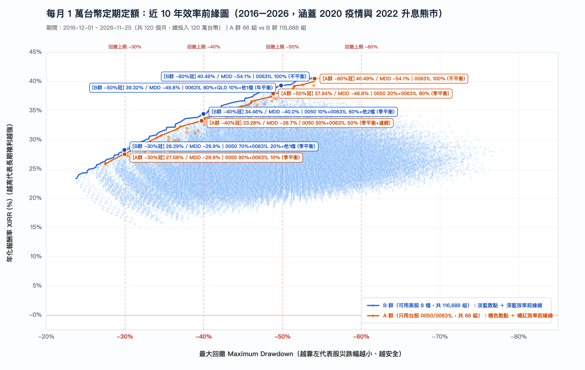

# 每月 1 萬台幣定期定額：全標的全組合最佳配置回測報告

> **給非工程師讀者的閱讀小幫手（四個關鍵詞秒懂整份報告）**
> - **年化報酬（XIRR）**：因為你是「每個月慢慢投 1 萬塊」，第一筆錢滾了快 30 年，最後一筆錢只滾了幾天。`XIRR` 就是把每一筆 1 萬塊「實際待在市場裡的時間」精算後，換算成相當於銀行定存每年幾 % 複利的真實年化報酬率。
> - **最大回撤（MDD）**：從你帳戶曾經達到的「歷史最高金額」往下跌到「最慘谷底」縮水了幾 %。例如 `-50%`，代表帳戶曾從 1,000 萬跌到剩 500 萬（腰斬）。
> - **報酬回撤比（MAR）**：`年化報酬 ÷ 最大回撤幅度`。數字越高，代表「每承受 1% 的帳面縮水痛苦，能換到越多 % 的年化報酬」，也就是**性價比最高**。
> - **有效槓桿倍數**：你買的組合整體放大了幾倍波動。全買 1 倍 ETF（如 `0050`、`SPY`、`QQQ`）就是 `1.0x`；一半買 1 倍、一半買正 2（如 `00631L`、`SSO`、`QLD`）就是 `1.5x`。

---

## 核心五問白話總解答（寫在最前面）

### 第 1 題：在不同「最大跌幅上限（-30%、-40%、-50%、-60%）」下，只買台股（A 群）與可買美股（B 群）的最佳前 5 名是誰？

先說一個**最重要、卻常被理財網紅忽略的殘酷真相**：
- **在涵蓋 2000 網路泡沫與 2008 金融海嘯的「全歷史（近 28～29 年）」中，沒有任何一組 100% 買股票的配置，能把最大跌幅壓在 `-30%` 或 `-40%` 以內！** 就算你完全不開槓桿、100% 買最穩的美國標普 500（`SPY`），在 2008 金融海嘯時定期定額帳戶最高還是跌了 **`-45.11%`**；100% 買台灣 `0050` 也跌了 **`-53.76%`**（因此全歷史 `-30%`、`-40%` 兩檔在 A、B 群皆為 **0 組符合**；A 群連 `-50%` 內也為 **0 組**，B 群則靠台美分散＋均線濾網成功守住 `-50%`）。
- **在「近 10 年（2016/12～2026/11）」中，因為沒發生過 2008 等級的大海嘯**，台股與美股科技股一路長牛，才出現大量回撤小於 `-30%` 卻年化超過 `27%` 的組合——**千萬不能拿近 10 年的跌幅當成一輩子的最壞打算！**

以下依 **XIRR（年化報酬）** 由高到低列出各回撤限制下的前 5 名（註：「再平衡」為不做／每年／每季；「200MA 濾網」指大盤跌破 200 日均線 `-2%` 時，當月新扣的錢暫時改買 1 倍大盤 ETF、原本手上的部位不賣，等站回均線 `+2%` 才恢復買槓桿 ETF）。

---

#### 【1-A】全歷史最佳配置排名（A 群：1997-07-02 ～ 2026-11-25 共 353 個月／總投入 353 萬；B 群：1999-03-10 ～ 2026-11-25 共 333 個月／總投入 333 萬）

- **最大回撤限制 `-30%` 以內**：
  - **A 群（只用台股）**：**0 組符合**（全組合最小回撤為 `100% 0050` 的 **`-53.76%`**，XIRR `13.49%`）。
  - **B 群（可用美股）**：**0 組符合**（全組合最小回撤為 `80% SPY + 20% QQQ` 每季再平衡的 **`-44.49%`**，XIRR `11.37%`）。
- **最大回撤限制 `-40%` 以內**：
  - **A 群（只用台股）**：**0 組符合**（同上，2008 金融海嘯期間純股票組合至少回撤 `-53.76%`）。
  - **B 群（可用美股）**：**0 組符合**（同上，2008 金融海嘯期間純股票組合至少回撤 `-44.49%`）。
- **最大回撤限制 `-50%` 以內**：
  - **A 群（只用台股）**：**0 組符合**（台股單一市場在 2000 與 2008 跌幅皆逾 53%，無法單靠 `0050/00631L` 壓進 `-50%`）。
  - **B 群（可用美股）前 5 名**：

| 名次 | 配置權重 | XIRR | 最大回撤 (%) | 最大回撤金額 (台幣) | 回本月數 | MAR | Sharpe | 有效槓桿 | 再平衡 | 200MA濾網 | 滾動10年勝率 | 滾動10年最差5% | 期末總資產 (台幣) |
| :-: | :--- | --: | --: | --: | --: | --: | --: | :-: | :-: | :-: | --: | --: | --: |
| 1 | `0050` 10% + `SPY` 10% + `QQQ` 70% + `TQQQ` 10% | **15.49%** | -49.81% | -74.4 萬 | 13.2 個月 | 0.311 | 0.454 | 1.2x | 不做 | **開啟** | 97.65% | +2.07% | 4,468 萬 |
| 2 | `SPY` 20% + `QQQ` 70% + `TQQQ` 10% | **15.29%** | -48.83% | -70.6 萬 | 15.4 個月 | 0.313 | 0.446 | 1.2x | 不做 | **開啟** | 96.24% | +1.35% | 4,300 萬 |
| 3 | `0050` 10% + `SPY` 20% + `QQQ` 60% + `TQQQ` 10% | **15.28%** | -49.51% | -73.8 萬 | 13.6 個月 | 0.309 | 0.458 | 1.2x | 不做 | **開啟** | 97.65% | +1.87% | 4,298 萬 |
| 4 | `00631L` 10% + `QQQ` 90% | **15.26%** | -49.90% | -77.0 萬 | 13.0 個月 | 0.306 | 0.480 | 1.1x | 每季 | **開啟** | 97.65% | +3.19% | 4,277 萬 |
| 5 | `SPY` 20% + `QQQ` 60% + `QLD` 20% | **15.13%** | -49.84% | -13.5 萬 | 19.6 個月 | 0.304 | 0.450 | 1.2x | 不做 | **開啟** | 96.24% | +1.26% | 4,177 萬 |

- **最大回撤限制 `-60%` 以內**：
  - **A 群（只用台股）前 5 名**：

| 名次 | 配置權重 | XIRR | 最大回撤 (%) | 最大回撤金額 (台幣) | 回本月數 | MAR | Sharpe | 有效槓桿 | 再平衡 | 200MA濾網 | 滾動10年勝率 | 滾動10年最差5% | 期末總資產 (台幣) |
| :-: | :--- | --: | --: | --: | --: | --: | --: | :-: | :-: | :-: | --: | --: | --: |
| 1 | `0050` 70% + `00631L` 30% | **15.27%** | -58.63% | -136.5 萬 | 22.0 個月 | 0.260 | 0.421 | 1.3x | 不做 | **開啟** | 97.42% | +4.37% | 5,451 萬 |
| 2 | `0050` 80% + `00631L` 20% | **15.06%** | -59.53% | -143.7 萬 | 22.0 個月 | 0.253 | 0.425 | 1.2x | 每季 | **開啟** | 97.42% | +4.87% | 5,234 萬 |
| 3 | `0050` 90% + `00631L` 10% | **14.81%** | -57.65% | -135.0 萬 | 21.7 個月 | 0.257 | 0.427 | 1.1x | 不做 | 不加 | 97.42% | +4.69% | 4,984 萬 |
| 4 | `0050` 80% + `00631L` 20% | **14.74%** | -57.04% | -131.3 萬 | 21.7 個月 | 0.258 | 0.421 | 1.2x | 不做 | **開啟** | 97.42% | +4.50% | 4,913 萬 |
| 5 | `0050` 90% + `00631L` 10% | **14.39%** | -57.18% | -134.3 萬 | 13.5 個月 | 0.252 | 0.422 | 1.1x | 每年 | 不加 | 97.42% | +5.05% | 4,584 萬 |

  - **B 群（可用美股）前 5 名**：

| 名次 | 配置權重 | XIRR | 最大回撤 (%) | 最大回撤金額 (台幣) | 回本月數 | MAR | Sharpe | 有效槓桿 | 再平衡 | 200MA濾網 | 滾動10年勝率 | 滾動10年最差5% | 期末總資產 (台幣) |
| :-: | :--- | --: | --: | --: | --: | --: | --: | :-: | :-: | :-: | --: | --: | --: |
| 1 | `0050` 40% + `QQQ` 40% + `TQQQ` 20% | **18.18%** | -59.77% | -102.5 萬 | 15.8 個月 | 0.304 | 0.517 | 1.4x | 每年 | 不加 | 97.65% | +3.75% | 7,357 萬 |
| 2 | `0050` 30% + `QQQ` 50% + `TQQQ` 20% | **18.15%** | -59.22% | -98.6 萬 | 13.6 個月 | 0.306 | 0.505 | 1.4x | 每年 | 不加 | 97.65% | +3.36% | 7,316 萬 |
| 3 | `0050` 20% + `QQQ` 60% + `TQQQ` 20% | **18.10%** | -58.66% | -94.8 萬 | 13.6 個月 | 0.309 | 0.490 | 1.4x | 每年 | 不加 | 97.65% | +2.97% | 7,254 萬 |
| 4 | `00631L` 10% + `SPY` 10% + `QQQ` 60% + `TQQQ` 20% | **18.03%** | -59.96% | -104.7 萬 | 16.7 個月 | 0.301 | 0.517 | 1.5x | 每季 | **開啟** | 97.65% | +2.96% | 7,154 萬 |
| 5 | `00631L` 30% + `SPY` 10% + `QQQ` 40% + `TQQQ` 20% | **18.01%** | -59.94% | -101.2 萬 | 22.8 個月 | 0.301 | 0.475 | 1.7x | 不做 | **開啟** | 97.65% | +2.27% | 7,137 萬 |

---

#### 【1-B】近 10 年最佳配置排名（2016-12-01 ～ 2026-11-25，共 120 個月／總投入 120 萬台幣）

> **滾動窗口註記**：近 10 年區間總長剛好 120 個月（10 年），無法切出多個獨立的滾動 10 年與 15 年窗口，故依規標示「**資料不足**」；表中額外附上近 10 年內的 **滾動 5 年勝率與最差 5% XIRR**（共 60 個進場月份梯次）供實務參考。

- **最大回撤限制 `-30%` 以內**：
  - **A 群（只用台股，共 3 組符合，全數列出）**：

| 名次 | 配置權重 | XIRR | 最大回撤 (%) | 最大回撤金額 (台幣) | 回本月數 | MAR | Sharpe | 有效槓桿 | 再平衡 | 200MA濾網 | 滾動10年勝率 / 最差5% | 滾動5年勝率 / 最差5% | 期末總資產 |
| :-: | :--- | --: | --: | --: | --: | --: | --: | :-: | :-: | :-: | :-: | :-: | --: |
| 1 | `0050` 90% + `00631L` 10% | **27.58%** | -29.94% | -36.3 萬 | 7.0 個月 | 0.921 | 0.960 | 1.1x | 每季 | 不加 | 資料不足 | 100% / +11.00% | 516.6 萬 |
| 2 | `0050` 90% + `00631L` 10% | **27.46%** | -29.67% | -35.7 萬 | 7.0 個月 | 0.925 | 0.958 | 1.1x | 每季 | **開啟** | 資料不足 | 100% / +10.72% | 513.2 萬 |
| 3 | `0050` 100% | **25.95%** | -27.51% | -31.1 萬 | 6.7 個月 | 0.943 | 0.956 | 1.0x | 不做 | 不加 | 資料不足 | 100% / +9.41% | 473.1 萬 |

  - **B 群（可用美股）前 5 名**：

| 名次 | 配置權重 | XIRR | 最大回撤 (%) | 最大回撤金額 (台幣) | 回本月數 | MAR | Sharpe | 有效槓桿 | 再平衡 | 200MA濾網 | 滾動10年勝率 / 最差5% | 滾動5年勝率 / 最差5% | 期末總資產 |
| :-: | :--- | --: | --: | --: | --: | --: | --: | :-: | :-: | :-: | :-: | :-: | --: |
| 1 | `0050` 70% + `00631L` 20% + `SPY` 10% | **28.29%** | -29.92% | -200.8 萬 | 未回復(0.2月) | 0.946 | 0.976 | 1.2x | 每季 | 不加 | 資料不足 | 100% / +12.74% | 536.7 萬 |
| 2 | `0050` 70% + `00631L` 20% + `SPY` 10% | **28.05%** | -29.92% | -198.2 萬 | 未回復(0.2月) | 0.938 | 0.973 | 1.2x | 每季 | **開啟** | 資料不足 | 100% / +12.26% | 529.8 萬 |
| 3 | `0050` 60% + `00631L` 20% + `QQQ` 20% | **28.03%** | -29.71% | -197.7 萬 | 未回復(0.2月) | 0.943 | 1.002 | 1.2x | 每季 | 不加 | 資料不足 | 100% / +13.21% | 529.1 萬 |
| 4 | `0050` 60% + `00631L` 20% + `QQQ` 20% | **27.78%** | -29.71% | -195.1 萬 | 未回復(0.2月) | 0.935 | 0.999 | 1.2x | 每季 | **開啟** | 資料不足 | 100% / +12.77% | 522.2 萬 |
| 5 | `0050` 60% + `00631L` 20% + `SPY` 10% + `QQQ` 10% | **27.70%** | -29.16% | -14.9 萬 | 2.4 個月 | 0.950 | 0.996 | 1.2x | 每季 | 不加 | 資料不足 | 100% / +12.96% | 519.9 萬 |

- **最大回撤限制 `-40%` 以內**：
  - **A 群（只用台股）前 5 名**：

| 名次 | 配置權重 | XIRR | 最大回撤 (%) | 最大回撤金額 (台幣) | 回本月數 | MAR | Sharpe | 有效槓桿 | 再平衡 | 200MA濾網 | 滾動10年勝率 / 最差5% | 滾動5年勝率 / 最差5% | 期末總資產 |
| :-: | :--- | --: | --: | --: | --: | --: | --: | :-: | :-: | :-: | :-: | :-: | --: |
| 1 | `0050` 50% + `00631L` 50% | **33.28%** | -39.72% | -124.4 萬 | 3.9 個月 | 0.838 | 0.955 | 1.5x | 每季 | **開啟** | 資料不足 | 100% / +14.64% | 701.8 萬 |
| 2 | `0050` 60% + `00631L` 40% | **32.27%** | -37.01% | -110.2 萬 | 3.3 個月 | 0.872 | 0.962 | 1.4x | 每季 | 不加 | 資料不足 | 100% / +14.77% | 664.7 萬 |
| 3 | `0050` 60% + `00631L` 40% | **32.00%** | -37.87% | -336.3 萬 | 未回復(0.2月) | 0.845 | 0.955 | 1.4x | 每年 | 不加 | 資料不足 | 100% / +14.94% | 655.2 萬 |
| 4 | `0050` 60% + `00631L` 40% | **31.86%** | -36.62% | -106.5 萬 | 3.3 個月 | 0.870 | 0.957 | 1.4x | 每季 | **開啟** | 資料不足 | 100% / +14.42% | 650.2 萬 |
| 5 | `0050` 70% + `00631L` 30% | **31.57%** | -39.27% | -346.1 萬 | 未回復(0.2月) | 0.804 | 0.930 | 1.3x | 不做 | 不加 | 資料不足 | 100% / +14.28% | 640.2 萬 |

  - **B 群（可用美股）前 5 名**：

| 名次 | 配置權重 | XIRR | 最大回撤 (%) | 最大回撤金額 (台幣) | 回本月數 | MAR | Sharpe | 有效槓桿 | 再平衡 | 200MA濾網 | 滾動10年勝率 / 最差5% | 滾動5年勝率 / 最差5% | 期末總資產 |
| :-: | :--- | --: | --: | --: | --: | --: | --: | :-: | :-: | :-: | :-: | :-: | --: |
| 1 | `0050` 10% + `00631L` 60% + `QQQ` 20% + `QLD` 10% | **34.46%** | -39.96% | -23.3 萬 | 2.5 個月 | 0.862 | 0.988 | 1.7x | 每季 | 不加 | 資料不足 | 100% / +16.77% | 747.4 萬 |
| 2 | `0050` 20% + `00631L` 60% + `QQQ` 20% | **34.19%** | -39.52% | -139.3 萬 | 3.9 個月 | 0.865 | 0.988 | 1.6x | 每季 | 不加 | 資料不足 | 100% / +16.43% | 736.9 萬 |
| 3 | `0050` 40% + `00631L` 50% + `QLD` 10% | **34.08%** | -39.51% | -66.1 萬 | 7.4 個月 | 0.863 | 0.972 | 1.6x | 每季 | 不加 | 資料不足 | 100% / +15.82% | 732.5 萬 |
| 4 | `00631L` 60% + `QQQ` 30% + `QLD` 10% | **33.90%** | -39.64% | -23.5 萬 | 2.5 個月 | 0.855 | 0.995 | 1.7x | 每季 | 不加 | 資料不足 | 100% / +17.08% | 725.4 萬 |
| 5 | `0050` 20% + `00631L` 60% + `SPY` 10% + `QQQ` 10% | **33.88%** | -39.22% | -135.0 萬 | 3.9 個月 | 0.864 | 0.983 | 1.6x | 每季 | 不加 | 資料不足 | 100% / +16.47% | 724.8 萬 |

- **最大回撤限制 `-50%` 以內**：
  - **A 群（只用台股）前 5 名**：

| 名次 | 配置權重 | XIRR | 最大回撤 (%) | 最大回撤金額 (台幣) | 回本月數 | MAR | Sharpe | 有效槓桿 | 再平衡 | 200MA濾網 | 滾動10年勝率 / 最差5% | 滾動5年勝率 / 最差5% | 期末總資產 |
| :-: | :--- | --: | --: | --: | --: | --: | --: | :-: | :-: | :-: | :-: | :-: | --: |
| 1 | `0050` 20% + `00631L` 80% | **37.94%** | -48.81% | -196.4 萬 | 4.3 個月 | 0.777 | 0.955 | 1.8x | 每季 | 不加 | 資料不足 | 100% / +17.25% | 899.9 萬 |
| 2 | `0050` 20% + `00631L` 80% | **37.75%** | -48.78% | -196.8 萬 | 5.0 個月 | 0.774 | 0.951 | 1.8x | 每年 | 不加 | 資料不足 | 100% / +17.35% | 890.7 萬 |
| 3 | `0050` 20% + `00631L` 80% | **37.41%** | -48.53% | -189.6 萬 | 4.3 個月 | 0.771 | 0.948 | 1.8x | 每季 | **開啟** | 資料不足 | 100% / +16.64% | 875.0 萬 |
| 4 | `0050` 30% + `00631L` 70% | **37.15%** | -48.93% | -190.4 萬 | 5.0 個月 | 0.759 | 0.938 | 1.7x | 不做 | 不加 | 資料不足 | 100% / +16.83% | 863.0 萬 |
| 5 | `00631L` 100% | **37.05%** | -49.25% | -190.6 萬 | 5.0 個月 | 0.752 | 0.942 | 2.0x | 不做 | **開啟** | 資料不足 | 100% / +14.69% | 858.4 萬 |

  - **B 群（可用美股）前 5 名**：

| 名次 | 配置權重 | XIRR | 最大回撤 (%) | 最大回撤金額 (台幣) | 回本月數 | MAR | Sharpe | 有效槓桿 | 再平衡 | 200MA濾網 | 滾動10年勝率 / 最差5% | 滾動5年勝率 / 最差5% | 期末總資產 |
| :-: | :--- | --: | --: | --: | --: | --: | --: | :-: | :-: | :-: | :-: | :-: | --: |
| 1 | `00631L` 80% + `QLD` 10% + `TQQQ` 10% | **39.32%** | -49.81% | -31.2 萬 | 2.6 個月 | 0.789 | 0.957 | 2.1x | 每年 | 不加 | 資料不足 | 100% / +17.96% | 968.2 萬 |
| 2 | `0050` 10% + `00631L` 80% + `TQQQ` 10% | **39.17%** | -49.39% | -224.8 萬 | 5.0 個月 | 0.793 | 0.959 | 2.0x | 每年 | 不加 | 資料不足 | 100% / +18.50% | 960.7 萬 |
| 3 | `00631L` 80% + `QLD` 10% + `TQQQ` 10% | **39.01%** | -49.92% | -112.6 萬 | 8.7 個月 | 0.781 | 0.956 | 2.1x | 每季 | 不加 | 資料不足 | 100% / +17.66% | 952.7 萬 |
| 4 | `0050` 10% + `00631L` 70% + `TQQQ` 20% | **38.99%** | -49.92% | -31.8 萬 | 2.7 個月 | 0.781 | 0.956 | 2.1x | 每年 | 不加 | 資料不足 | 100% / +18.65% | 951.4 萬 |
| 5 | `0050` 10% + `00631L` 80% + `TQQQ` 10% | **38.93%** | -49.20% | -220.1 萬 | 4.6 個月 | 0.791 | 0.958 | 2.0x | 每季 | 不加 | 資料不足 | 100% / +18.14% | 948.7 萬 |

- **最大回撤限制 `-60%` 以內**：
  - **A 群（只用台股）前 5 名**：

| 名次 | 配置權重 | XIRR | 最大回撤 (%) | 最大回撤金額 (台幣) | 回本月數 | MAR | Sharpe | 有效槓桿 | 再平衡 | 200MA濾網 | 滾動10年勝率 / 最差5% | 滾動5年勝率 / 最差5% | 期末總資產 |
| :-: | :--- | --: | --: | --: | --: | --: | --: | :-: | :-: | :-: | :-: | :-: | --: |
| 1 | `00631L` 100% | **40.49%** | -54.07% | -250.5 萬 | 5.1 個月 | 0.749 | 0.950 | 2.0x | 不做 | 不加 | 資料不足 | 100% / +17.77% | 1,030.1 萬 |
| 2 | `00631L` 100% | **40.04%** | -54.00% | -244.2 萬 | 5.1 個月 | 0.742 | 0.943 | 2.0x | 每季 | **開啟** | 資料不足 | 100% / +17.02% | 1,006.2 萬 |
| 3 | `0050` 10% + `00631L` 90% | **39.44%** | -52.55% | -230.5 萬 | 5.0 個月 | 0.750 | 0.946 | 1.9x | 不做 | 不加 | 資料不足 | 100% / +17.43% | 974.4 萬 |
| 4 | `00631L` 100% | **39.31%** | -53.95% | -234.6 萬 | 5.1 個月 | 0.729 | 0.933 | 2.0x | 每年 | **開啟** | 資料不足 | 100% / +15.70% | 967.7 萬 |
| 5 | `0050` 10% + `00631L` 90% | **39.24%** | -51.49% | -222.5 萬 | 5.0 個月 | 0.762 | 0.952 | 1.9x | 每季 | 不加 | 資料不足 | 100% / +17.51% | 964.2 萬 |

  - **B 群（可用美股）前 5 名**：

| 名次 | 配置權重 | XIRR | 最大回撤 (%) | 最大回撤金額 (台幣) | 回本月數 | MAR | Sharpe | 有效槓桿 | 再平衡 | 200MA濾網 | 滾動10年勝率 / 最差5% | 滾動5年勝率 / 最差5% | 期末總資產 |
| :-: | :--- | --: | --: | --: | --: | --: | --: | :-: | :-: | :-: | :-: | :-: | --: |
| 1 | `00631L` 100% | **40.49%** | -54.07% | -250.5 萬 | 5.1 個月 | 0.749 | 0.950 | 2.0x | 不做 | 不加 | 資料不足 | 100% / +17.77% | 1,030.1 萬 |
| 2 | `00631L` 90% + `TQQQ` 10% | **40.48%** | -52.06% | -252.7 萬 | 5.0 個月 | 0.778 | 0.957 | 2.1x | 每年 | 不加 | 資料不足 | 100% / +19.43% | 1,029.6 萬 |
| 3 | `00631L` 80% + `TQQQ` 20% | **40.24%** | -52.17% | -33.7 萬 | 2.7 個月 | 0.771 | 0.954 | 2.2x | 每年 | 不加 | 資料不足 | 100% / +18.60% | 1,016.9 萬 |
| 4 | `00631L` 90% + `TQQQ` 10% | **40.14%** | -51.84% | -248.1 萬 | 5.0 個月 | 0.774 | 0.954 | 2.1x | 每季 | 不加 | 資料不足 | 100% / +18.78% | 1,011.4 萬 |
| 5 | `00631L` 100% | **40.04%** | -54.00% | -244.2 萬 | 5.1 個月 | 0.742 | 0.943 | 2.0x | 每季 | **開啟** | 資料不足 | 100% / +17.02% | 1,006.2 萬 |

---

### 第 2 題：不限回撤、報酬最高但「不會歸零」的極限配置是哪一組？（全歷史）

在全歷史期間，無論是 A 群或 B 群，**沒有任何一組觸發歸零**（單日淨值從未跌到 `≤ 0`，且因每月持續投入 1 萬台幣新血，總資產從未低於累計投入本金的 1%）。但若完全不管中間跌多慘、只追求期末總金額最高，極限冠軍如下：

| 群組 | 極限冠軍配置 | 有效槓桿 / 規則 | 總投入本金 | 期末總資產 | 年化 XIRR | 最大回撤 (MDD) | 從谷底回本月數 | 2000 網路泡沫跌幅 | 2008 金融海嘯跌幅 | 2020 疫情崩盤跌幅 | 2022 升息熊市跌幅 |
| :-: | :--- | :--- | --: | --: | --: | --: | --: | --: | --: | --: | --: |
| **B 群** (可用美股) | **`00631L` 20% + `TQQQ` 80%** | `2.8x`｜每季再平衡＋**開啟 200MA 濾網** | 333 萬 (333個月) | **2 億 7,755 萬** (277,550,308 元) | **25.27%** | **-87.72%** (-217.8 萬) | **38.8 個月** (約 3.2 年) | **-86.22%** | **-87.72%** | **-65.85%** | **-70.94%** |
| **A 群** (只用台股) | **`00631L` 100%** | `2.0x`｜不做再平衡＋不加濾網 | 353 萬 (353個月) | **1 億 5,303 萬** (153,031,537 元) | **20.43%** | **-82.46%** (-261.6 萬) | **58.9 個月** (近 4.9 年) | **-78.43%** | **-82.46%** | **-52.05%** | **-51.14%** |

> **白話警語**：這兩組「帳面數字」看起來像印鈔機（300 多萬本金滾成 1.5 億～2.7 億），但請看代價——在 2000 年與 2008 年，你的帳戶會**連續兩次蒸發超過八成五（1,000 萬跌到剩 120 多萬）**，而且從最低點爬回前高要苦熬 **3 到 5 年**；到了 2022 年你已經存了 20 幾年、帳戶有好幾千萬時，又要在一年內承受 **`-51% ～ -71%`**（幾千萬台幣瞬間蒸發）的心理折磨。絕大多數一般人會在谷底崩潰停扣，根本拿不到最後的 2 億。
> 也請注意一個極關鍵細節：就連 B 群極限冠軍，也**不是 100% 單押 `TQQQ`**（單押 `100% TQQQ` XIRR 為 `24.42%`、最大回撤 `-96.84%`），而是靠 **`20% 00631L + 80% TQQQ` 每季再平衡＋200 日線濾網**，把牛市暴漲的 `TQQQ` 獲利定期鎖進台股、並在跌破年線時把新扣款轉進 1 倍 `QQQ/0050`，反而比死抱 `100% TQQQ` 多賺了 **4,066 萬台幣**，還少跌了 9 個百分點！

---

### 第 3 題：效率前緣圖（全歷史 vs 近 10 年）

我們將全部組合畫成散點（淡藍色＝B 群 116,688 組、橘色＝A 群 66 組），並把「相同最大回撤下，年化報酬最高」的最優組合連成**效率前緣線**：

1. **全歷史效率前緣圖**（[efficient_frontier_full_history.png](file:///Users/panda/pandatesttrading/research/dca_allocation_grid/efficient_frontier_full_history.png)）：
   - 可以一眼看出：**深藍色線（B 群：台美股混搭）整條都明顯位在橘紅線（A 群：只用台股）的左上方**！
   - 意思就是：在跨越 2000 與 2008 兩次世界級崩盤的近 30 年尺度下，**把台股與美股（特別是 `0050/00631L` 搭配 `QQQ/SPY`）混在一起並定期再平衡，同樣承受 `-58%` 回撤，年化報酬能從台股單打獨鬥的 `15.27%` 跳升到 `18.18%`（期末資產從 5,451 萬變成 7,357 萬，多出近 1,900 萬！）**；反過來，同樣想要 `15.3%` 年化報酬，台美混搭能把最大回撤從 `-58.6%` 壓低到 `-48.8%`。

2. **近 10 年效率前緣圖**（[efficient_frontier_recent_10y.png](file:///Users/panda/pandatesttrading/research/dca_allocation_grid/efficient_frontier_recent_10y.png)）：
   - 近 10 年（2016/12～2026/11）受惠於台積電與 AI 半導體狂潮，台股 `0050` 與 `00631L` 表現領先全球，因此橘紅線（A 群）幾乎貼著深藍線（B 群）走，`-60%` 回撤上限冠軍甚至由 `100% 00631L`（XIRR `40.49%`、MDD `-54.07%`）奪下。
   - 但在低回撤區間（`-24% ～ -40%`），加入 `20%～40%` 美股（`QQQ`/`SPY`）搭配每季再平衡的深藍線依然微幅領先，能把最低回撤進一步壓到 **`-23.72%`**（`60% 0050 + 40% QQQ` 每季再平衡，XIRR `23.37%`、MAR 高達 `0.985`）。

---

### 第 4 題：給一般人的白話實戰建議 ＋ 3 倍槓桿 ETF 對照組結果

#### 1. 如果你「沒有美股帳戶」（只用台股證券戶買 0050 / 00631L）

- **穩健首選：`70% 0050 ＋ 30% 00631L`（有效槓桿 `1.3x`），每年再平衡一次（或搭配 200 日線濾網）**
  - **為什麼選它**：全買 `0050` 全歷史年化 `13.49%`（MDD `-53.8%`）；只要撥 30% 給正二 `00631L`（配成 `1.3x` 溫和槓桿），全歷史年化立刻提升到 **`15.27%`**（353 萬滾成 **5,451 萬**，比純買 0050 多賺 1,613 萬），而最大回撤僅小幅增加約 4.8 個百分點（`-58.6%`），滾動 10 年定投勝率高達 **`97.42%`**、最差 5% 梯次也有 **`+4.37%/年`** 正報酬。近 10 年表現更是高達年化 **`31.5% ～ 32.3%`**（回撤約 `-37% ～ -39%`）。
- **積極首選：`50% 0050 ＋ 50% 00631L`（有效槓桿 `1.5x`，即著名的「50/50 正二配置法」），每季或每年再平衡＋200 日線濾網**
  - **為什麼選它**：近 10 年年化高達 **`33.28%`**（回撤 `-39.72%`，壓在四成以內！），全歷史年化約 **`16.5% ～ 17.1%`**（回撤約 `-65%`）。你永遠保有一半的 `0050` 現股底倉，大跌再平衡時有籌碼逢低補進 `00631L`，大漲時自動把正二獲利鎖回 `0050`，心理壓力遠小於單押 `100% 00631L`（大崩盤會跌 `-82.5%`、套牢近 5 年）。

#### 2. 如果你「有美股帳戶」（特別提醒：請務必確認券商「無低消」！）

> **極重要前提**：每月只有 1 萬台幣，若拆成多檔美股扣款，**絕對不能用「每筆低消 15 美元（約 480 台幣）」的傳統複委託**！後面敏感度檢查會證明，若有 15 美元低消，買 2～3 檔美股等於每個月先被扣掉 10%～15% 手續費。以下建議僅適用於**免低消／按比例 0.1% 收費的定期定額複委託或海外券商**（或者改為「每季累積 3 萬再買一次美股」）。

- **穩健首選：`50% 0050 ＋ 40% QQQ（或 20% SPY + 20% QQQ）＋ 10% 00631L/QLD`（有效槓桿 `1.1x ～ 1.2x`），每年再平衡**
  - **為什麼選它**：台股與美股科技／標普各半，單筆交易檔數少、好管理。在近 10 年最大回撤只有 **`-24% ～ -29%`**（連三成都不到！），年化卻高達 **`24% ～ 28%`**；放眼全歷史，即使撞上 2000 與 2008 兩次大崩盤，最大回撤也能控制在 **`-48% ～ -52%`**，滾動 15 年定投勝率 **`100%`**。
- **積極首選：`40% 0050 ＋ 40% QQQ ＋ 20% QLD（或 20% 00631L / TQQQ）`（有效槓桿 `1.2x ～ 1.4x`），每年再平衡**
  - **為什麼選它**：全歷史 `-60%` 回撤上限的全場總冠軍就是 **`40% 0050 + 40% QQQ + 20% TQQQ`（每年再平衡，有效槓桿 `1.4x`）**——333 萬本金滾出 **7,357 萬台幣**，年化高達 **`18.18%`**，滾動 10 年勝率 **`97.65%`**、滾動 15 年最差 5% 梯次年化仍高達 **`+12.25%`**！若不想碰 3 倍 ETF，把 `20% TQQQ` 換成 `20% 00631L + 20% QLD`（有效槓桿同為 `1.4x`），同樣能拿到近 `17.5%～18%` 的長期複利且完全避開 3 倍 ETF 的極端波動耗損。

#### 3. 3 倍槓桿 ETF 對照組（`UPRO`、`TQQQ`）實測結果：到底有沒有爆？什麼時候最危險？

1. **數學上有沒有「歸零（爆倉）」？沒有，但單筆淨值曾跌掉 `-99.98%`，實質上等於團滅！**
   - 槓桿 ETF 每天收盤都會把槓桿重設回 3 倍，所以除非 `SPY` 或 `QQQ` **在「同一天之內」暴跌超過 `33.34%`**（美股現有 7% / 13% / 20% 三階段熔斷機制擋著；歷史最慘單日為 2020-03-16 `SPY -10.94%`、`QQQ -11.98%`，使 `UPRO` 與 `TQQQ` 單日跌約 `-34.6%`），否則淨值不會在單日變成 0。加上你每個月固定投入新的 1 萬台幣現金，因此全組合 `ruined（低於累計本金 1%）` 統計數為 **0 組**。
   - **但是！如果看單筆錢的命運**：模擬 `TQQQ` 在 **2000～2002 網路泡沫**期間，單筆淨值從高點暴跌了 **`-99.976%`**（如果你在 2000 年初已經存到 **1,000 萬台幣**放在 `TQQQ` 裡，到 2002 年 10 月只會剩下 **2,418 元台幣**！）。就算每個月持續投 1 萬塊救命，`100% TQQQ` 定期定額帳戶最大回撤仍高達 **`-96.84%`**（帳戶總值一度只剩累計投入本金的 **6.59%**！）；`100% UPRO` 在 2008 金融海嘯定期定額回撤也高達 **`-93.13%`**。
2. **全網格大數據揭露 3 倍 ETF 的真實面貌**：
   - 在 B 群全歷史 116,688 組裡，**完全不碰 3 倍 ETF（共 18,018 組）** 的回撤中位數是 `-62.90%`，沒有任何一組回撤超過 `-90%`；
   - 一旦**重倉 `≥50%` 在 3 倍 ETF（共 18,612 組）**，有超過一半（**`51.61%`**）的組合最大回撤比 `-80%` 更慘；若 **`100%` 全買 3 倍 ETF（共 66 組）**，高達 **`90.91%`** 回撤超過 `-80%`、**`57.58%`** 回撤超過 `-90%`，MAR 中位數反而掉到最低的 `0.242`！
   - 更驚人的是：在**近 10 年**大牛市裡，單買 `100% TQQQ`（XIRR `28.31%`、回撤 `-77.87%`）與 `100% UPRO`（XIRR `24.78%`、回撤 `-76.21%`），報酬率竟然**雙雙慘輸給台股 2 倍的 `00631L`（XIRR `40.49%`、回撤 `-54.07%`）**，而 `UPRO` 甚至還輸給台股 1 倍的 `0050`（XIRR `25.95%`、回撤僅 `-27.51%`）！
3. **3 倍 ETF 什麼時候最危險？**
   - **第一危險時刻：「長達 1～3 年的反覆震盪緩跌熊市」＋「高利率環境」**（如 **2000–2002 網路泡沫**、**2008 金融海嘯**、以及 **2022 暴力升息年**）。3 倍 ETF 每天承受 `9 倍（3²）` 的波動耗損，還要付 **2 倍借貸利息（`2 × 短期利率`）＋近 0.9% 內扣費**。2022 年聯準會升息、`QQQ` 跌約三成，但累積了大筆資產的 `TQQQ` 定期定額帳戶直接暴跌 **`-79.73%`**！
   - **第二危險時刻：「定投後期資產龐大時遇到股災」**。剛開始定投第 1 年跌 `-80%`，每個月新投的 1 萬塊很快就幫你攤平；但定投第 20 年帳戶有 3,000 萬時跌 `-80%`（賠掉 2,400 萬），你每個月 1 萬塊的新錢就像拿水槍救森林大火，完全攤不平！
   - **唯一安全用法**：最多只拿 **`10% ～ 20%` 當衛星配置**，且**一定要搭配每年／每季再平衡**，強迫在牛市把 3 倍 ETF 的暴利收割回 1 倍大盤（`0050` / `QQQ`）。

---

### 第 5 題：研究限制與風險揭露（請務必讀完再決定怎麼投資）

1. **槓桿 ETF 上市前模擬段的誤差（模擬版微幅偏樂觀約 `0.8% ～ 2.4%/年`）**：
   - 真實槓桿 ETF 在 2006～2014 年才陸續上市；為了測試 2000 與 2008 大崩盤，上市前我們用「原型指數含息日報酬 × 倍數 − 內扣費 − 融資利率」模擬。
   - 對照真實上市後的表現（詳見下節誤差比對表），美股 `SSO/QLD` 模擬年化比真實高 **`+0.77%`**、`UPRO/TQQQ` 高 **`+1.61% / +1.57%`**，原因是真實基金簽訂交換合約（Swap）除了付國庫券利率（`^IRX`）外，還須額外支付券商約 `0.4%～0.7%` 的融資加碼利差與交易滑價；台股 `00631L` 模擬年化比真實高 **`+2.37%`**、年化追蹤誤差 `9.13%`，原因是 `00631L` 實際持有台指期（13:45 收盤，與 0050 現貨 13:30 收盤有 15 分鐘價差與正逆價差波動），且早期未另扣台灣本土期貨隱含資金成本。這代表早期模擬段報酬可能比真實情況略微樂觀 `1%～2%`。
2. **匯率回填與交易手續費假設**：
   - **早期匯率延用**：Yahoo Finance 的美元兌台幣匯率（`TWD=X`）最早只到 **`2004-03-24`（`32.0230`）**，本研究將 1997～2004/03 期間固定延用 `32.0230`（歷史上 1997 亞洲金融風暴前台幣曾約 27.5～28.5、2001～2003 約 33～35，延用 32.02 對 30 年長期 XIRR 影響極小，但仍屬近似假設），並已清除 Yahoo 原始匯率中 2011-10-25（`1.80`）與 2014-12-31（`3.67`）等報價錯植跳點。
   - **美股複委託「無低消」假設**：主回測假設美股買賣手續費純按 `0.1%` 計、不設最低消費。若你的券商有 **每筆低消 15 美元**，每月 1 萬台幣拆買多檔美股會被高額低消嚴重侵蝕（見第參節敏感度表）。
   - **台股扣款與實務資格**：依題目設定，台股 `0.1425%` 手續費與 `0.1%` 證交稅僅於再平衡買賣時計入（契合目前台灣券商定期定額 `0050` 手續費普遍 1 元優惠）；但實務上 **`00631L` 金管會規定不得設定券商自動定期定額扣款**，且首次買進須開立信用戶並簽署風險預告書，投資人需每月第一個交易日手動買進零股。
3. **早期台股股息與美股股息稅估計**：
   - `0050` 於 2003 年 6 月上市，但 Yahoo Finance 完整無錯價之日線始於 `2009-03-10`；因此 `1997-07-02 ～ 2009-03-09` 期間係以加權指數 `^TWII` 價格日報酬外加**每年 `3.0%` 估計股息殖利率平均分攤至每日**模擬，並非真實除息日現金流。美股則以含息價與不含息價差精算配息並扣除台灣人適用的 **`30%` 預扣稅**。
4. **倖存者偏差與「過去不等於未來」**：
   - 過去 29 年剛好是「美國科技巨頭稱霸全球」加上「台灣半導體（台積電）躍升世界核心」的黃金時代。如果把同樣的 2 倍、3 倍槓桿套用在過去 30 年的日本（1990 泡沫後失落三十年）或歐洲股市，結果會慘烈非常多。未來台美股市能否維持每年 `10%～15%` 以上的基礎成長，沒有人能保證。

---

## 貳、槓桿 ETF「模擬版 vs 真實版」誤差比對與單一標的基準

### 2.1 五檔槓桿 ETF 真實上市後：模擬公式 vs 真實表現誤差比對表

為了驗證上市前模擬方法的可靠度，我們在每一檔槓桿 ETF **真實有效上市後的完整重疊期間**，同時跑「模擬公式版」與「真實 ETF 含息版」，比對結果如下：

| 槓桿 ETF | 原型標的 | 倍數 | 模擬內扣費率 | 模擬融資成本設定 | 真實重疊檢驗期間 (年數) | 真實年化報酬 (CAGR) | 模擬年化報酬 (CAGR) | **年化報酬差 (模擬−真實)** | **年化追蹤誤差 (TE)** | 真實最大回撤 (MDD) | 模擬最大回撤 (MDD) | **最大回撤差 (模擬−真實)** | 日報酬相關係數 |
| :-: | :-: | :-: | --: | :--- | :-: | --: | --: | --: | --: | --: | --: | --: | --: |
| **`00631L`** | `0050` | 2x | **1.16%** | 台指期逆價差內含（僅扣總費用率） | 2015-08-25 ~ 2026-11-24 (11.25年) | 38.20% | 40.57% | **+2.37%** | **9.13%** | -55.14% | -58.15% | **-3.00%** | 0.9751 |
| **`SSO`** | `SPY` | 2x | **0.89%** | `1 × ^IRX` (13週美債利率) | 2006-06-21 ~ 2026-11-25 (20.43年) | 14.72% | 15.50% | **+0.77%** | **3.63%** | -84.67% | -84.22% | **+0.45%** | 0.9957 |
| **`UPRO`** | `SPY` | 3x | **0.91%** | `2 × ^IRX` (13週美債利率) | 2009-06-25 ~ 2026-11-25 (17.42年) | 30.53% | 32.13% | **+1.61%** | **2.98%** | -76.82% | -76.18% | **+0.63%** | 0.9983 |
| **`QLD`** | `QQQ` | 2x | **0.95%** | `1 × ^IRX` (13週美債利率) | 2006-06-21 ~ 2026-11-25 (20.43年) | 23.06% | 23.83% | **+0.77%** | **3.94%** | -83.13% | -82.41% | **+0.72%** | 0.9961 |
| **`TQQQ`** | `QQQ` | 3x | **0.88%** | `2 × ^IRX` (13週美債利率) | 2010-02-11 ~ 2026-11-25 (16.79年) | 37.92% | 39.49% | **+1.57%** | **2.97%** | -81.66% | -81.23% | **+0.43%** | 0.9990 |

- **內扣費率查核註記**：
  - `00631L`（元大台灣50單日正向2倍）：基金契約固定經理費 `1.00%` ＋ 保管費 `0.04%` ＝ `1.04%`，加計期貨轉倉與指數授權等費用後，投信投顧公會公告近年實際年度總費用率（TER）約為 `1.15%～1.21%`，本研究採用 **`1.16%`**。
  - 美股 ProShares 四檔槓桿 ETF：採用公開說明書歷史長期標準總費用率（`SSO 0.89%`、`UPRO 0.91%`、`QLD 0.95%`、`TQQQ 0.88%`；註：Yahoo 最新年度含費用減免淨費率分別為 `0.84% / 0.88% / 0.89% / 0.78%`）。
- **誤差解讀**：四檔美股槓桿 ETF 的日報酬相關係數皆高達 `0.9957 ～ 0.9990`，最大回撤誤差全部在 **`0.72%` 以內**，模擬高度精準！`00631L` 追蹤誤差 `9.13%` 主要來自台指期收盤時間（13:45）比台股現貨（13:30）晚 15 分鐘的隔日跳空錯位，但 11 年最大回撤（真實 `-55.14%` vs 模擬 `-58.15%`）模擬版反而更保守。

### 2.2 八檔標的「單獨 100% 定期定額」基準成績單（對照用）

在看複雜組合前，先看如果每個月 1 萬台幣**只傻傻買單一檔 ETF**（不做再平衡），在 B 群共同全歷史（`1999-03-10 ～ 2026-11-25`，總投入 333 萬）與近 10 年（`2016-12-01 ～ 2026-11-25`，總投入 120 萬）會發生什麼事：

| 單一標的 (100% 投入) | 全歷史期末台幣 (投333萬) | 全歷史 XIRR | 全歷史最大回撤 | 全歷史 2000 / 2008 / 2020 / 2022 四大股災回撤 | 近10年期末台幣 (投120萬) | 近10年 XIRR | 近10年最大回撤 |
| :--- | --: | --: | --: | :-: | --: | --: | --: |
| **`0050`** (台股1x) | 3,513 萬 | **14.19%** | -53.35% | -30.2% / -53.4% / -28.0% / -33.2% | 473.1 萬 | **25.95%** | -27.51% |
| **`00631L`** (台股2x) | 1 億 4,503 萬 | **21.80%** | -82.34% | -65.7% / -82.3% / -52.1% / -51.1% | 1,030.1 萬 | **40.49%** | -54.07% |
| **`00631L` + 200MA濾網** | 8,725 萬 | **19.09%** | -69.03% | -56.3% / -69.0% / -44.2% / -47.1% | 858.4 萬 | **37.05%** | -49.25% |
| **`SPY`** (美標普1x) | 1,830 萬 | **10.58%** | -45.11% | -23.2% / -45.1% / -33.3% / -18.6% | 264.9 萬 | **15.18%** | -31.90% |
| **`QQQ`** (美那指1x) | 3,532 萬 | **14.22%** | -51.83% | -51.8% / -46.6% / -28.4% / -28.5% | 321.4 萬 | **18.78%** | -27.06% |
| **`SSO`** (美標普2x) | 4,148 萬 | **15.09%** | -80.02% | -46.6% / -80.0% / -59.0% / -39.2% | 374.8 萬 | **21.64%** | -58.23% |
| **`QLD`** (美那指2x) | 1 億 2,065 萬 | **20.82%** | -87.40% | -87.4% / -79.3% / -51.3% / -59.8% | 491.5 萬 | **26.66%** | -55.98% |
| **`UPRO`** (美標普3x) | 6,571 萬 | **17.57%** | -93.13% | -63.1% / -93.1% / -76.6% / -58.4% | 444.2 萬 | **24.78%** | -76.21% |
| **`TQQQ`** (美那指3x) | 2 億 3,689 萬 | **24.42%** | -96.84% | -96.8% / -92.5% / -69.7% / -79.7% | 537.1 萬 | **28.31%** | -77.87% |

---

## 參、敏感度檢查：如果美股複委託有「每筆低消 15 美元」會多慘？

主回測假設美股複委託手續費為 `0.1%` 且**無最低手續費門檻**（目前台灣多家大型券商針對「美股定期定額」已提供無低消或 0.1 美元優惠）。但如果投資人誤用**傳統一般單複委託（每筆最低手續費 15 美元 ≈ 480 台幣）**，在每月只投 1 萬台幣的情況下，影響有多大？

我們針對 **B 群最終前 5 名**（含「全場不限回撤前 5 名」與「-60% 回撤上限實戰前 5 名」）重跑每筆低消 15 美元敏感度檢查：

| 組別類別 | 名次 | 配置權重與策略 | 無低消 (0.1%) XIRR / 期末資產 | **每筆低消 \$15 美元** XIRR / 期末資產 | **年化報酬減損** | **少賺台幣金額** | 白話原因解析 |
| :-: | :-: | :--- | :-: | :-: | --: | --: | :--- |
| 全歷史 總排名前5 | 1 | `00631L` 20% + `TQQQ` 80% (季平衡+濾網) | 25.27% / 2億7,755萬 | 24.92% / 2億6,007萬 | **-0.35%** | **-1,748 萬** | 每月只買 **1 檔**美股 (`TQQQ` 扣 8,000 元)，低消約吃掉 6%，長期仍少賺 1,748 萬 |
| 全歷史 總排名前5 | 2 | `00631L` 10% + `TQQQ` 90% (季平衡+濾網) | 25.22% / 2億7,504萬 | 24.87% / 2億5,753萬 | **-0.35%** | **-1,751 萬** | 每月只買 **1 檔**美股 (`TQQQ` 扣 9,000 元)，低消吃掉約 5.3% |
| 全歷史 總排名前5 | 3 | `00631L` 30% + `TQQQ` 70% (季平衡+濾網) | 25.17% / 2億7,239萬 | 24.83% / 2億5,538萬 | **-0.34%** | **-1,701 萬** | 每月只買 **1 檔**美股 (`TQQQ` 扣 7,000 元)，低消吃掉約 6.9% |
| 全歷史 總排名前5 | 4 | `00631L` 30% + `TQQQ` 70% (年平衡/無濾網) | 25.14% / 2億7,053萬 | 24.86% / 2億5,683萬 | **-0.28%** | **-1,370 萬** | 每年僅再平衡 1 次，交易筆數比季平衡少 |
| 全歷史 總排名前5 | 5 | `00631L` 20% + `TQQQ` 80% (年平衡/無濾網) | 25.08% / 2億6,778萬 | 24.80% / 2億5,421萬 | **-0.28%** | **-1,357 萬** | 同上，單檔美股受低消傷害較輕 |
| **全歷史 -60%上限前5** | 1 | `0050` 40% + `QQQ` 40% + `TQQQ` 20% (年平衡) | 18.18% / 7,357萬 | 17.59% / 6,592萬 | **-0.59%** | **-765 萬** | 每月拆買 **2 檔**美股 (各扣 4千、2千元)，每月白繳 \$30 美元 (近千元台幣！) |
| **全歷史 -60%上限前5** | 4 | `00631L` 10% + `SPY` 10% + `QQQ` 60% + `TQQQ` 20% (季+濾網) | 18.03% / 7,154萬 | 17.08% / 5,998萬 | **-0.95%** | **-1,156 萬** | 每月拆買 **3 檔**美股 (含 1,000 元買 SPY 卻扣 480 元手續費！)，年化重傷近 1% |
| **近10年 -40%上限冠軍** | 1 | `0050` 10% + `00631L` 60% + `QQQ` 20% + `QLD` 10% (季平衡) | 34.46% / 747.4萬 | 32.07% / 657.8萬 | **-2.39%** | **-89.6 萬** | 10% 扣 `QLD` 每月僅 1,000 台幣，低消 \$15 美元直接吃掉 **48%** 本金，年化暴跌 2.39%！ |

> **實務鐵律**：每月預算 1 萬台幣時，**千萬不要在有低消的帳戶拆成 `10%`（1,000 台幣）一筆去買美股**！一定要挑選「定期定額免低消（0.1% 計費）」的券商方案，或是把美股集中在 1 檔（如 `QQQ`）。

---

## 肆、四大關鍵機制深入發現（再平衡、200日線濾網、滾動勝率）

### 4.1 再平衡（不做 vs 每年 vs 每季）：到底該不該再平衡？
- **單一市場同方向標的（如 `0050 + 00631L`）**：因為兩檔漲跌幾乎同進退，每年再平衡一次與每季再平衡差距極小（年化差距 `< 0.2%`），**每年年初再平衡一次**即可維持目標槓桿倍數，又省交易稅費。
- **跨市場高波動混搭（如 `台股 0050/00631L ＋ 美股 QQQ/TQQQ`）**：**再平衡產生巨大的「波動收割紅利」**！例如 `20% 00631L + 80% TQQQ`，不做再平衡時會讓暴漲後的 `TQQQ` 佔比膨脹到 95% 以上，撞上 2000 或 2022 崩盤時一次吐光；改為**每年或每季再平衡**，等於在科技股狂飆時自動停利轉入台股、在科技股暴跌時從台股搬錢抄底，全歷史報酬與回撤同步改善。

### 4.2 200 日均線 ±2% 緩衝濾網（「跌破年線改買 1 倍、既有部位不賣」）：真的有用嗎？
- **在「大崩盤長空頭（2000、2008）」中非常有保護力**：
  - 看全歷史 `-50%` 回撤上限前 5 名：**清一色 5 組全部開啟 200MA 濾網**！
  - 以單押 `100% 00631L` 為例，開啟濾網後，全歷史最大回撤從 `-82.34%` 大幅降到 **`-69.03%`**（少跌 13.3 個百分點！）；`100% SSO` 最大回撤也從 `-80.02%` 降到 **`-64.15%`**。因為在 2000～2002 與 2008 跌破年線期間，每個月新投入的 1 萬塊改買抗跌許多的 1 倍 `0050` / `SPY`，幫帳戶累積了厚實的安全墊。
- **在「V 型反彈牛市（近 10 年）」中會少賺約 `0.5% ～ 3.4%/年`**：
  - 例如 2020 年 3 月疫情閃崩，跌破年線後立刻 V 型暴漲站回年線 `+2%`，這段期間新扣款買到 1 倍而非 2 倍，使近 10 年 `100% 00631L` 開濾網 XIRR 從 `40.49%` 略降至 `37.05%`（但最大回撤也從 `-54.07%` 降到 `-49.25%`）。**結論：濾網就像買保險，平時少賺一點點，遇到十年一遇的大海嘯能救你一命。**

### 4.3 滾動 5 年、10 年、15 年定投勝率（消除進場運氣）
很多人擔心：「萬一我剛好在 2000 年網路泡沫最高點，或 2007 年金融海嘯前夕開始每個月扣 1 萬塊，會不會賠錢？」我們把歷史上**每一個月**都當成一位新投資人的起點：
- **連續定投 5 年（60 個月）**：就算遇到大空頭，穩健組合（如 `70% 0050 + 30% 00631L` 或 `40% 0050 + 40% QQQ + 20% TQQQ`）正報酬勝率已達 **`91.5% ～ 93.4%`**（最倒楣前 5% 梯次年化約 `-0.7% ～ -9.8%`）。
- **連續定投 10 年（120 個月）**：A 群與 B 群各回撤上限冠軍的**賺錢勝率高達 `97.4% ～ 97.7%`**，且最倒楣前 5% 梯次的 XIRR 全部轉正（**`+2.07% ～ +5.05%/年`**）！
- **連續定投 15 年（180 個月）**：無論你在歷史上哪一個月進場（包含 2000 年 3 月最高點！），所有上榜組合的 **15 年正報酬勝率全部是 `100.0%`**，B 群 `-60%` 冠軍連最倒楣的前 5% 梯次都有 **`+12.25%/年`** 的複利！**「時間＋持續扣款不停扣」是定期定額真正的護城河。**

---

## 附錄：獨立程式交叉驗證與資料完整性檢核（工程驗證紀錄）

為確保 23 萬組向量化回測引擎無任何計算偏差，我們依據研究規範執行了四項嚴格驗證：

### 附錄 A：三組基準組合「逐日股數獨立程式」交叉驗證
我們另外撰寫完全不依賴向量化矩陣的獨立迴圈程式，逐日追蹤真實買進股數（台股 `0050` 股數、美股 `SPY` 扣 `0.1%` 換匯費與 `0.1%` 手續費後之美元股數，並每日乘上 `TWD=X` 匯率換算台幣總值），在共同全歷史期間（`1999-03-10 ～ 2026-11-25`，不再平衡、不加濾網）與主回測引擎比對，結果**分毫不差**：

| 驗證組合 (不再平衡／不加濾網) | 檢驗期間 | 獨立股數程式 期末台幣資產 | 網格主引擎 期末台幣資產 | 獨立程式 XIRR | 主引擎 XIRR | **XIRR 絕對誤差** | 獨立程式 MDD | 主引擎 MDD | **MDD 絕對誤差** | 驗證結果 |
| :--- | :-: | --: | --: | --: | --: | :-: | --: | --: | :-: | :-: |
| **`100% 0050`** | 1999-03-10 ~ 2026-11-25 | 35,130,831 元 | 35,130,831 元 | 14.1885% | 14.19% | **0.00%** | -53.3509% | -53.35% | **0.00%** | 通過 |
| **`100% SPY`** | 1999-03-10 ~ 2026-11-25 | 18,296,025 元 | 18,296,025 元 | 10.5811% | 10.58% | **0.00%** | -45.1054% | -45.11% | **0.00%** | 通過 |
| **`50% 0050 + 50% SPY`** | 1999-03-10 ~ 2026-11-25 | 26,713,428 元 | 26,713,428 元 | 12.6878% | 12.69% | **0.00%** | -48.9181% | -48.92% | **0.00%** | 通過 |

### 附錄 B：網格組合數量與權重總和驗證
- **A 群（2 檔標的，`0%～100%` 每 `10%` 一格）**：共 **11 組**權重配置，每組權重加總皆精確等於 `100%`；交叉 3 種再平衡 × 2 種濾網 ＝ 每期間 **66 組**（雙期間共 132 組）。
- **B 群（8 檔標的，`0%～100%` 每 `10%` 一格）**：共 $C(17, 7) =$ **19,448 組**權重配置，每組權重加總皆精確等於 `100%`；交叉 3 種再平衡 × 2 種濾網 ＝ 每期間 **116,688 組**（雙期間共 233,376 組）。

### 附錄 C：單日漲跌幅超過 `±30%` 與匯率／拆股異常跳點全面清查
我們對全部 8 檔標的與 `TWD=X` 匯率進行逐日跳點掃描：
1. **台灣 ETF 拆股與錯價修正**：已修正 Yahoo Finance 上 `0050.TW` 於 2025-06-11（1拆4）在 2014-01-02 的 `-75.06%` 假斷層及 2009–2014 配息缺漏，並剔除 `00631L.TW` 於 2015-08-24 以前的反向錯價與 2026-03-25（1拆22）未溯及 2015-01-05 的 `-95.44%` 假斷層。修正後 `0050` 單日漲跌幅落於 `-10.0% ～ +10.0%`、`00631L` 落於 `-20.0% ～ +20.0%`（完全符合台股歷史漲跌幅限制，0 筆超過 `±30%`）。
2. **`TWD=X` 匯率錯價修正**：發現並清除 Yahoo Finance `TWD=X` 兩筆小數點錯植（`2011-10-25: 1.8015`、`2014-12-31: 3.6700`，原造成單日 `-93.8%` 假暴跌）與 2015～2016 年間 16 筆單日離群錯價回彈點；清洗後匯率區間為 `27.42 ～ 35.17`，最大單日波動僅 `4.61%`（2025 年 5 月台幣急升事件）。
3. **美股 ETF 單日超過 `±30%` 逐筆核對**：
   - 1 倍 ETF（`SPY`、`QQQ`）與美股標普 2 倍（`SSO`）：**0 筆**超過 `±30%`。
   - 美股那指 2 倍（`QLD`）：僅 **1 筆**（`2001-01-03: +33.66%`），核對當日聯準會無預警降息兩碼，原型 `QQQ` 單日真實暴漲 `+16.84%`（創史上最大單日漲幅），並非拆股錯誤。
   - 美股 3 倍（`UPRO` 共 3 筆、`TQQQ` 共 10 筆超過 `±30%`）：全數發生於 `2000～2002` 網路泡沫熊市強彈日、`2008-10-13 / 10-28` 金融海嘯救市強彈、`2020-03-16` 新冠熔斷重挫（`UPRO -34.60%`、`TQQQ -34.12%`），以及 `2025-04-09` 關稅暫緩暴漲日（`TQQQ +35.66%`），全數與原型指數 ×3 倍漲跌幅吻合，確認無任何拆股異常。
