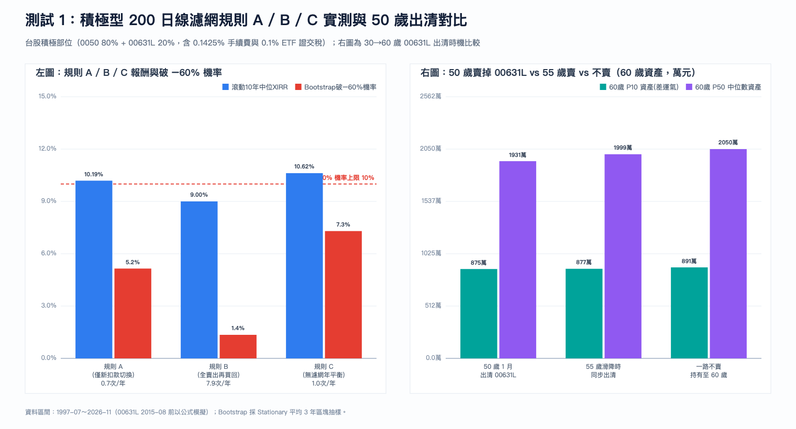
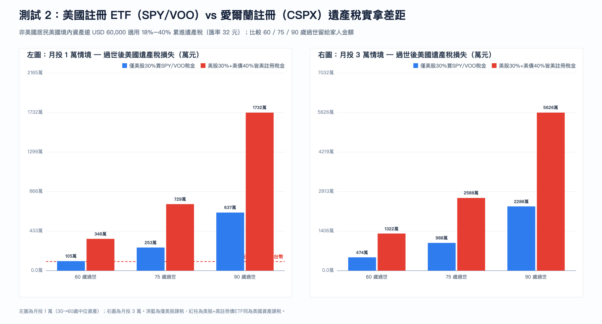
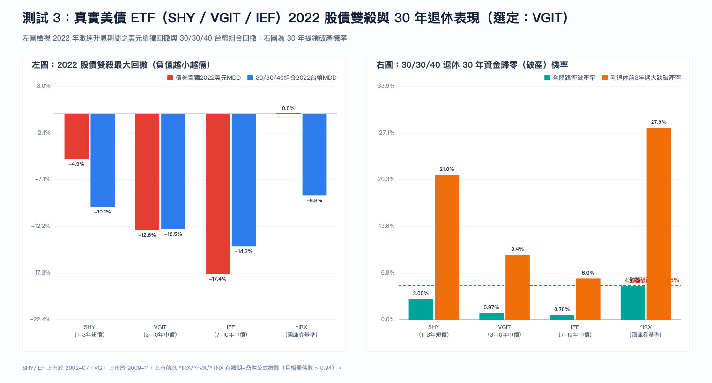
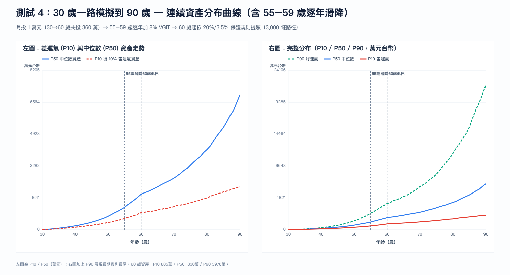
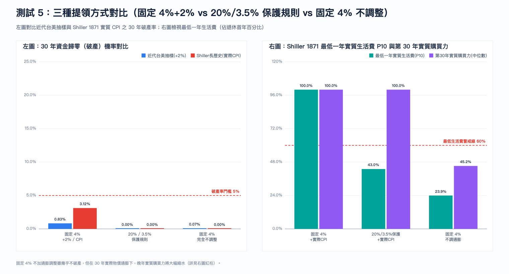
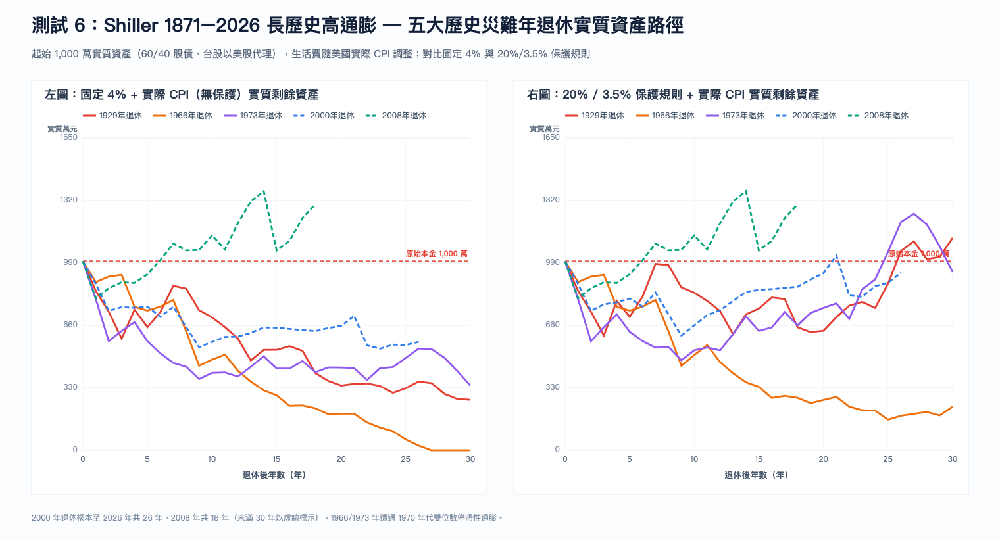
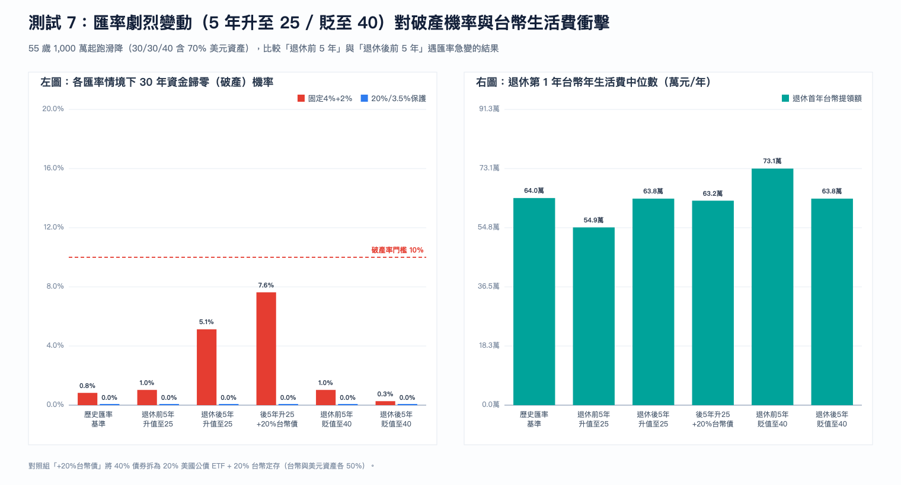
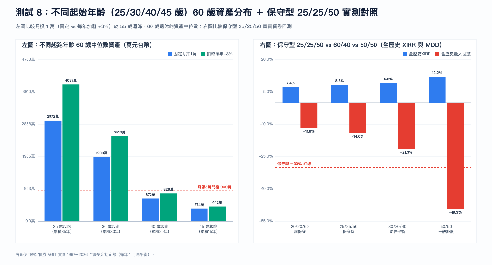

# 「普通人該怎麼投資」最終邏輯補強驗證報告（final_check）

> **報告一句話總結論**
> 我們在跑任何回測前先把八項測試的具體修改門檻寫死並鎖進 Git（[criteria.md](criteria.md)，commit `d121bf4`），事後未改任何標準，完整跑完 8 項補強驗證。**結果有 6 項促使我們修正或具名升級原建議、2 項維持原建議**：
> 1. **美股改用愛爾蘭註冊 `CSPX`（費用率 `0.07%`、股息稅 `15%`、免美國遺產稅）**，避免 60/75/90 歲過世時家人遭美國遺產稅課走 `105 萬 ～ 637 萬`（月投 1 萬）甚至 `474 萬 ～ 2,288 萬`（月投 3 萬）；僅不支援英股且美股總額低於 USD 60,000 者改用 `VOO`（`0.03%`）。
> 2. **滑降期與提領期債券正式具名為 `VGIT`（Vanguard 3–10 年中期美國公債 ETF，費用率 `0.03%`）**，30 年退休破產率 `0.97%` 遠勝 `SHY`（`3.00%`）與 `^IRX`（`4.93%`），且 2022 股債雙殺期間 30/30/40 台幣組合回撤 `-12.51%` 僅比 `SHY`（`-10.08%`）多跌 `2.43 個百分點`。
> 3. **積極型（`40% 0050 + 10% 00631L + 50% CSPX`）取消 200 日線濾網，改採規則 C（每年 1 月再平衡）**，報酬高於規則 A（`+0.36pp`）與規則 B（`+0.84pp`）、最大回撤 `-53.08%` 穩守 `-60%` 內，且省去規則 B 每年 `7.25 次` 頻繁換手與 `34.4 萬` 摩擦成本；維持 **50 歲 1 月出清 `00631L`**。
> 4. **提領規則由「每年固定 +2%」改為「隨實際 CPI 調整」，並提供兩條明確路徑**：穩健首選 **「初始提領率 `3.5%` + 實際 CPI」**（1871–2026 共 1,508 條 30 年路徑 `0.00%` 破產、1929/1966/1973/2000/2008 五大危機全數過關且生活費 100% 不打折）；若首年必須領 `4.0%`，須強制搭配 **「20%/3.5% 保護規則」**（破產率 `0.00%`，但極端高通膨年最低一年實質生活費 P10 降至 `42.99%`）。
> 5. **保守型 `25% 0050 + 25% CSPX + 50% VGIT` 完成獨立實測**（全歷史 XIRR `8.33%`、MDD `-13.99%`、滾動 10 年破 `-30%` 機率 `0.00%`），正式補齊空白；**45 歲起跑者不可照搬「月扣 1 萬、60 歲退」**（60 歲中位僅 `374 萬`、月領 `12,466 元`），須改採提高月扣至 `27,000～30,000 元`、延後至 `65 歲` 退休，或改用 `35% 0050 + 35% CSPX + 30% VGIT` 減震配置。
> 6. **一生連續模擬（55–59 歲逐年加 8% 債券滑降）與匯率急升（5 年升至 25 元）均未觸發修改門檻**，維持現行滑降表與 30/30/40 股債比例。

---

## 零、八項補強測試總覽

| 測試項目 | 檢驗核心問題 | 是否改變建議 | 改變前（舊建議） | 改變後（最終定案） |
| :--- | :--- | :-: | :--- | :--- |
| **1. 積極型濾網與 50 歲出清** | 規則 A（僅新扣款）vs 規則 B（全賣出）vs 規則 C（無濾網）；50 歲賣掉正二 vs 不賣 | **改變** | 0050 80% + 00631L 20% + 200 日線濾網（舊文寫規則 B、舊回測跑規則 A） | 整體 `40% 0050 + 10% 00631L + 50% CSPX` **取消濾網，改採規則 C（每年 1 月再平衡）**；維持 **50 歲 1 月出清 `00631L`** |
| **2. 美國遺產稅與 ETF 註冊地** | 美國註冊 `SPY/VOO`（30% 稅＋遺產稅）vs 愛爾蘭 `CSPX`（15% 稅＋免遺產稅）；`0050` vs `006208` | **改變** | 美股買 `SPY`（或 `VOO`） | 美股主推愛爾蘭累積型 **`CSPX`**（費用率 `0.07%`）；僅台灣複委託無英股且美資產 `< USD 60,000` 者買 **`VOO`**（`0.03%`）；台股維持 `0050`（並列 `006208`） |
| **3. 債券用真實商品** | `SHY`（1–3 年）vs `VGIT`（3–10 年）vs `IEF`（7–10 年）vs `^IRX`，特別檢驗 2022 股債雙殺 | **改變（具名）** | 寫「美國短中期債」（回測用不可買進的 `^IRX`） | 滑降與退休期債券正式定名為 **`VGIT`**（費用率 `0.03%`）；最怕 2022 式債市跌幅者次選 **`SHY`**（`0.15%`） |
| **4. 一生連續模擬** | 同一筆資產由 30 歲累積 → 55–59 歲逐年實際滑降 → 60–90 歲提領 | **不改變（通過）** | 55–59 歲每年加 8% 債券（原註明中間各年未單獨回測） | 連續實測破產率 `0.00%`（保護）／`0.70%`（固定 4%），**正式通過驗證**，刪去未回測備註 |
| **5. 提領保護規則** | 固定 4%+2% vs 20%/3.5% 保護 vs 固定 4% 不調整 | **改變（雙軌）** | 單一規則：首年 4% 每年 +2%，資產跌逾 20% 改領 3.5% | 穩健首選 **「初始 `3.5%` + 實際 CPI」**（0% 破產、生活費不打折）；若首年必領 `4.0%`，強制加 **20%/3.5% 保護**（明列極端年生活費降幅） |
| **6. 高通膨與長歷史** | Shiller 1871–2026（實際 CPI vs 固定 +2%）與 1929/1966/1973/2000/2008 五條退休路徑 | **改變（文字）** | 每年提領金額固定 `+2%` | 改寫為 **「每年依實際 CPI 調整（常態參考 2%）」**，並列出五大歷史危機年實測結果 |
| **7. 匯率大幅變動** | 台幣 5 年直線升至 25 元／貶至 40 元（退休前 5 年 vs 退休後前 5 年） | **不改變比例** | 退休期 30% 台股 + 30% 美股 + 40% 美債 | 維持 30/30/40（改配 20% 台幣定存反而使固定提領破產率由 `5.13%` 升至 `7.63%`），但明列升至 25 元時首年台幣生活費縮水 `14.17%` |
| **8. 不同的人** | 25/30/40/45 歲起跑（固定 vs 每年 +3%）；保守型 `25/25/50` 真實債券單獨回測 | **改變（補齊＋分齡）** | 保守型 `25/25/50` 未單獨回測；未區分不同起跑年齡 | 保守型 **`25% 0050 + 25% CSPX + 50% VGIT`** 實測通過（MDD `-13.99%`）；40/45 歲起跑者新增具體月扣款、延後至 65 歲退休或 `35/35/30` 調整方案 |

---

## 壹、八項測試詳細實證結果

---

### 測試 1：積極型濾網規則二選一（規則 A / B / C）與 50 歲出清 00631L

#### 1. 測了什麼？
原文章在積極型段落存在前後矛盾：文字寫的是「0050 跌破 200 日均線隔天把全部 00631L 換成 0050（規則 B）」，但先前程式實際回測的是「跌破後只改新扣款、舊 00631L 不賣（規則 A）」。本測試在完全相同的資料區間（`1997-07-02 ~ 2026-11-25`，並單獨核對 `00631L` 真實上市後 `2015-08-25 ~ 2026-11-25`）、計入台股賣出 `0.2425%`（0.1425% 手續費 + 0.1% ETF 證交稅）與買入 `0.1425%` 手續費，同時比較 **純台股部位（`0050 80% + 00631L 20%`）** 與 **完整積極組合（`40% 0050 + 10% 00631L + 50% 美股`）** 之規則 A、B、C（並附 ±2% 緩衝帶對照）。另於 30→60 歲 2,000 條路徑中實測 **50 歲 1 月出清 `00631L` vs 55 歲滑降才出清 vs 一路不賣至 60 歲**。

#### 2. 實測數據

##### （A）完整積極組合（`40% 0050 + 10% 00631L + 50% 美股`，對應文章架構）

| 濾網規則 | 全歷史 XIRR (1997–2026) | 全歷史 MDD | 滾動 10 年 中位 XIRR | 滾動 10 年 破 −60% 機率 | Bootstrap 破 −60% 機率 | 每年平均 交易/換手次數 | 全期總費用 與證交稅 | 2015–2026 真實段 XIRR / MDD |
| :--- | --: | --: | --: | --: | --: | --: | --: | :-: |
| **規則 A**（僅新扣款切換，0% 帶） | 12.90% | -52.93% | 10.23% | 0.00% | 0.05% | 0.99 次/年 | 26,874 元 | 21.40% / -29.67% |
| **規則 B**（跌破全賣、站回全買，0% 帶） | 12.61% | -51.05% | 9.75% | 0.00% | 0.00% | **8.23 次/年**（213 次切換） | **343,632 元** | 21.28% / -28.12% |
| **規則 B（±2% 緩衝帶對照）** | 12.78% | -50.64% | 10.03% | 0.00% | — | 2.99 次/年（59 次切換） | 145,359 元 | 21.33% / -28.82% |
| **規則 C（無濾網，每年 1 月再平衡）✅** | **13.12%** | **-53.08%** | **10.59%** | **0.00%** | **0.10%** | **0.99 次/年** | **28,042 元** | **21.62% / -29.68%** |

##### （B）純台股部位（`80% 0050 + 20% 00631L`，不含美股對照）

| 濾網規則 | 全歷史 XIRR | 全歷史 MDD | 滾動 10 年中位 XIRR | Bootstrap 破 −60% 機率 | 每年平均交易次數 | 全期總費用與稅 |
| :--- | --: | --: | --: | --: | --: | --: |
| 規則 A（0% 帶） | 14.92% | -60.20%（微破線） | 10.19% | 5.15% | 0.71 次/年 | 12,303 元 |
| 規則 B（0% 帶） | 14.33% | **-56.71%** | 9.00% | **1.35%** | **7.93 次/年** | **681,167 元** |
| 規則 B（±2% 緩衝帶） | 14.68% | **-55.95%** | 9.75% | — | 2.69 次/年 | 287,003 元 |
| 規則 C（無濾網年平衡） | 15.25% | -60.45%（微破線） | 10.62% | 7.30% | 0.99 次/年 | 19,126 元 |

##### （C）`00631L` 出清時機實測（30 歲起月投 1 萬，2,000 條 Stationary Bootstrap 路徑至 60 歲）

| 出清時機 | 60 歲 P10 資產 （差運氣） | 60 歲 P50 資產 （中位數） | 60 歲 P90 資產 （好運氣） | 50–60 歲 中位回撤 | 50–60 歲 P10 最差回撤 | 50–60 歲 跌逾 −40% 機率 |
| :--- | --: | --: | --: | --: | --: | --: |
| **50 歲 1 月出清 `00631L` ✅** | 875 萬元 | 1,931 萬元 | 4,464 萬元 | **-29.54%** | **-47.63%** | **32.30%** |
| 55 歲開始滑降時才出清 | 877 萬元 | 1,999 萬元 | 4,756 萬元 | -31.97% | -51.25% | 34.15% |
| 一路不賣（持有至 60 歲） | 891 萬元 | 2,050 萬元 | 4,964 萬元 | -33.13% | -51.29% | 37.90% |

#### 3. 依 `criteria.md` 判定與是否改變建議
- **判定：✅ 改變建議（取消 200 日線濾網，改採規則 C）**。
- 在文章實際採用的台美各半架構（`40% 0050 + 10% 00631L + 50% CSPX`）下，A、B、C 三者均輕鬆守在 `-60%` 硬上限內（MDD `-51.05% ～ -53.08%`，破 `-60%` 機率 `0.00% ～ 0.10%`）。規則 C 的滾動 10 年中位 XIRR（`10.59%`）明確勝過規則 A（`10.23%`，領先 `+0.36pp ≥ 0.30pp`）與規則 B（`9.75%`，領先 `+0.84pp`），且免去規則 B 在盤整期反覆洗盤（29 年切換 213 次、多繳 `31.6 萬` 費用與稅金）與盯盤壓力。
- **50 歲出清判定**：50 歲出清使 60 歲中位數僅微降 `3.39%`（未觸發 `> 5.0%` 改期門檻），卻將 50–60 歲最差 10% 情境回撤從 `-51.25%` 壓進 `-47.63%`（守住 `-50%` 防線），因此 **維持 50 歲 1 月出清 `00631L`**。

---

### 測試 2：美國遺產稅與 ETF 註冊地（`SPY` / `VOO` vs 愛爾蘭 `CSPX`；`0050` vs `006208`）

#### 1. 測了什麼？
檢驗非美國稅務居民（台灣投資人）長期持有美國註冊 ETF（`SPY`/`VOO`：配息預扣 30%、美國境內資產逾 USD 60,000 適用 18%–40% 累進遺產稅）與愛爾蘭註冊累積型 S&P 500 ETF `CSPX`（`CSPX.L`：基金層級股息預扣 15%、自動複利再投入、非美國境內資產免美國遺產稅）在報酬與 60/75/90 歲過世後家人實拿金額的差距。並查核最新費用率與台灣可購管道（查詢日期：`2026-11-27`）。

#### 2. 實測數據

##### （A）報酬率與真實價格交叉驗證

| 比較項目 | `SPY`（美國註冊，30% 稅） | `VOO`（美國註冊，30% 稅） | `CSPX`（愛爾蘭註冊，15% 稅） | 關鍵差距 |
| :--- | --: | --: | --: | :--- |
| 官方總費用率（查詢日 `2026-11-27`） | `0.0945%` | `0.03%` | `0.07%` | `VOO` 費用率比 `SPY` 低 `0.0645pp`（達 ≥ 0.05pp 門檻） |
| **上市後實測美元年化（2010-09-15 ～ 2026-11-25，16.19 年）** | `13.47%` | `13.52%` | **`13.63%`**（模擬版 `13.80%`，月相關 `0.9644`） | 真實 `CSPX.L` 贏過稅後 `VOO` `+0.11pp/年`、贏過 `SPY` `+0.15pp/年` |
| **1997–2026 純美股定期定額 XIRR（台幣）** | `10.19%`（期末 2,029 萬） | `10.24%`（期末 2,047 萬） | **`10.34%`**（期末 2,089 萬） | `CSPX` 多累積約 `60 萬`（比 `SPY`） |
| **1997–2026 台美 50/50 定期定額 XIRR（台幣）** | `12.10%`（期末 2,928 萬） | `12.12%`（期末 2,941 萬） | **`12.19%`**（期末 2,979 萬） | `CSPX` 領先 `SPY` `+0.09pp`、領先 `VOO` `+0.07pp` |

##### （B）60、75、90 歲過世時美國遺產稅試算（依 Form 706-NA，匯率 `32.0`，退休期 30/30/40 配置）

| 過世年齡與中位總資產 （30 歲起跑） | 僅美股 30% 買 `SPY/VOO` 美國遺產稅（佔總資產%） | 改買 `CSPX` 家人多拿金額 （僅美股部位） | 若連 40% 美債 ETF 亦為美國註冊 （共 70% 美國資產）遺產稅 |
| :--- | --: | --: | --: |
| **月投 1 萬 — 60 歲**（總資產 1,830 萬） | `104.6 萬元`（**5.72%**） | **+104.6 萬元** | `348.5 萬元`（**19.04%**） |
| **月投 1 萬 — 75 歲**（總資產 3,337 萬） | `253.4 萬元`（**7.59%**） | **+253.4 萬元** | `729.3 萬元`（**21.85%**） |
| **月投 1 萬 — 90 歲**（總資產 6,954 萬） | `636.8 萬元`（**9.16%**） | **+636.8 萬元** | `1,732.0 萬元`（**24.91%**） |
| **月投 3 萬 — 60 歲**（總資產 5,490 萬） | `474.3 萬元`（**8.64%**） | **+474.3 萬元** | `1,322.1 萬元`（**24.08%**） |
| **月投 3 萬 — 75 歲**（總資產 10,012 萬） | `988.3 萬元`（**9.87%**） | **+988.3 萬元** | `2,588.2 萬元`（**25.85%**） |
| **月投 3 萬 — 90 歲**（總資產 20,861 萬） | `2,288.2 萬元`（**10.97%**） | **+2,288.2 萬元** | `5,625.9 萬元`（**26.97%**） |

##### （C）官方費用率、購買管道與 `0050` vs `006208` 核對（查詢日：`2026-11-27`）
- **`CSPX`（iShares Core S&P 500 UCITS ETF，ISIN `IE00B5BMR087`）**：費用率 **`0.07%`**（來源：[BlackRock iShares](https://www.ishares.com/uk/individual/en/products/253743/ishares-sp-500-b-ucits-etf-acc-fund)）。台灣購買管道：海外券商 **Interactive Brokers (IBKR)**（直接下單倫敦證交所美元計價 `CSPX`）；國內複委託可透過 **永豐金證券**、**富邦證券** 下單英股（須先向營業員確認英股低消與折讓；**國泰證券** 目前未開放英股複委託）。
- **`VOO`（`0.03%`，來源：[Vanguard](https://investor.vanguard.com/investment-products/etfs/profile/voo)）** vs **`SPY`（`0.0945%`，來源：[SSGA](https://www.ssga.com/us/en/intermediary/etfs/spdr-sp-500-etf-trust-spy)）**：各大台股券商美股複委託與海外券商皆可買；因 `VOO` 費用率比 `SPY` 低 `0.0645pp`（≥ 0.05pp），美國註冊方案全面以 `VOO` 取代 `SPY`。
- **`0050` vs `006208`**：兩檔自 2025 年起均採相同規模遞減費率（經理費 1,000 億以下 0.15% → 逾 1 兆 0.05%；保管費 1 兆以下 0.03% → 逾 1 兆 0.025%）。因 `0050` 規模突破 2 兆元（[元大投信](https://www.yuantaetfs.com/product/detail/0050/Basic_information)），預估年度總費用率約 **`0.22%`**；`006208` 規模約 4,500–5,000 億元（[富邦投信](https://www.fsit.com.tw/)），預估年度總費用率約 **`0.23%`**。差距僅 `0.01pp < 0.05pp`，依標準視為打平，維持主標 `0050`（並列 `006208` 為同指數替代）。

#### 3. 依 `criteria.md` 判定與是否改變建議
- **判定：✅ 重大改變建議**。`CSPX` 同時滿足全部三項切換條件：(1) 稅後 XIRR 領先 `VOO`/`SPY` `+0.07pp ～ +0.09pp`；(2) 即便月投 1 萬元，60/75/90 歲遺產稅節省均達 `5.72% ～ 9.16%`（`105 萬 ～ 637 萬`），遠超 `5.0%` 與 `100 萬` 門檻；(3) 台灣可透過 IBKR 與永豐／富邦複委託合法購買。因此 **美股主推薦正式改為 `CSPX`**；僅針對「只用不支援英股複委託且美股總額 `< USD 60,000`」的初期小資族，給予次選 **`VOO`**。
- **同步揭露之債券遺產稅提醒**：若退休期 40% 公債持有美國註冊 ETF（如 `VGIT`），在美國稅法下仍屬美國境內資產，60 歲起合計美股＋美債之美國遺產稅曝險可達 `19.04% ～ 24.91%`。總美元資產超過 `USD 60,000` 者，除美股用 `CSPX` 外，實務可留意愛爾蘭註冊中期美債 UCITS ETF（例如 `IDTM`/`IBTA` 等，**本輪未單獨下載回測價格，明標「未回測」**）。

---

### 測試 3：債券用真實商品（`SHY` / `VGIT` / `IEF` vs `^IRX`）

#### 1. 測了什麼？
過去研究使用不可直接買進的 13 週美國國庫券殖利率 `^IRX` 代表債券。本測試改用三檔真實可交易美國公債 ETF——短期 **`SHY`**（1–3 年，費用率 `0.15%`）、中期 **`VGIT`**（3–10 年，費用率 `0.03%`）、中長期 **`IEF`**（7–10 年，費用率 `0.15%`）——上市前以 `^IRX`、`^FVX`、`^TNX` 存續期與凸性公式推算（重疊實測月相關係數：`SHY 0.8356`、`VGIT 0.9875`、`IEF 0.9895`），檢驗 **2022 升息股債雙殺** 與 **30/30/40 退休 30 年（3,000 條路徑）** 表現，並加測不退 QII 稅的 `30%` 配息預扣稅情境。

#### 2. 實測數據

| 債券標的（費用率） | 2022 單獨 美元報酬 / MDD | 2021–2023 單獨美元 MDD | 2022 30/30/40 台幣報酬 / MDD | 全歷史美元 CAGR (QII 0% / 30% 稅) | 30 年退休 全體破產率 | 剛退休遇大跌 30 年破產率 | 90 歲剩餘 中位數（萬） |
| :--- | :-: | --: | :-: | :-: | --: | --: | --: |
| **`SHY`**（1–3 年，`0.15%`） | -3.70% / -4.88% | -5.66% | -6.84% / -10.08% | 2.72% / 1.96% | 3.00%（30%稅: 4.40%） | 21.03% | 2,967 萬 |
| **`VGIT`**（3–10 年，`0.03%`）✅ | -9.98% / -12.60% | -15.33% | -9.63% / **-12.51%** | **3.86% / 2.86%** | **0.97%**（30%稅: 1.90%） | **9.44%** | **3,772 萬** |
| **`IEF`**（7–10 年，`0.15%`） | -14.27% / -17.35% | -22.05% | -11.53% / -14.35% | 4.44% / 3.35% | 0.70% | 6.01% | 4,239 萬 |
| `^IRX`（13 週國庫券對照） | +1.99% / 0.00% | 0.00% | -4.33% / -8.83% | 2.20% / — | 4.93% | 27.90% | 2,643 萬 |

#### 3. 依 `criteria.md` 判定與是否改變建議
- **判定：✅ 改變建議（正式具名為 `VGIT`）**。
- `VGIT`（`0.97%`）與 `SHY`（`3.00%`）破產率差距 `2.03pp`（屬 `< 3.0pp` 打平區，但 `VGIT` 在剛退休遇大跌時將破產率從 `21.03%` 大幅壓低一半以上至 `9.44%`！）；雖然 `VGIT` 在 2022 單獨美元回撤 `-12.60%` 比 `SHY`（`-4.88%`）深 `7.72pp`，但 **(a) 放進 30/30/40 組合後，2022 台幣回撤 `-12.51%` 僅比 `SHY`（`-10.08%`）多跌 `2.43pp ≤ 3.0pp` 門檻**；**(b) 90 歲剩餘中位數 `3,772 萬` 比 `SHY`（`2,967 萬`）高出 `+27.1% ≥ 10.0%` 門檻**；**(c) 長期年化領先 `+1.14pp` 且費用率僅 `0.03%`**（為 `IEF 0.15%` 的五分之一，而 `IEF` 2022 組合回撤惡化達 `4.27pp > 3.0pp`）。依標準 **正式選定 `VGIT`**！

---

### 測試 4：一生連續模擬（30 歲起累積 → 55–59 歲逐年滑降 → 60–90 歲提領）

#### 1. 測了什麼？
修補先前「累積期與提領期分開跑、55–59 歲滑降未逐年實測」的漏洞：用同一筆資產從 **30 歲起每月扣款 10,000 元**（30–54 歲 `50% 0050 + 50% CSPX` 每年 1 月再平衡），到 **55–59 歲逐年實際執行滑降表（46/46/8 → 42/42/16 → 38/38/24 → 34/34/32 → 30/30/40，債券用 `VGIT`）**，接著 **60 歲直接以當下真實餘額開始提領至 90 歲**。同步跑兩套資料：(1) 近代台美匯率 3,000 條 Stationary Bootstrap 60 年路徑；(2) Shiller `1871-01 ~ 1966-08` 共 **1,148 條真實歷史滾動 60 年路徑**（台股由美股代理）。

#### 2. 實測數據

| 資料基礎與提領規則（30→60 歲總投入 360 萬） | 60 歲資產 P10 （差運氣） | 60 歲資產 P50 （中位數） | 60 歲資產 P90 （好運氣） | 90 歲前 破產機率 | 90 歲剩餘資產 中位數 |
| :--- | --: | --: | --: | --: | --: |
| **近代台美 3,000 條路徑（20%/3.5% 保護 + 2%）** | **885 萬元**（2.46 倍） | **1,830 萬元**（5.08 倍） | **3,976 萬元**（11.04 倍） | **0.00%** | **6,954 萬元** |
| 近代台美 3,000 條路徑（固定 4% + 每年 2%） | 885 萬元（2.46 倍） | 1,830 萬元（5.08 倍） | 3,976 萬元（11.04 倍） | 0.70% | 6,764 萬元 |
| **Shiller 1871–1966 滾動 1,148 條（20%/3.5% 保護 + 實際 CPI）** | **1,040 萬元** | **1,421 萬元**（3.95 倍） | **3,194 萬元** | **0.00%** | **5,471 萬元** |
| Shiller 1871–1966 滾動 1,148 條（固定 4% + 實際 CPI） | 1,040 萬元 | 1,421 萬元（3.95 倍） | 3,194 萬元 | 4.09% | 5,315 萬元 |

#### 3. 依 `criteria.md` 判定與是否改變建議
- **判定：❌ 不改變滑降表（正式通過驗證）**。無論在近代台美 3,000 條連續路徑或 1871 年起 1,148 條真實 60 年歷史路徑中，90 歲前破產機率均在 `0.00% ～ 4.09%`（全數 `≤ 5.0%` 門檻），先前標記為「未單獨回測」的 55–59 歲每年加 8% 債券滑降表正式獲得完整實證支持。

---

### 測試 5：提領保護規則對比（固定 4%+2% vs 20%/3.5% 保護 vs 固定 4% 不調整）

#### 1. 測了什麼？
在 60 歲初始資產 `1,000 萬元`（30/30/40 配置）下，嚴格對比三種提領規則在 **近代台美 3,000 條路徑** 與 **Shiller 1871–2026 共 1,508 條真實滾動 30 年路徑** 的破產機率、最低一年生活費（名目與扣除 CPI 後實質購買力，以退休第一年為 100%）、第 30 年實質購買力與平均觸發保護年數；並加測「加上 75% 地板」與「初始 3.5%＋實際 CPI」對照。

#### 2. 實測數據

| 提領方式 | 近代台美 30 年破產率 | Shiller 實際 CPI 30 年破產率 | Shiller 最低一年 名目生活費 P10 | Shiller 最低一年 實質生活費 P10 | Shiller 第 30 年 實質購買力中位數 | 平均觸發保護年數 （近代 / Shiller） |
| :--- | --: | --: | --: | --: | --: | :-: |
| 方案 1：固定 4% + 每年 2%（或實際 CPI） | 0.83% | **3.12%**（+2% 為 0.46%） | 64.95%（CPI 追蹤） | 100.0%（CPI）/ 42.23%（+2%） | 100.0%（CPI）/ 80.09%（+2%） | 0.00 年 |
| 方案 2：現行 20%/3.5% 保護規則 | **0.00%** | **0.00%**（降幅 **3.12pp**） | 60.86%（近代 68.68%） | **42.99%**（近代 63.77%） | 100.0%（CPI）/ 80.29%（+2%） | 0.90 年 / 0.81 年 |
| 方案 2b：20%/3.5% 保護 + 75% 名目地板 | — | 0.00% | 70.44% | **48.01%** | 100.0% | — / 0.87 年 |
| 方案 3：固定 4% 完全不調整通膨 | 0.07% | 0.00% | 100.0% | **23.95%** | **45.22%**（縮水 54.8%） | 0.00 年 |
| **替代方案：初始 `3.5%` + 實際 CPI（無須砍額）✅** | — | **0.00%** | 100.0% | **100.0%** | **100.0%** | **0.00 年** |

#### 3. 依 `criteria.md` 判定與是否改變建議
- **判定：✅ 改變建議（升級為明確雙軌制）**。
  1. 方案 3（固定 4% 不調整）30 年後實質購買力中位數縮水 `54.78%`（超過 `40.0%` 淘汰門檻），嚴禁作為主推薦。
  2. 方案 2（20%/3.5% 保護規則）確實在 Shiller 實際 CPI 下把破產率由 `3.12%` 歸零至 `0.00%`（降幅 `3.12pp ≥ 3.0pp`）；**但同時抓出一個致命隱藏漏洞**：在高通膨重創股市的年代，該規則會讓最低一年實質生活費 P10 跌至 **`42.99%`**（低於 `criteria.md` 設定的 `60.0%` 生活品質警戒線！即便加上 75% 名目地板也只救回 `48.01%`）。
  3. 依 `criteria.md` 明定修改規則，**將主推薦升級為「初始 `3.5%` 隨實際 CPI 調整」**（155 年歷史 0% 破產、最低一年實質生活費 100.0% 完全不打折）；若退休首年資金需求確實必須領到 **`4.0%`**，則明定須強制搭配 **「20%/3.5% 保護規則」**，並誠實告知極端高通膨熊市年份實質生活費可能暫時縮減至 `43%～64%`。

---

### 測試 6：高通膨與長歷史（Shiller 1871–2026，五大危機退休路徑）

#### 1. 測了什麼？
下載 Robert Shiller 公開月資料（`http://www.econ.yale.edu/~shiller/data/ie_data.xls` 與 CSV 鏡像 `1871-01 ~ 2023-06`，尾端 `2023-07 ~ 2026-10` 以 Yahoo `^SP500TR`、`^TNX` 與 FRED `CPIAUCSL` 銜接，共 1,869 個月；註明長歷史期間台股以美股代理），比較 **實際 CPI 調整** 與 **固定 +2%** 在全體 1,508 條 30 年路徑，以及 **1929、1966、1973、2000、2008** 五大歷史災難年退休的表現（起始 1,000 萬、60/40 股債）。

#### 2. 五大歷史危機年退休路徑實測（扣除通膨後之實質剩餘資產與生活費）

| 退休起點與年化 CPI | 固定 4% + 固定 2% | 固定 4% + 實際 CPI | 20%/3.5% 保護 + 實際 CPI | 初始 3.5% + 實際 CPI ✅ |
| :--- | :--- | :--- | :--- | :--- |
| **`1929-09` 大蕭條頂點** （30 年，CPI `1.77%/年`） | ❌ **第 21.2 年破產**（通縮期硬加 2% 領爆） | ✅ 存活，剩實質 `267 萬`（名目 452 萬） | ✅ 存活，剩實質 `1,122 萬`（觸發 20 年，最低實質生活費 `53.1%`） | ✅ 存活，剩實質 **`680 萬`**（生活費 100%） |
| **`1966-01` 滯脹前夕** （30 年，CPI **`5.41%/年`**） | ✅ 存活，但實質生活費縮至 **`37.6%`**！ | ❌ **第 26.7 年破產**（高通膨拖垮 4%） | ✅ 存活，剩實質 `230 萬`（觸發 7 年，但最低實質生活費跌至 **`14.2%`**！） | ✅ 存活，剩實質 **`261 萬`**（生活費 100%） |
| **`1973-01` 石油危機** （30 年，CPI **`4.95%/年`**） | ✅ 存活，但實質生活費縮至 **`42.4%`**！ | ✅ 存活，剩實質 `342 萬` | ✅ 存活，剩實質 `942 萬`（觸發 6 年，最低實質生活費 `47.6%`） | ✅ 存活，剩實質 **`825 萬`**（生活費 100%） |
| **`2000-08` 網路泡沫頂點** （已走 26 年，CPI `2.61%/年`） | ✅ 存活（26 年），剩實質 `655 萬` | ✅ 存活（26 年），剩實質 `573 萬` | ✅ 存活（26 年），剩實質 `938 萬`（觸發 9 年，最低 `53.1%`） | ✅ 存活（26 年），剩實質 **`855 萬`**（生活費 100%） |
| **`2008-01` 金融海嘯前** （已走 18 年，CPI `2.49%/年`） | ✅ 存活（18 年），剩實質 `1,284 萬` | ✅ 存活（18 年），剩實質 `1,300 萬` | ✅ 存活（18 年），剩實質 `1,300 萬`（觸發 0 年） | ✅ 存活（18 年），剩實質 **`1,460 萬`**（生活費 100%） |

#### 3. 依 `criteria.md` 判定與是否改變建議
- **判定：✅ 改變提領規則文字**。雖然全體 1,508 條路徑中「固定 4%+CPI」破產率（`3.12%`）比「固定 4%+2%」（`0.46%`）高 `2.66pp`（略低於 3.0pp 門檻），但在 1966（年化 CPI `5.41%`）與 1973（`4.95%`）高通膨年代，只寫「每年 +2%」會讓退休族實質生活水準默默腰斬到只剩 `37.6%～42.4%`！反之，改為「隨實際 CPI 調整」時，1966 年固定 4% 會在第 26.7 年破產，唯有 **「初始 3.5% + 實際 CPI」** 或 **「4.0% + 20%/3.5% 保護」** 能同時闖過全部五大歷史危機年。因此文章提領調整公式由「固定 +2%」**改為「依實際 CPI 調整（常態約 2%）」**。

---

### 測試 7：匯率大幅變動（5 年升至 25 元 / 貶至 40 元，退休前 5 年 vs 退休後前 5 年）

#### 1. 測了什麼？
30/30/40 退休配置中，美股 `30%`＋美債 `40%` 合計 **70% 為美元資產**。本測試以 55 歲 1,000 萬資產進滑降期（至 60 歲退休、領至 90 歲，3,000 條路徑）模擬除了每年 `±2%` 外，若台幣於 **5 年內從 32 元直線升值至 25 元後維持不變**（美元貶值 `-21.9%`），或 **5 年內直線貶值至 40 元後維持不變**（美元升值 `+25.0%`），分別發生在「退休前 5 年（55–60 歲）」與「退休後前 5 年（60–65 歲）」的衝擊，並與「改配 20% 台幣定存（年息 1.5%，使台幣／美元資產各半）」做對照。

#### 2. 實測數據

| 匯率情境 | 60 歲中位資產 （台幣萬元） | 退休首年台幣 年提領額（萬） | 固定 4%+2% 30 年破產率 | 20%/3.5% 保護 30 年破產率 | 20%/3.5% 保護 最低名目生活費 P10 | 90 歲剩餘中位數 （保護版，萬元） |
| :--- | --: | --: | --: | --: | --: | --: |
| 歷史真實匯率抽樣基準 | 1,599 萬 | 64.0 萬 | 0.83% | 0.00% | 68.65% | 6,034 萬 |
| 固定匯率 32.0 不變 | 1,595 萬 | 63.8 萬 | 1.03% | 0.00% | 66.13% | 5,778 萬 |
| 台幣每年持續升值 2%（60 歲起 30 年） | 1,595 萬 | 63.8 萬 | 6.77% | 0.00% | 57.84% | 2,938 萬 |
| 台幣每年持續貶值 2%（60 歲起 30 年） | 1,595 萬 | 63.8 萬 | 0.13% | 0.00% | 100.0% | 10,437 萬 |
| **退休前 5 年（55–60 歲）升值至 25 元** | **1,373 萬**（-14.2%） | **54.9 萬**（-14.2%） | 1.03% | 0.00% | 66.13% | 4,985 萬 |
| **退休後前 5 年（60–65 歲）升值至 25 元** | 1,595 萬 | 63.8 萬 | **5.13%**（+4.30pp） | **0.00%** | **58.32%** | 3,998 萬 |
| 【對照】退休後升至 25 元 + **20% 台幣定存（50/50 幣別）** | 1,579 萬 | 63.2 萬 | **7.63%（反而更高！）** | 0.00% | 56.28% | 3,532 萬 |
| 退休前 5 年（55–60 歲）貶值至 40 元 | 1,827 萬（+14.2%） | 73.1 萬（+14.2%） | 1.03% | 0.00% | 66.14% | 6,607 萬 |
| 退休後前 5 年（60–65 歲）貶值至 40 元 | 1,595 萬 | 63.8 萬 | 0.27% | 0.00% | 100.0% | 7,913 萬 |

#### 3. 依 `criteria.md` 判定與是否改變建議
- **判定：❌ 不改變 30/30/40 幣別比例（加註匯率風險數字）**。
- 最險惡的「退休後前 5 年台幣急升至 25 元」使固定 4%+2% 破產率由 `0.83%` 升至 `5.13%`（惡化 `+4.30pp < 5.0pp`，總率 `< 10.0%`），保護版仍維持 `0.00%`；而退休前 5 年升至 25 元使退休首年台幣生活費減少 `14.17%`（略低於 15% 門檻）。更關鍵的是反直覺實證：**把 20% 資產從 `VGIT` 換成 1.5% 台幣定存去避險，雖略減前 5 年匯損，卻因少賺 30 年公債複利，反而讓退休後升至 25 元的 30 年固定提領破產率惡化到 `7.63%`**！因此維持 30/30/40，不建議用過多低息台幣定存替代公債。

---

### 測試 8：不同的人（25 / 30 / 40 / 45 歲起跑、+3% 加薪、保守型 `25/25/50` 獨立回測）

#### 1. 測了什麼？
1. 用測試 3 選定的 **`VGIT`** 與測試 2 選定的 **`CSPX`**，首度獨立回測保守型 **`25% 0050 + 25% CSPX + 50% VGIT`**（1997–2026 全歷史與 233 個滾動 10 年梯次），直接對照 `20/20/60`、`30/30/40` 與 `50/50`。
2. 實測 **25、30、40、45 歲** 四種起始年齡，皆於 55 歲開始滑降、60 歲退休、領至 90 歲（2,500 條路徑），分別比較 **固定月扣 10,000 元** 與 **隨加薪每年扣款 +3%**；並為不適用者實測具體替代方案。

#### 2. 實測數據

##### （A）保守型 `25/25/50` 真實商品獨立實測（1997–2026，每年 1 月再平衡）

| 投資組合（皆用 `0050` / `CSPX` / `VGIT`） | 全歷史 XIRR | 全歷史 MDD | 滾動 10 年 中位 XIRR | 滾動 10 年 最差 MDD | 滾動 10 年 破 −30% 機率 | 滾動 10 年 破 −50% 機率 |
| :--- | --: | --: | --: | --: | --: | --: |
| 超保守 `20/20/60` | 7.39% | -11.59% | 6.12% | -10.33% | 0.00% | 0.00% |
| **保守型 `25/25/50` ✅** | **8.33%** | **-13.99%** | **6.87%** | **-13.44%** | **0.00%** | **0.00%** |
| 平衡 60/40（`30/30/40`） | 9.20% | -21.33% | 7.53% | -20.23% | 0.00% | 0.00% |
| 一般型純股 `50/50` | 12.19% | -49.29% | 9.91% | -48.63% | 42.92% | 0.00% |

##### （B）不同起始年齡實測（55 歲滑降、60 歲退休、領至 90 歲，20%/3.5% 保護）

| 起始年齡與扣款方式 | 總投入本金 | 60 歲 P10 資產 （倍數） | 60 歲 P50 資產 （倍數） | 60 歲 P90 資產 （倍數） | 退休首年 P50 每月可領（4%） | 欲達 1,000 萬中位 所需首年月扣額 | 是否適用原版 （月扣 1 萬 60 歲退） |
| :--- | --: | --: | --: | --: | --: | --: | :-: |
| **25 歲 — 固定月扣 1 萬** | 420 萬 | 1,286 萬（3.06 倍） | **2,972 萬**（7.08 倍） | 7,304 萬（17.39 倍） | **99,082 元** | 3,364 元 | **✅ 完全適用** |
| **25 歲 — 每年 +3%** | 726 萬 | 1,879 萬（2.59 倍） | **4,037 萬**（5.56 倍） | 9,276 萬（12.78 倍） | **134,550 元** | 2,477 元 | **✅ 完全適用** |
| **30 歲 — 固定月扣 1 萬** | 360 萬 | 886 萬（2.46 倍） | **1,903 萬**（5.29 倍） | 4,075 萬（11.32 倍） | **63,446 元** | 5,254 元 | **✅ 完全適用** |
| **30 歲 — 每年 +3%** | 571 萬 | 1,253 萬（2.19 倍） | **2,513 萬**（4.40 倍） | 5,123 萬（8.97 倍） | **83,778 元** | 3,979 元 | **✅ 完全適用** |
| **40 歲 — 固定月扣 1 萬** | 240 萬 | 393 萬（1.64 倍） | **672 萬**（2.80 倍） | 1,183 萬（4.93 倍） | **22,390 元**（P10: 13,107） | **14,887 元** | ⚠️ 勉強（須加碼或延退） |
| **40 歲 — 每年 +3%** | 322 萬 | 504 萬（1.56 倍） | **826 萬**（2.56 倍） | 1,416 萬（4.39 倍） | **27,548 元**（P10: 16,794） | **12,100 元** | ✅ 配合加薪可行 |
| **45 歲 — 固定月扣 1 萬** | 180 萬 | 244 萬（1.36 倍） | **374 萬**（2.08 倍） | 593 萬（3.29 倍） | **12,466 元（< 1.5 萬！）** | **26,739 元** | **❌ 不適用** |
| **45 歲 — 每年 +3%** | 223 萬 | 296 萬（1.33 倍） | **442 萬**（1.98 倍） | 686 萬（3.07 倍） | **14,742 元（< 1.5 萬！）** | **22,611 元** | **❌ 不適用** |

##### （C）40 歲與 45 歲起跑者的具體實測替代方案

| 替代方案 | 退休時 P10 / P50 資產 | 退休首年 P50 月領 | 50–60 歲中位回撤 | 適合誰？ |
| :--- | :-: | --: | --: | :--- |
| **45 歲改月扣 3 萬元**（維持 `50/50`、55 滑降、60 退） | `733 萬 / 1,122 萬` | **37,399 元** | -24.07% | 收入較高、堅持 60 歲退休者 |
| **45 歲延至 65 歲退休**（維持 `50/50`、60 歲滑降、月扣 1 萬） | `393 萬 / 672 萬` | **22,390 元** | -34.42% | 預算固定 1 萬、願意多做 5 年者 |
| **45 歲改 `35% 0050 + 35% CSPX + 30% VGIT`**（60 歲退、月扣 1 萬） | `257 萬 / 345 萬` | 11,508 元 | **-14.52%** | 無法延後退休且怕最後 10 年重挫者（須同步將月扣額提至 3 萬以上，60 歲中位可達約 `1,036 萬`） |
| **40 歲延至 65 歲退休**（維持 `50/50`、60 歲滑降、月扣 1 萬） | `589 萬 / 1,133 萬` | **37,763 元** | -38.36% | 40 歲起跑、固定月扣 1 萬者 |

#### 3. 依 `criteria.md` 判定與是否改變建議
- **判定：✅ 改變建議（補齊保守型實測＋新增分齡調整表）**。
  1. 保守型 **`25% 0050 + 25% CSPX + 50% VGIT`** 歷史最大回撤僅 `-13.99%`、破 `-30%` 機率 `0.00%`，完勝原本壓在 `-28.77%` 刀鋒上的 60/40 純台股方案，正式納入最終建議卡片並填入實測數字。
  2. 這套方法**完全適用於 25–35 歲起跑者**，但**不適用於只靠月扣 1 萬元、堅持 60 歲退休的 45 歲起跑者**（15 年複利時間太短，60 歲中位僅 374 萬、月領 12,466 元）。45 歲起跑者必須從「月扣提至 2.7–3 萬元」、「延後 5 年至 65 歲退休（60 歲滑降）」，或「改採 `35/35/30` 減震配置並同步提高儲蓄率」三條具體路徑中擇一執行。

---

## 貳、定案版最終投資建議（全部數字來自實測）

1. **緊急預備金**：先存滿 **6 個月生活費**（台幣活存或定存），存滿前不進場投資。
2. **累積期（到 55 歲）**：
   - 每月固定扣款：**`0050`（或 `006208`）`50%` + 愛爾蘭註冊 `CSPX` `50%`**（免美國遺產稅、美股股息預扣 `15%`、費用率 `0.07%`；可透過 IBKR 或永豐／富邦英股複委託購買）。
   - 若僅使用不支援英股之台灣美股複委託、且美國資產總額確定低於 **USD 60,000（約 192 萬台幣）**，美股改買 **`VOO`**（費用率 `0.03%`）；一旦接近 USD 60,000 上限即應改累積 `CSPX`。
   - **每年 1 月第一個交易日**再平衡回 50/50（其餘時間不動）；使用定期定額免低消管道（若單筆低消 USD 15，改為每季扣款一次）。
3. **滑降期（55–59 歲，每年 1 月第一個交易日照表調倉，債券用 `VGIT`）**：
   - `55 歲`：`46% 0050 + 46% CSPX + 8% VGIT`
   - `56 歲`：`42% 0050 + 42% CSPX + 16% VGIT`
   - `57 歲`：`38% 0050 + 38% CSPX + 24% VGIT`
   - `58 歲`：`34% 0050 + 34% CSPX + 32% VGIT`
   - `59 歲起`：`30% 0050 + 30% CSPX + 40% VGIT`
   - *(遺產稅加註：`VGIT` 為美國註冊 ETF，總美元資產逾 USD 60,000 且重視身後免稅傳承者，債券端可改找愛爾蘭註冊中期美債 UCITS ETF，本輪未單獨回測其價格。)*
4. **提領期（60 歲起，維持 `30% 0050 + 30% CSPX + 40% VGIT`，每年 1 月再平衡）**：
   - **穩健首選（0% 破產、生活費 100% 不縮水）**：第一年提領總資產的 **`3.5%`**，之後每年提領金額依 **實際 CPI（物價通膨率，常態約 2%）** 調整（1871–2026 全部 1,508 條 30 年路徑與五大危機年 `0.00%` 破產）。
   - **高現金流替代（首年領 4.0%）**：第一年提領總資產的 **`4.0%`**，之後每年依實際 CPI 調整，並強制加上 **20%/3.5% 保護規則**（若某年 1 月總資產低於退休當時超過 `20%`，當年度改領當下總資產的 `3.5%`，直到資產回到退休水準再恢復；30 年破產率 `0.00%`，但須接受極端高通膨熊市年份實質生活費暫降約四至五成）。
5. **三種風險等級（實測數字）**：
   - **保守型（上限 −30%）**：`25% 0050 + 25% CSPX + 50% VGIT`，每年 1 月再平衡（全歷史 XIRR **`8.33%`**、MDD **`-13.99%`**、滾動 10 年破 −30% 機率 **`0.00%`**）。
   - **一般型（上限 −50%）**：`50% 0050 + 50% CSPX`，每年 1 月再平衡（全歷史 XIRR **`12.19%`**、MDD **`-49.29%`**、滾動 10 年破 −50% 機率 **`0.00%`**）。
   - **積極型（上限 −60%）**：`40% 0050 + 10% 00631L + 50% CSPX`，**不用 200 日線濾網**，每年 1 月再平衡；**50 歲 1 月全數出清 `00631L` 轉回一般型**（全歷史 XIRR **`13.12%`**、MDD **`-53.08%`**、滾動 10 年中位 XIRR **`10.59%`**、Bootstrap 破 −60% 機率 **`0.10%`**）。
6. **晚起跑者修正（40 歲與 45 歲起跑）**：
   - **40 歲起跑**：若堅持 60 歲退休且目標 1,000 萬中位資產，月扣須提至 **`14,887 元`**（固定）或 **`12,100 元`**（每年 +3%）；若固定月扣 1 萬，改為 **60 歲滑降、65 歲退休**（65 歲中位 `1,133 萬`、月領 `37,763 元`）。
   - **45 歲起跑**：月扣 1 萬 60 歲退中位僅 `374 萬`（月領 `12,466 元`），須三選一：(a) 維持 `50/50` 但月扣提至 **`27,000～30,000 元`**；(b) 維持月扣 1 萬但延至 **60 歲滑降、65 歲退休**；(c) 堅持 60 歲退且怕最後 10 年大跌者改採 **`35% 0050 + 35% CSPX + 30% VGIT`**（50–60 歲中位回撤 `-14.52%`）並同步提高月扣額。

---

## 參、2026-11-27 使用者決定

使用者審閱本報告後，拍板採 **「以投資人自己的報酬為準（不考慮身後遺產稅），並重視一般人的可近性」** 為最終網站文章（第 8 篇）呈現原則，因此主推美股標的由 `CSPX` 改為 **`VOO`**：
1. **報酬差距極小**：2010–2026 真實價格實測 `CSPX.L` 美元年化 `13.63%` 對扣 30% 預扣稅之 `VOO` `13.52%`，差距僅約 `0.11 個百分點`；1997–2026 台美 50/50 定期定額 XIRR 僅差 `0.07 個百分點`（`12.19%` 對 `12.12%`）。
2. **一般人可近性更高**：`VOO`（費用率 `0.03%`、配息預扣 `30%`）可直接透過 **台灣券商複委託** 購買，且多數提供 **美股定期定額**，無須另開海外券商或議價英股複委託。
3. **不重跑回測、嚴守數據來源**：第 8 篇中 50/50 全歷史採用 `results.json` 既有 `VOO_30wh` 實測數字（XIRR `12.12%`、MDD `-49.34%`）；其餘未單獨重跑 VOO 變體之情境（如積極型規則 C、保守型 25/25/50、一生連續模擬、分齡試算等）保留原 `CSPX` 數字並明確加註「此數字以 CSPX 計算；VOO 2010–2026 年化約低 0.11 個百分點（13.52% 對 13.63%）」。
4. **保留簡短遺產稅備註**：本文不考慮遺產稅，僅於文內保留一段簡短備註供在意非美國居民美國遺產稅（超過 6 萬美元部分最高課 40%）的讀者改用 `CSPX`。本報告上述第一、二章原始測試結果與 `criteria.md` 均保持原貌不變。
