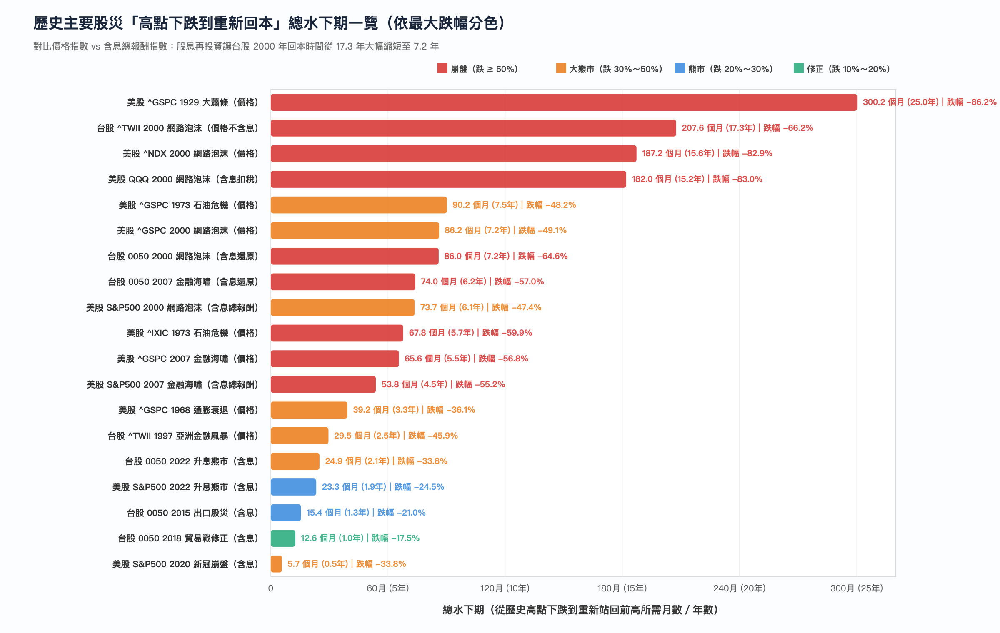
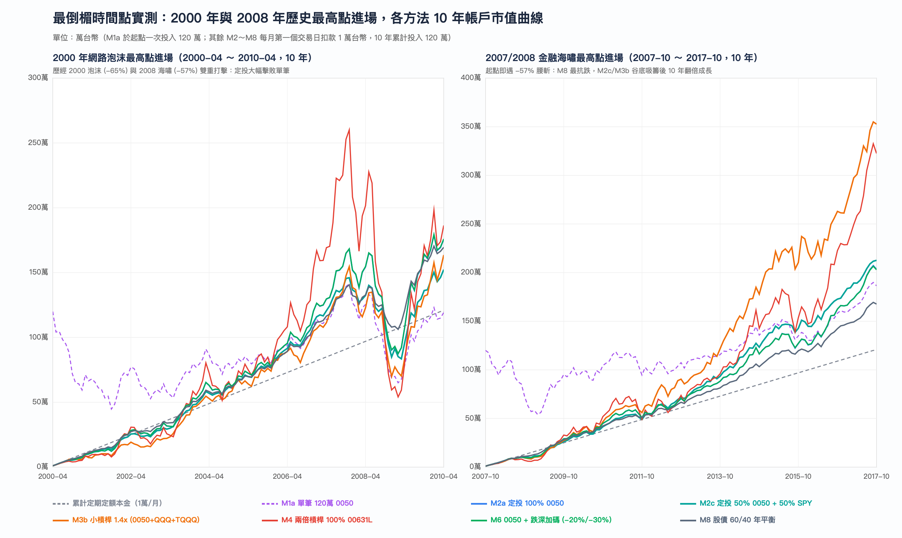
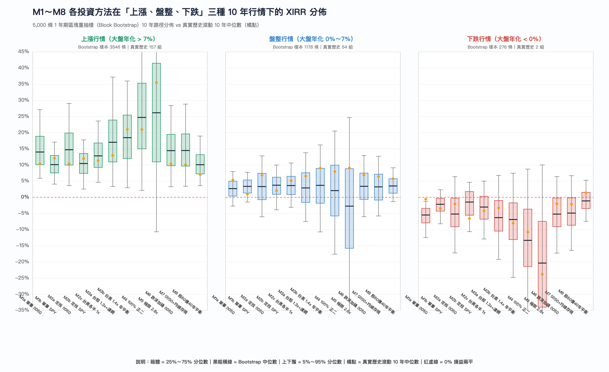

# 創歷史新高後下跌要多久才回本？如果在最高點進場該怎麼投資？（歷史實證與全天候策略穩健度報告）

> **一句話總結 Q1 與 Q2（先看結論）**
> - **Q1（從歷史高點跌下去，要多久才漲回原點？）**：如果只是 `10%～20%` 的一般修正，台美股通常 **2～7 個月**就站回新高；一旦跌超過 `20%` 進入熊市，**含息再投資**中位數要等 **約 1.7～3.2 年（20～39 個月）**，而若遇上跌超過 `50%` 的史詩級崩盤（如 2000 網路泡沫、2008 金融海嘯），就算把股息全部再投入也要熬 **4.5～15.2 年**（若只看「不含息價格指數」，最久甚至長達 **17.3～25.0 年**）！
> - **Q2（如果不幸在最高點開始投資，哪種方法最適合一般上班族？）**：千萬不要把大筆積蓄一次歐印（2000 年高點單筆買進要套牢近 7 年），改用**每月固定扣款**能把回本時間直接砍到 **約 1.7～2 年（20～23 個月）**；綜合「上漲、盤整、下跌」三種 10 年行情與人類心理極限：**怕跌破 `-30%` 的保守族選 `M8（60% 0050 + 40% 美國短債，每年再平衡）`**、**一般上班族首選免看盤的 `M2c（50% 0050 + 50% SPY 定期定額）`（純台股戶選 `M6 跌深加碼 0050`）**、**能忍受 `-60%` 波動的積極族選 `1.3x～1.4x` 溫和槓桿 `M3b / M3a`**——至於 2 倍以上的 `M4 / M5`，超過九成機率會遇到腰斬再腰斬（`-68%～-88%`），遇到盤整或下跌十年更是慘賠，一般人絕對撐不住。

---

## 給非工程師讀者的四個秒懂關鍵詞

1. **總水下期（Underwater Period）**：從指數創下「歷史最高點」那天開始往下跌（**下跌期**），一路跌到「最慘谷底」，再慢慢爬回「原本那個高點」（**回升期**），前後總共被套牢了幾個月（`下跌期 ＋ 回升期 ＝ 總水下期`）。
2. **價格指數 vs 含息總報酬指數**：我們平常看新聞報的「台股加權指數 `^TWII`」或「美股標普 `^GSPC`」都是**不含息價格指數**（除息時點數會蒸發）；但你實際買 `0050` 或 `SPY` 會領到現金股利，把股利買回股票就是**含息總報酬**——時間拉長，回本速度差非常多！
3. **年化報酬率（XIRR）**：定期定額每個月投 1 萬塊，第 1 筆錢滾了 10 年、最後 1 筆錢只滾了 1 個月。`XIRR` 會把每一筆 1 萬塊實際待在市場裡的天數精算出來，換算成「相當於銀行定存每年幾 % 複利」。
4. **回本所需月數（帳戶市值 ≥ 累計投入本金）**：對定期定額的人來說，**指數還沒漲回前高，你的帳戶早就先賺錢了！** 因為大跌時你每個月都在低檔買進便宜股數，把平均成本大幅拉低。本報告實測從股災高點開始扣款，要過幾個月帳戶總市值才會重新超越你掏出去的總本金。

---

## 壹、A 部分：從歷史高點下跌到重新站回高點，到底要多久？（回答 Q1）

### 1.1 Q1 白話總表（一眼看懂各市場回本時間）

下表整理美股與台股主要指數在歷史上遇到「一般修正（跌 `10%～20%`）」與「熊市以上（跌超過 `20%`）」時，從高點跌下去再爬回原點的真實統計（資料截至 `2026-11-25`）：

| 指數與計價方式 | 資料期間（年數） | 10%～20% 修正 已回本次數 / 中位數月數 | **跌超過 20% 熊市** 已回本次數（未回本） | 跌逾 20% 下跌期中位數 | 跌逾 20% 回升期中位數 | **跌逾 20%** **總水下期中位數** | **歷史最久水下期** （最慘跌幅） | 白話一句話結論 |
| :--- | :-: | :-: | :-: | --: | --: | --: | :-: | :--- |
| **美股 S&P 500 價格 (`^GSPC`, USD)** | 1927-12 ~ 2026-11 (98.9 年) | 14 次 / **6.9 個月** | 12 次（0） | 15.8 個月 | 17.5 個月 | **25.1 個月** (約 2.1 年) | **25.0 年 / 300.2 月** (-86.19%, 1929) | 百年來美股不含息跌逾 20%，中位數約 **2.1 年**回前高；最慘是 1929 大蕭條等了 **25 年**。 |
| **美股 S&P 500 含息 (`^SP500TR`, USD)** | 1988-01 ~ 2026-11 (38.9 年) | 10 次 / **4.9 個月** | 4 次（0） | 13.1 個月 | 25.4 個月 | **38.5 個月** (約 3.2 年) | **6.1 年 / 73.7 月** (-55.25%, 2008) | 近 39 年現代美股含息跌逾 20%，中位數 **38.5 個月**回前高，最久是 2000 泡沫的 **6.1 年**。 |
| **美股 SPY 含息扣稅 (`SPY`, 台幣計價)** | 1993-01 ~ 2026-11 (33.8 年) | 12 次 / **4.1 個月** | 3 次（0） | 17.0 個月 | 48.5 個月 | **66.0 個月** (約 5.5 年) | **6.6 年 / 79.0 月** (-52.68%, 2008) | 換成台灣人實拿台幣（扣 30% 股息稅），2022 升息熊市因美元大漲僅跌 `-18.85%`（未滿 20%），跌逾 20% 僅 3 次，最久 **6.6 年**。 |
| **美股 Nasdaq 100 價格 (`^NDX`, USD)** | 1985-10 ~ 2026-11 (41.2 年) | 26 次 / **3.2 個月** | 8 次（0） | 2.8 個月 | 3.8 個月 | **7.2 個月** (約 0.6 年) | **15.6 年 / 187.2 月** (-82.90%, 2000) | 科技股平時急跌急彈（中位數 **7.2 個月**就創新高），但一旦遇上 2000 泡沫破滅，最久套牢 **15.6 年**！ |
| **美股 Nasdaq 綜合 (`^IXIC`, USD)** | 1971-02 ~ 2026-11 (55.8 年) | 18 次 / **3.8 個月** | 13 次（0） | 3.8 個月 | 5.5 個月 | **17.2 個月** (約 1.4 年) | **15.1 年 / 181.4 月** (-77.93%, 2000) | 涵蓋 1970 年代停滯性通膨與 2000 泡沫，跌逾 20% 中位數 **17.2 個月**回前高，最久 **15.1 年**。 |
| **美股 QQQ 含息扣稅 (`QQQ`, 台幣計價)** | 1999-03 ~ 2026-11 (27.7 年) | 12 次 / **1.8 個月** | 5 次（0） | 3.8 個月 | 4.7 個月 | **7.3 個月** (約 0.6 年) | **15.3 年 / 183.7 月** (-82.96%, 2000) | 台灣人買 QQQ 含息換算台幣，一般熊市不到一年就回本，唯獨 2000 年科技泡沫苦熬 **15.3 年**。 |
| **台股加權價格指數 (`^TWII`, TWD)** | 1997-07 ~ 2026-11 (29.4 年) | 4 次 / **2.5 個月** | 5 次（1 未回） | 9.7 個月 | 12.2 個月 | **25.4 個月** (約 2.1 年) | **17.3 年 / 207.6 月** (-66.22%, 2000) | 台股每年除息蒸發 3%～4% 點數，只看價格指數在 2000 年後竟等了 **17.3 年**才重見萬點！ |
| **台股 0050 含息總報酬 (`0050`, TWD)** | 1997-07 ~ 2026-11 (29.4 年) | 6 次 / **2.5 個月** | 8 次（1 未回） | 6.6 個月 | 11.6 個月 | **20.2 個月** (約 1.7 年) | **7.2 年 / 86.0 月** (-64.64%, 2000) | **把台股高股息再投入後，跌逾 20% 中位數只要 20.2 個月回前高，最久紀錄從 17.3 年直接砍半再砍半剩 7.2 年！** |

> [!NOTE]
> 表中「1 未回」為 `2026-10-06` 創高後至資料截止日 `2026-11-25`（僅約 1.6 個月）正在進行中的秋季高檔拉回（`0050` 暫時回檔 `-27.51%`、美股 `^GSPC` 回檔 `-11.62%`），因尚未走完回升週期，不納入已回本期間之中位數計算並獨立標示。

---

### 1.2 依最大跌幅深淺 4 級分組詳細統計（修正 vs 熊市 vs 大熊市 vs 崩盤）

「跌 15%」跟「跌 55%」根本是兩種不同生物！我們將每一段歷史水下事件嚴格拆成 4 個等級，結果顯示**總水下期並非線性增加，而是隨跌幅呈「指數型暴增」**（當跌掉 `-50%` 時，必須從谷底大漲 `+100%` 才能回到原點；跌掉 `-80%` 則必須暴漲 `+400%`）：

| 指數名稱 | 跌幅分組 | 事件總數 (已回 / 未回) | 下跌期 (月) 中位數 / 平均 / 最長 | 回升期 (月) 中位數 / 平均 / 最長 | **總水下期 (月)** **中位數 / 平均 / 最長** | 樣本量提示 |
| :--- | :--- | :-: | :-: | :-: | :-: | :-: |
| **美股 `^GSPC`** (價格, 1928–2026) | `10%～20%`（修正） | 15 (14 / 1) | 2.92 / 4.05 / 14.75 | 2.92 / 3.26 / 6.47 | **6.94 / 7.30 / 17.84** | 充足 |
| | `20%～30%`（熊市） | 5 (5 / 0) | 9.26 / 11.73 / 20.44 | 11.07 / 10.03 / 15.24 | **23.16 / 21.76 / 25.69** | 中等 (5次) |
| | `30%～50%`（大熊市） | 5 (5 / 0) | 17.84 / 14.69 / 30.52 | 21.36 / 34.21 / 69.45 | **39.20 / 48.90 / 90.15** | 中等 (5次) |
| | `50% 以上`（崩盤） | 2 (2 / 0) | 24.74 / 24.74 / 32.49 | 158.16 / 158.16 / 267.70 | **182.90 / 182.90 / 300.19** | **極少 (僅1929與2008)** |
| **美股 `^SP500TR`** (含息, 1988–2026) | `10%～20%`（修正） | 11 (10 / 1) | 1.53 / 2.15 / 6.77 | 3.17 / 3.12 / 5.49 | **4.93 / 5.27 / 8.97** | 充足 |
| | `20%～30%`（熊市） | 1 (1 / 0) | 9.26 / 9.26 / 9.26 | 14.03 / 14.03 / 14.03 | **23.29 / 23.29 / 23.29** | **極少 (僅2022)** |
| | `30%～50%`（大熊市） | 2 (2 / 0) | 13.16 / 13.16 / 25.23 | 26.53 / 26.53 / 48.46 | **39.69 / 39.69 / 73.69** | **少 (2000與2020)** |
| | `50% 以上`（崩盤） | 1 (1 / 0) | 16.99 / 16.99 / 16.99 | 36.80 / 36.80 / 36.80 | **53.78 / 53.78 / 53.78** | **極少 (僅2008)** |
| **美股 `SPY` 台幣** (含息扣稅, 1993–2026) | `10%～20%`（修正） | 12 (12 / 0) | 2.04 / 2.04 / 3.25 | 2.04 / 2.96 / 11.73 | **4.11 / 5.00 / 14.32** | 充足 (含2022升息) |
| | `20%～30%`（熊市） | 0 (0 / 0) | — | — | **無事件** | 匯率緩衝使2022僅跌-18.85% |
| | `30%～50%`（大熊市） | 2 (2 / 0) | 15.80 / 15.80 / 30.52 | 26.80 / 26.80 / 48.46 | **42.59 / 42.59 / 78.98** | **少 (2000與2020)** |
| | `50% 以上`（崩盤） | 1 (1 / 0) | 16.99 / 16.99 / 16.99 | 49.05 / 49.05 / 49.05 | **66.04 / 66.04 / 66.04** | **極少 (僅2008)** |
| **美股 `^NDX`** (價格, 1985–2026) | `10%～20%`（修正） | 27 (26 / 1) | 1.30 / 1.80 / 4.99 | 1.38 / 2.10 / 6.83 | **3.24 / 3.90 / 10.09** | 充足 |
| | `20%～30%`（熊市） | 4 (4 / 0) | 2.10 / 2.26 / 3.84 | 2.53 / 2.46 / 3.75 | **3.90 / 4.72 / 7.59** | 少 (4次) |
| | `30%～50%`（大熊市） | 3 (3 / 0) | 2.86 / 5.61 / 13.27 | 11.56 / 11.48 / 18.99 | **19.68 / 17.09 / 24.84** | 少 (1987/1990/2022) |
| | `50% 以上`（崩盤） | 1 (1 / 0) | 30.36 / 30.36 / 30.36 | 156.88 / 156.88 / 156.88 | **187.24 / 187.24 / 187.24** | **極少 (僅2000泡沫)** |
| **台股 `^TWII`** (價格, 1997–2026) | `10%～20%`（修正） | 4 (4 / 0) | 1.17 / 3.59 / 11.37 | 1.59 / 3.27 / 9.56 | **2.54 / 6.86 / 20.93** | 少 (2000–2017全被大水下期覆蓋) |
| | `20%～30%`（熊市） | 3 (2 / 1) | 5.54 / 5.54 / 8.94 | 3.99 / 3.99 / 4.30 | **9.53 / 9.53 / 13.24** | 少 (2次已回+1未回) |
| | `30%～50%`（大熊市） | 2 (2 / 0) | 13.51 / 13.51 / 17.35 | 13.95 / 13.95 / 15.70 | **27.45 / 27.45 / 29.54** | **少 (1997與2022)** |
| | `50% 以上`（崩盤） | 1 (1 / 0) | 19.52 / 19.52 / 19.52 | 188.06 / 188.06 / 188.06 | **207.57 / 207.57 / 207.57** | **極少 (2000含2008雙重底)** |
| **台股 `0050`** (含息, 1997–2026) | `10%～20%`（修正） | 6 (6 / 0) | 1.06 / 1.50 / 4.17 | 1.64 / 2.43 / 8.38 | **2.46 / 3.93 / 12.55** | 中等 (6次) |
| | `20%～30%`（熊市） | 5 (4 / 1) | 2.58 / 2.47 / 3.91 | 4.43 / 5.91 / 11.50 | **6.12 / 8.38 / 15.41** | 少 (4次已回+1未回) |
| | `30%～50%`（大熊市） | 2 (2 / 0) | 13.29 / 13.29 / 17.35 | 13.68 / 13.68 / 15.70 | **26.98 / 26.98 / 29.01** | **少 (1997與2022)** |
| | `50% 以上`（崩盤） | 2 (2 / 0) | 15.35 / 15.35 / 17.94 | 64.61 / 64.61 / 68.01 | **79.95 / 79.95 / 85.95** | **少 (2000與2008)** |

**從分級數據看到的三大規律**：
1. **`10%～20%` 修正不用怕**：不管台股美股，幾乎都在 **半年內（中位數 2.5～6.9 個月）** 自動修復創新高。
2. **`20%～50%` 熊市需要 1～3 年耐心**：通常花 **6～18 個月探底**，再花 **1～2 年爬回來**，總水下期中位數約 **1.5～3.3 年**。
3. **`50%` 以上大崩盤才是真正的魔王**：一旦腰斬以上，回升期動輒 **4～15 年**！這也是為什麼投資策略絕對不能讓帳戶輕易出現 `-60% ～ -80%` 的毀滅性深坑。

---

### 1.3 「含息版 vs 價格版」與「美元 vs 台幣計價」差多少？

很多新聞喜歡嚇大家：「台股 2000 年上萬點，套牢 17 年才解套！」——這句話**只對了一半**，因為它漏算了台灣股市每年 `3%～4%` 的豐厚現金股息！請看實測比對表：

| 重大歷史股災 | 價格指數（不含息） 最大跌幅 / 總水下月數 | **含息總報酬（股息再投資）** 最大跌幅 / 總水下月數 | **股息幫你提早回本幾個月？** | 台灣人台幣計價（扣 30% 美股稅） 最大跌幅 / 總水下月數 |
| :--- | :-: | :-: | :-: | :-: |
| **台股 2000 網路泡沫** (`^TWII` vs `0050`) | `-66.22%` / **207.57 月 (17.3 年)** | `-64.64%` / **85.95 月 (7.2 年)** | **提早 121.62 個月（省下 10.1 年！）** | —（本身即台幣） |
| **台股 2008 金融海嘯** (`^TWII` vs `0050`) | （併入 2000–2017 未創高區間） | `-56.97%` / **73.95 月 (6.2 年)** | 價格指數 2007 未過前高；含息 2007 已創高 | —（本身即台幣） |
| **美股 S&P 500 2000 泡沫** (`^GSPC` vs `^SP500TR`) | `-49.15%` / **86.18 月 (7.2 年)** | `-47.41%` / **73.69 月 (6.1 年)** | **提早 12.49 個月（省下 1.0 年）** | `-48.01%` / **78.98 月 (6.6 年)** |
| **美股 S&P 500 2008 海嘯** (`^GSPC` vs `^SP500TR`) | `-56.78%` / **65.61 月 (5.5 年)** | `-55.25%` / **53.78 月 (4.5 年)** | **提早 11.83 個月（省下 1.0 年）** | `-52.68%` / **66.04 月 (5.5 年)** |
| **美股 S&P 500 2022 升息** (`^GSPC` vs `^SP500TR`) | `-25.43%` / **24.51 月 (2.0 年)** | `-24.49%` / **23.29 月 (1.9 年)** | 提早 1.22 個月 | **`-18.85%` / 14.32 月（美元升值神救援，提早 9 個月！）** |
| **美股 Nasdaq 100 2000 泡沫** (`^NDX` vs `QQQ`) | `-82.90%` / **187.24 月 (15.6 年)** | `-82.96%` / **181.98 月 (15.2 年)** | 提早 5.26 個月（當時科技股幾乎不配息） | `-82.96%` / **183.66 月 (15.3 年)** |
| **美股 Nasdaq 100 2022 升息** (`^NDX` vs `QQQ`) | `-35.56%` / **24.84 月 (2.1 年)** | `-35.24%` / **24.77 月 (2.1 年)** | 提早 0.07 個月 | **`-28.84%` / 18.76 月（台幣計價少跌近 7%）** |

**台灣投資人必懂的兩個實戰啟示**：
1. **股息再投資是破除長期套牢的加速器**：台股 `^TWII` 在 `2000-02-17` 攻上 `10,202` 點後，2007 年最高只漲到 `9,809` 點又遇到 2008 海嘯，一直等到 `2017-06-05` 才重新站回 `10,202` 點（整整 17.3 年）；但如果你買的是 `0050` 並把每年股利再買進去，早在 **`2007-06-04`（7.2 年）** 就已經完全解套創新高了！
2. **買美股自帶「股災匯率防彈衣」**：每當全球發生股災或美國暴力升息（例如 **2022 年**或 **2008 年底**），資金會湧向美元避險，台幣往往貶值（美元兌台幣在 2022 年從 `27.6` 升到 `32.2`，漲幅逾 `16%`）。因此 2022 年美國人看 `SPY` 跌了 `-24.5%`、套牢近兩年；**台灣人用台幣看手上的 `SPY` 卻只跌了 `-18.85%`，14.3 個月就創新高！**（反面則是 2009–2012 美股復甦期台幣升值，使 2008 海嘯台幣計價回本比美元版慢了約 1 年）。

（圖檔連結：[underwater_duration_bars.png](file:///Users/panda/pandatesttrading/research/peak_recovery/underwater_duration_bars.png)）

---

### 1.4 歷史上最漫長的 5 個水下事件故事（外加 1990 年台股萬二泡沫特別篇）

如果單筆買在歷史最瘋狂的頂點而且死抱不動，人類金融史上最折磨人的五次紀錄如下：

1. **第 1 名：1929 年美國經濟大蕭條（`^GSPC` 價格指數：水下 `300.19 個月 ＝ 25.02 年`）**
   - **時間軸**：`1929-09-16` 高點（`31.86`）→ `1932-06-01` 谷底（`4.40`，**暴跌 `-86.19%`**，下跌 32.5 個月）→ `1954-09-22` 重回高點（回升 267.7 個月）。
   - **白話故事**：1920 年代美股融資炒作狂熱，崩盤後聯準會錯誤緊縮貨幣並引發數千家銀行倒閉、失業率飆破 25%，接著又撞上 1937 二次衰退與第二次世界大戰。不計股息的話，一個 30 歲年輕人在 1929 年高點單筆買進，要等到 **55 歲**才看到指數回到原點（註：現代研究顯示若計入 1930 年代高達 5%～10% 的股息再投資並考慮嚴重通貨緊縮，實質購買力約在 1936–1945 年間回本；且現代央行已有存款保險與無限 QE 機制，此事件主要作為極端歷史參考）。
2. **第 2 名：2000 年台股網路泡沫與失落十七年（`^TWII` 價格指數：水下 `207.57 個月 ＝ 17.30 年`；含息 `0050` 為 `7.16 年`）**
   - **時間軸**：`2000-02-17` 高點（`10,202.20`）→ `2001-10-03` 谷底（`3,446.26`，**暴跌 `-66.22%`**，下跌 19.5 個月）→ `2017-06-05` 重回萬點高點。
   - **白話故事**：2000 年總統大選與全球網路熱潮把台股推上萬點，隨後科技泡沫破裂加上本土金融呆帳風暴跌到三千四百點；好不容易 2007 年爬到 `9,809` 點差臨門一腳，又被 2008 雷曼風暴打回 `3,955` 點，造就價格指數長達 17.3 年的「萬點魔咒」。但如前節所述，**含息 `0050` 其實 7.2 年就回本了**。
   - **【同場補充：1990 年台股 12,682 萬二泡沫】**：Yahoo Finance 的 `^TWII` 日線僅自 `1997-07-02` 開始，若往前回溯台灣證交所歷史紀錄，1980 年代末台灣錢淹腳目、地下投資公司盛行、國泰人壽本益比破百倍，加權指數在 **`1990-02-12` 衝上 `12,682.41` 點**，隨後 8 個月內暴跌 **`-80.40%`** 至 `1990-10-12` 的 `2,485.25` 點！若只看價格指數，台股一直等到 **`2020-07-28`（整整 `30.46 年`！）** 靠台積電領軍才突破 `12,682` 點。這提醒我們：**當整個市場本益比漲到 80～100 倍的全面投機泡沫時，單筆追高的代價可能是半輩子。**
3. **第 3 名：2000 年美股 Nasdaq 網路泡沫（`^NDX` 價格指數：水下 `187.24 個月 ＝ 15.60 年`；含息 `QQQ` 為 `15.17 年`）**
   - **時間軸**：`2000-03-27` 高點（`4,704.73`）→ `2002-10-07` 谷底（`804.64`，**暴跌 `-82.90%`**，下跌 30.4 個月）→ `2015-11-03` 重回高點（含息 `QQQ` 亦等到 `2015-05-27`）。
   - **白話故事**：當時只要公司名字加上 `.com` 股價就翻倍，連沒賺錢的空殼公司都飆上天；泡沫戳破後 Nasdaq 100 跌掉八成三，因為當時科技股幾乎不發股利，就算買 `QQQ` 含息也整整套牢超過 15 年，直到蘋果、微軟、亞馬遜與雲端時代真正創造龐大獲利才收復失土。
4. **第 4 名：1973–1974 年第一次石油危機與停滯性通膨（`^GSPC` 價格指數：水下 `90.15 個月 ＝ 7.51 年`）**
   - **時間軸**：`1973-01-11` 高點（`120.24`）→ `1974-10-03` 谷底（`62.28`，**下跌 `-48.20%`**，下跌 20.7 個月）→ `1980-07-17` 重回高點。
   - **白話故事**：美股「漂亮 50（Nifty Fifty）」高估值藍籌股泡沫遇上中東贖罪日戰爭石油禁運，油價翻四倍、通膨飆破 10%、經濟卻陷入衰退（停滯性通膨），股市名目價格盤整了七年半才回到前高。
5. **第 5 名：2000 年美股 S&P 500 網路泡沫（`^GSPC` 價格指數：水下 `86.18 個月 ＝ 7.18 年`；含息 `^SP500TR` 為 `6.14 年`）**
   - **時間軸**：`2000-03-24` 高點（`1,527.46`）→ `2002-10-09` 谷底（`776.76`，**下跌 `-49.15%`**，下跌 30.5 個月）→ `2007-05-30` 重回高點（隨後不到 5 個月又撞上 2008 金融海嘯！）。
   - **白話故事**：大型分散的 S&P 500 雖然不像 Nasdaq 跌八成，但從 2000 年跌近腰斬後，剛在 2007 年回本又立刻在 2008 年再腰斬一次（`-56.78%`），形成著名的「美股失落十年（2000–2010）」。**這正是為什麼我們在 Q2 必須嚴格測試「萬一未來 10 年大盤盤整或下跌，哪種方法才活得下來」！**

---

## 貳、B 部分：如果剛好在最高點開始投資，哪種方法最適合一般上班族？（回答 Q2）

### 2.1 回測共同規則與 M1～M8（共 12 種方法）一覽

- **共同投入與成本設定**（與 `dca_allocation_grid` 完全一致）：
  - **定期定額（M2～M8）**：每月第一個交易日投入 **`10,000` 台幣**（10 年共 120 期，累計本金 **120 萬台幣**）。
  - **單筆對照組（M1a / M1b）**：在起點當天一次把 10 年份的錢 **`120 萬台幣`** 全部買進，之後不再投入。
  - **真實摩擦成本**：美股換匯成本 `0.1%`、複委託手續費 `0.1%`（主結果不計 15 美元低消）、美股配息預扣 `30%` 股息稅；台股再平衡或現金單筆加碼買進手續費 `0.1425%`、賣出證交稅 `0.1%` 加手續費 `0.1425%`；最終市值一律按當日 `TWD=X` 匯率換算回台幣。

| 代號 | 方法名稱 | 有效槓桿 | 操作規則白話說明 |
| :-: | :--- | :-: | :--- |
| **`M1a`** | 單筆投入：100% `0050` | `1.0x` | 120 萬在起點一次全買 `0050`（最倒楣歐印對照組）。 |
| **`M1b`** | 單筆投入：100% `SPY` | `1.0x` | 120 萬在起點換匯一次全買美股 `SPY`（對照組）。 |
| **`M2a`** | 定期定額 1x：100% `0050` | `1.0x` | 每月 1 萬買 `0050`，不擇時、不再平衡。 |
| **`M2b`** | 定期定額 1x：100% `SPY` | `1.0x` | 每月 1 萬換匯買 `SPY`，不擇時、不再平衡。 |
| **`M2c`** | 定期定額 1x：50% `0050` + 50% `SPY` | `1.0x` | 每月 5 千買 `0050`、5 千買 `SPY`，台美各半分散。 |
| **`M3a`** | 小槓桿 1.3x：70% `0050` + 30% `00631L`（開濾網） | `1.3x` | 跌破 200 日線 `-2%` 時新扣款全買 `0050`，站回 `+2%` 恢復，舊部位不賣、不再平衡。 |
| **`M3b`** | 小槓桿 1.4x：40% `0050` + 40% `QQQ` + 20% `TQQQ` | `1.4x` | 每年第一個交易日再平衡一次，不開濾網（上一份研究 `-60%` 上限總冠軍）。 |
| **`M4`** | 2 倍槓桿：100% `00631L` | `2.0x` | 每月 1 萬全買元大台灣50正2（`00631L`）。 |
| **`M5`** | 極限槓桿 2.8x：20% `00631L` + 80% `TQQQ` | `2.8x` | 每季再平衡＋開啟 200 日線 `±2%` 濾網（上一份研究不限回撤極限冠軍）。 |
| **`M6`** | 定投＋跌深加碼 1x：`0050` 8千 + 現金 2千 | `≤1.0x` | 平時 8 千買 `0050`、2 千存現金領 `^IRX` 利息；`0050` 離歷史高點跌逾 `20%` 投入一半現金、跌逾 `30%` 投入剩餘現金（水下期間月扣全買 `0050`），回前高後重新存現金。 |
| **`M7`** | 1 倍＋200 日線濾網：100% `0050` | `≤1.0x` | 跌破 200 日均線 `-2%` 時新扣款改存現金生息，站回 `+2%` 時把現金全數買進 `0050`；舊部位不賣。 |
| **`M8`** | 股債配置 60/40：60% `0050` + 40% 美國短債 | `0.6x` | 40% 公債以 `^IRX` 累積短債報酬加計美元匯率，每年再平衡一次（保守型對照組）。 |

---

### 2.2 測試一：在歷史大跌「最高點當天」進場的真實下場（12 次股災實測）

如果你就是傳說中「一買進隔天就崩盤」的地獄倒楣鬼，以下列出最具代表性的股災最高點進場實測結果（完整 12 場事件：美股 `2000、2007、2020、2022` 與台股 `1997、2000、2007、2015、2018、2020、2022、2024` 全數收錄於 `results.json`）：

#### （A）四大經典股災高點進場：10 年完整對決表（2000 泡沫 vs 2007/2008 海嘯）

| 高點進場事件 | 方法 | 10年內帳戶最大回撤 (% / 金額) | 相對本金最慘虧損 (% / 金額) | **回本要多久？** (市值 ≥ 本金) | 3 年市值 (XIRR) 定投本金 36 萬 | 5 年市值 (XIRR) 定投本金 60 萬 | **10 年市值 (XIRR)** **總本金皆 120 萬** |
| :--- | :--- | :-: | :-: | --: | --: | --: | --: |
| **台股 2000 泡沫高點** (`2000-04-05`) 0050 跌 `-64.64%` | `M1a` 單筆 0050 | -64.64% (-77.6萬) | -64.64% (-77.6萬) | **85.95 個月** | 55.8萬 (-22.62%) | 82.3萬 (-7.28%) | **119.2萬 (-0.07%)** |
| | `M1b` 單筆 SPY | -52.68% (-73.4萬) | -46.59% (-55.9萬) | **77.96 個月** | 71.0萬 (-16.09%) | 101.3萬 (-3.33%) | **106.1萬 (-1.23%)** |
| | **`M2a` 定投 0050** | -53.12% (-91.5萬) | -22.40% (-23.3萬) | **20.24 個月** | 31.4萬 (-8.60%) | 72.4萬 (+7.44%) | **175.6萬 (+7.39%)** |
| | `M2b` 定投 SPY | -44.12% (-56.5萬) | -33.73% (-36.4萬) | 44.42 個月 | 28.6萬 (-14.40%) | 67.1萬 (+4.45%) | 129.1萬 (+1.45%) |
| | **`M2c` 台美各半 1x** | **-48.36%** (-71.6萬) | -26.48% (-27.5萬) | **22.97 個月** | 30.0萬 (-11.45%) | 69.8萬 (+5.97%) | **152.3萬 (+4.67%)** |
| | `M3a` 台股 1.3x+濾網 | -57.97% (-104.6萬) | -27.04% (-28.1萬) | 20.24 個月 | 30.7萬 (-10.00%) | 71.8萬 (+7.14%) | 174.4萬 (+7.27%) |
| | `M3b` 台美 1.4x 年平衡 | -59.43% (-93.4萬) | -38.67% (-40.2萬) | 41.43 個月 | 23.4萬 (-26.18%) | 64.1萬 (+2.63%) | 163.6萬 (+6.04%) |
| | `M4` 100% 正二 | **-82.25%** (-222.5萬) | -53.84% (-56.0萬) | 20.24 個月 | 24.6萬 (-23.34%) | 75.0萬 (+8.84%) | 186.4萬 (+8.53%) |
| | `M5` 極限 2.8x | **-87.67%** (-212.7萬) | -71.22% (-74.1萬) | 37.98 個月 | 23.7萬 (-25.45%) | 76.6萬 (+9.69%) | 143.6萬 (+3.52%) |
| | **`M6` 跌深加碼 0050** | -53.08% (-91.5萬) | -22.19% (-23.1萬) | **20.24 個月** | 31.5萬 (-8.43%) | 72.5萬 (+7.51%) | **176.0萬 (+7.44%)** |
| | `M7` 0050+均線存現 | -52.08% (-88.5萬) | -21.68% (-22.5萬) | 20.24 個月 | 32.0萬 (-7.55%) | 71.5萬 (+6.96%) | 172.7萬 (+7.08%) |
| | **`M8` 股60債40年平衡** | **-28.36%** (-40.5萬) | **-14.85% (-4.6萬)** | **20.07 個月** | 34.2萬 (-3.37%) | 69.9萬 (+6.03%) | **169.5萬 (+6.72%)** |
| **美股 2007 海嘯高點** (`2007-10-09`) SPY 跌 `-55.58%` | `M1a` 單筆 0050 | -56.97% (-69.7萬) | -56.14% (-67.4萬) | 39.66 個月 | 106.5萬 (-3.92%) | 109.5萬 (-1.82%) | 190.0萬 (+4.71%) |
| | `M1b` 單筆 SPY | -52.68% (-63.1萬) | -52.77% (-63.3萬) | **66.04 個月** | 87.7萬 (-10.00%) | 106.9萬 (-2.30%) | 207.7萬 (+5.65%) |
| | `M2a` 定投 0050 | -28.11% (-2.8萬) | -45.38% (-6.4萬) | **18.86 個月** | 44.9萬 (+14.88%) | 70.5萬 (+6.36%) | 203.5萬 (+10.19%) |
| | `M2b` 定投 SPY | -25.43% (-2.9萬) | -36.45% (-6.6萬) | 24.18 個月 | 38.1萬 (+3.78%) | 73.2萬 (+7.91%) | 221.8萬 (+11.81%) |
| | **`M2c` 台美各半 1x** | **-25.83%** (-2.8萬) | -42.41% (-5.9萬) | **21.82 個月** | 41.5萬 (+9.48%) | 71.9萬 (+7.14%) | **212.7萬 (+11.02%)** |
| | `M3a` 台股 1.3x+濾網 | -29.51% (-2.9萬) | -47.66% (-6.7萬) | 18.86 個月 | 45.1萬 (+15.22%) | 70.1萬 (+6.09%) | 221.0萬 (+11.74%) |
| | **`M3b` 台美 1.4x 年平衡** | -36.79% (-3.9萬) | -52.35% (-7.3萬) | **21.39 個月** | 46.6萬 (+17.61%) | 90.3萬 (+16.36%) | **351.8萬 (+20.39%)** |
| | `M4` 100% 正二 | -57.96% (-5.4萬) | -62.38% (-10.0萬) | 18.86 個月 | 51.9萬 (+25.37%) | 73.9萬 (+8.25%) | 322.5萬 (+18.78%) |
| | `M5` 極限 2.8x | -42.06% (-4.3萬) | -59.24% (-8.3萬) | 21.45 個月 | 53.3萬 (+27.24%) | 127.0萬 (+30.52%) | 996.4萬 (+39.73%) |
| | `M6` 跌深加碼 0050 | -28.18% (-2.9萬) | -44.91% (-6.3萬) | 18.86 個月 | 45.0萬 (+15.08%) | 70.7萬 (+6.45%) | 202.9萬 (+10.14%) |
| | `M7` 0050+均線存現 | -18.42% (-24.9萬) | -34.44% (-4.8萬) | 21.36 個月 | 43.2萬 (+12.21%) | 68.0萬 (+4.92%) | 198.5萬 (+9.72%) |
| | **`M8` 股60債40年平衡** | **-10.81%** (-1.2萬) | **-21.70% (-3.5萬)** | **18.83 個月** | 42.3萬 (+10.85%) | 66.7萬 (+4.19%) | **167.8萬 (+6.51%)** |

> [!TIP]
> **為什麼 2007 年高點開始定投，帳戶最大回撤（如 `M2c` 僅 `-25.83%`）遠小於 2000 年高點進場（`-48.36%`）？**
> 因為 2007 年 10 月你剛開始定投第 1 年就遇到 2008 金融海嘯，當時帳戶裡只有十幾萬台幣（跌一半也只虧 6 萬台幣，新投的 1 萬塊馬上就幫你攤平了！）；但 2000 年高點開始定投的人，到了第 8 年（2008 年）帳戶已經累積到 **140～260 萬台幣**，這時再撞上 2008 年腰斬，`M4 正二` 直接從 262 萬暴跌 `-82.25%` 剩 46 萬（蒸發 222 萬台幣）！下方的市值曲線圖能讓你一眼看清這個殘酷差異。

（圖檔連結：[peak_2000_2008_equity_curves.png](file:///Users/panda/pandatesttrading/research/peak_recovery/peak_2000_2008_equity_curves.png)）

#### （B）其餘歷次股災高點進場精選對照表（台股 1997 / 2018 / 2022 / 2024 與美股 2020 / 2022）

以下列出各代表性方法在歷次台美股高點進場的「回本月數」與各期績效（未滿 3／5／10 年或 `QQQ` 未上市者依規標示「**資料不足**」）：

| 事件與高點日期 | 方法 | 期內最大回撤 | **回本月數** | 3 年市值 (XIRR) | 5 年市值 (XIRR) | 10 年市值 (XIRR) |
| :--- | :--- | --: | --: | --: | --: | --: |
| **台股 1997 亞洲金融風暴** (`1997-08-26`, 0050 跌 `-43.55%`) | `M1a` 單筆 0050 | -64.64% | 29.01 月 | 103.1萬 (-5.05%) | 67.3萬 (-11.07%) | 141.0萬 (+1.64%) |
| | `M2a` 定投 0050 | -41.79% | **19.58 月** | 39.3萬 (+5.72%) | 49.0萬 (-7.90%) | **198.3萬 (+9.70%)** |
| | `M2c` 台美各半 1x | **-25.76%** | **14.23 月** | 42.3萬 (+10.81%) | 47.9萬 (-8.84%) | **180.8萬 (+7.95%)** |
| | `M3b` / `M5` (含QQQ) | 資料不足 | 資料不足 | 資料不足 | 資料不足 | 資料不足 |
| | `M8` 股60債40年平衡 | **-18.68%** | **19.19 月** | 39.8萬 (+6.59%) | 57.0萬 (-2.05%) | **179.0萬 (+7.76%)** |
| **台股 2018 美中貿易戰** (`2018-08-30`, 0050 跌 `-17.53%`) | `M1a` 單筆 0050 | -33.83% | 12.55 月 | 209.4萬 (+20.97%) | 212.1萬 (+12.27%) | 資料不足 |
| | `M2c` 台美各半 1x | -24.91% | **5.91 月** | 53.1萬 (+26.99%) | 85.3萬 (+14.07%) | 資料不足 |
| | `M3b` 台美 1.4x 年平衡 | -33.15% | **6.37 月** | 66.8萬 (+44.60%) | 110.4萬 (+24.69%) | 資料不足 |
| | `M8` 股60債40年平衡 | **-18.07%** | **6.57 月** | 47.6萬 (+18.97%) | 78.6萬 (+10.74%) | 資料不足 |
| **美股 2020 新冠疫情高點** (`2020-02-19`, SPY 跌 `-33.83%`) | `M1b` 單筆 SPY | -33.36% | 6.21 月 | 150.2萬 (+7.91%) | 243.7萬 (+15.36%) | 資料不足 |
| | `M2c` 台美各半 1x | -23.87% | **2.69 月** | 41.4萬 (+9.33%) | 100.7萬 (+20.76%) | 資料不足 |
| | `M6` 跌深加碼 0050 | -26.95% | **1.91 月** | 41.3萬 (+9.09%) | 103.2萬 (+21.76%) | 資料不足 |
| | `M8` 股60債40年平衡 | **-17.92%** | **3.42 月** | 40.7萬 (+8.06%) | 91.1萬 (+16.65%) | 資料不足 |
| **美股 2022 暴力升息高點** (`2022-01-03`, SPY 跌 `-24.76%`) | `M1b` 單筆 SPY | -18.85% | 16.92 月 | 179.0萬 (+14.26%) | 資料不足 | 資料不足 |
| | `M2b` 定投 SPY | -15.04% | **6.80 月** | 51.6萬 (+24.71%) | 資料不足 | 資料不足 |
| | `M2c` 台美各半 1x | -20.16% | **10.91 月** | 53.5萬 (+27.42%) | 資料不足 | 資料不足 |
| | `M3b` 台美 1.4x 年平衡 | -28.02% | 12.98 月 | 62.1萬 (+38.68%) | 資料不足 | 資料不足 |
| **台股 2022 升息熊市高點** (`2022-01-17`, 0050 跌 `-33.83%`) | `M1a` 單筆 0050 | -33.83% | 24.94 月 | 170.0萬 (+12.50%) | 資料不足 | 資料不足 |
| | `M2a` 定投 0050 | -27.05% | **12.42 月** | 55.4萬 (+30.03%) | 資料不足 | 資料不足 |
| | `M6` 跌深加碼 0050 | -26.59% | **11.96 月** | 55.7萬 (+30.47%) | 資料不足 | 資料不足 |
| | `M8` 股60債40年平衡 | **-17.59%** | **10.22 月** | 50.1萬 (+22.57%) | 資料不足 | 資料不足 |
| **台股 2024 夏季高點** (`2024-07-11`, 含 2025 關稅修正) | `M1a` 單筆 0050 | -27.51% | 12.12 月 | 資料不足 | 資料不足 | 資料不足 |
| | `M2c` 台美各半 1x | -18.23% | **10.97 月** | 資料不足 | 資料不足 | 資料不足 |
| | `M6` 跌深加碼 0050 | -24.66% | **10.09 月** | 資料不足 | 資料不足 | 資料不足 |
| | `M8` 股60債40年平衡 | **-16.01%** | **11.47 月** | 資料不足 | 資料不足 | 資料不足 |

---

### 2.3 測試二（a）：「在高點附近進場」真的比「等大跌再進場」慘嗎？（213 組滾動 10 年實證）

很多人看到股市創歷史新高就不敢定期定額，總想「等跌超過 20% 再開始扣」。我們把 `1999-03` 到 `2016-11` 之間**每一個月（共 213 個起點）** 往後看 10 年，依起點當時 `0050` 離歷史高點的距離分成三組：

| 起點離歷史高點距離 | 樣本數 | `M1a` 單筆 0050 XIRR 中位數 (虧錢率) | `M2a` 定投 0050 XIRR 中位數 (虧錢率) | **`M2c` 台美各半 1x** **XIRR 中位數 (虧錢率)** | `M3b` 台美 1.4x XIRR 中位數 (虧錢率) | `M8` 股債 60/40 XIRR 中位數 (虧錢率) |
| :--- | :-: | :-: | :-: | :-: | :-: | :-: |
| **在高點附近（`0%～-5%`）** | 40 組 | 12.58% (2.50%) | **15.25% (0.00%)** | **14.27% (0.00%)** | **23.54% (0.00%)** | **10.37% (0.00%)** |
| **回檔區間（`-5%～-20%`）** | 72 組 | 10.57% (1.39%) | 11.79% (0.00%) | 11.49% (0.00%) | 21.61% (1.39%) | 7.75% (0.00%) |
| **跌超過 `-20%`（`<-20%`）** | 101 組 | 7.61% (1.98%) | 7.42% (1.98%) | 7.51% (2.97%) | 14.77% (3.96%) | 5.34% (0.00%) |

> [!IMPORTANT]
> **顛覆直覺的大數據真相**：在過去近 28 年裡，在「高點附近（`0%～-5%`）」開始定期定額 `M2a`、`M2c`、`M3a`、`M3b`、`M6`、`M7`、`M8` 的 40 個梯次，**10 年後虧錢機率通通是 `0.00%`！** 為什麼「跌超過 `-20%`」開始扣的那 101 組（多半集中在 2001～2006 年）10 年 XIRR 反而只有 `7.5%`？因為那些梯次的第 7～9 年剛好迎面撞上 **2008 金融海嘯或 2011/2015 股災收尾**！這證明了：**定期定額真正決定勝負的是「你結束出場前那 2～3 年的行情」，根本不是「第 1 個月進場是不是最高點」——現在高點就開始扣，絕對好過空手苦等！**

---

### 2.4 測試二（b）：在「上漲、盤整、下跌」三種 10 年行情下，各方法表現如何？

因為過去 28 年台美股長牛，在真實歷史 213 個 10 年起點裡，「未來 10 年大盤年化 `< 0%`（下跌行情）」的樣本極少（台美 50/50 綜合大盤僅 **2 個起點**，單看台股 `0050` 也僅 **4 個起點**，皆少於 12 個起點門檻！）。因此我們依研究規範，以 **1 年（12 個日曆月）歷史真實日報酬為一塊**，固定亂數種子（`seed = 20261126`）隨機重組生成 **5,000 條 10 年路徑（Block Bootstrap）**，將「模擬 5,000 條路徑」與「真實歷史 213 個起點」分開列示如下（主表採公平對待台美股的「台美 50/50 大盤年化報酬」分類，避免單一國家漲跌偏誤；`results.json` 另完整收錄純 `0050` 與純 `SPY` 分類供交叉核對）：

#### 【表 2.4A】Block Bootstrap 5,000 條 10 年模擬路徑（補足盤整與下跌極端壓力測試）

| 方法 | **上漲行情（>7%，共 3,546 條）** XIRR 中位 / 最差5% / 虧錢率 / MDD中位 / 回本月 | **盤整行情（0%～7%，共 1,178 條）** XIRR 中位 / 最差5% / 虧錢率 / MDD中位 / 回本月 | **下跌行情（<0%，共 276 條）** XIRR 中位 / 最差5% / 虧錢率 / MDD中位 / 回本月 |
| :--- | :-: | :-: | :-: |
| `M1a` 單筆 0050 | 14.02% / +5.90% / 0.00% / -43.27% / 8.3月 | 2.70% / -2.73% / 21.05% / -58.72% / 67.9月 | -5.47% / -12.44% / **98.91%** / -73.24% / ≥120月 |
| `M1b` 單筆 SPY | 10.12% / +4.08% / 0.11% / -33.36% / 7.0月 | 3.39% / -1.47% / 12.39% / -44.66% / 47.1月 | -2.15% / -8.19% / 76.45% / -55.92% / ≥120月 |
| `M2a` 定投 0050 | 14.73% / +3.62% / 1.16% / -34.88% / 21.3月 | 3.33% / -6.02% / 29.20% / -45.52% / 72.7月 | -5.18% / -17.21% / 75.72% / -49.40% / ≥120月 |
| `M2b` 定投 SPY | 10.47% / +2.56% / 1.33% / -28.13% / 20.6月 | **3.75%** / -3.87% / 17.74% / -32.40% / 64.4月 | -1.47% / -10.62% / 64.13% / -34.99% / 108.9月 |
| **`M2c` 台美各半 1x** | **12.83%** / **+4.64%** / **0.37%** / **-27.61%** / 18.4月 | **3.64%** / **-3.10%** / **18.68%** / **-33.02%** / 68.1月 | **-3.01%** / -12.90% / 73.19% / **-40.44%** / 115.1月 |
| `M3a` 台股 1.3x+濾網 | 17.04% / +3.35% / 1.78% / -42.87% / 23.1月 | 2.91% / -7.49% / 33.28% / -51.32% / 75.5月 | -6.28% / -19.20% / 77.90% / -53.28% / ≥120月 |
| **`M3b` 台美 1.4x 年平衡** | **18.47%** / +2.95% / 2.62% / -49.33% / 20.5月 | **3.71%** / -10.70% / 33.53% / -56.78% / 76.2月 | -6.87% / -24.77% / 80.43% / -58.88% / ≥120月 |
| `M4` 100% 正二 | 24.72% / +2.16% / 3.58% / -64.28% / 27.5月 | 2.08% / -17.60% / 42.87% / -76.80% / 85.5月 | **-13.32%** / **-42.71%** / 84.78% / **-79.54%** / ≥120月 |
| `M5` 極限 2.8x | **26.17%** / -10.67% / 12.01% / -79.60% / 39.0月 | **-2.73%** / **-37.70%** / **56.37%** / **-86.37%** / 106.4月 | **-20.35%** / **-57.63%** / **87.32%** / **-87.32%** / ≥120月 |
| `M6` 跌深加碼 0050 | 14.45% / +3.29% / 1.44% / -33.75% / 23.1月 | 3.41% / -6.00% / 28.86% / -45.10% / 74.2月 | -5.20% / -17.28% / 75.72% / -49.24% / ≥120月 |
| `M7` 0050+均線存現 | 14.49% / +3.42% / 1.21% / -33.25% / 24.8月 | 3.24% / -5.77% / 29.63% / -42.63% / 79.8月 | -4.88% / -16.42% / 76.09% / -46.11% / ≥120月 |
| **`M8` 股60債40年平衡** | 10.10% / +3.63% / **0.20%** / **-17.61%** / **16.2月** | **3.52%** / **-1.32%** / **13.07%** / **-22.63%** / **56.0月** | **-1.11%** / **-7.42%** / **63.41%** / **-24.41%** / **102.3月** |

#### 【表 2.4B】真實歷史滾動 10 年（1999-03 ～ 2026-11，共 213 個起點；下跌組 `n=2` 小樣本警示！）

| 方法 | **真實上漲行情（>7%，共 157 組）** XIRR 中位 / 最差5% / 虧錢率 / MDD中位 / 回本月 | **真實盤整行情（0%～7%，共 54 組）** XIRR 中位 / 最差5% / 虧錢率 / MDD中位 / 回本月 | **真實下跌行情（<0%，僅 2 組 ⚠️小樣本）** XIRR 中位 / 最差5% / 虧錢率 / MDD中位 / 回本月 |
| :--- | :-: | :-: | :-: |
| `M1a` 單筆 0050 | 10.36% / +5.92% / 0.00% / -33.83% / 9.4月 | 5.36% / +0.21% / 3.70% / -56.97% / 37.5月 | -0.57% / -0.86% / 100.00% / -64.64% / 35.6月 |
| `M1b` 單筆 SPY | 12.10% / +5.63% / 0.00% / -33.36% / 9.6月 | 1.02% / -2.21% / 38.89% / -52.68% / 66.3月 | -3.43% / -3.87% / 100.00% / -51.53% / 68.8月 |
| `M2a` 定投 0050 | 10.41% / +5.90% / 0.00% / -29.54% / 23.3月 | 6.84% / +4.52% / 0.00% / -52.69% / 26.8月 | -2.06% / -3.37% / 100.00% / -53.34% / 35.5月 |
| `M2b` 定投 SPY | 11.97% / +4.91% / 0.00% / -32.76% / 21.3月 | 2.06% / -2.03% / 20.37% / -42.56% / 73.0月 | -6.58% / -7.58% / 100.00% / -44.68% / 57.6月 |
| **`M2c` 台美各半 1x** | **11.36%** / **+5.54%** / **0.00%** / **-28.01%** / 21.0月 | **5.15%** / **+1.80%** / **1.85%** / **-47.30%** / 49.9月 | -4.17% / -5.35% / 100.00% / **-48.89%** / 54.5月 |
| `M3a` 台股 1.3x+濾網 | 12.99% / +5.78% / 0.00% / -36.17% / 24.2月 | 6.58% / +3.97% / 0.00% / -57.91% / 30.5月 | -3.29% / -4.72% / 100.00% / -58.45% / 35.7月 |
| **`M3b` 台美 1.4x 年平衡** | **21.00%** / **+9.97%** / **0.00%** / -35.70% / 13.1月 | **9.03%** / +0.26% / 5.56% / -58.95% / 38.4月 | -8.00% / -9.59% / 100.00% / -59.76% / 57.6月 |
| `M4` 100% 正二 | 20.99% / +6.80% / 0.00% / -51.78% / 26.3月 | 7.97% / +3.08% / 1.85% / -82.02% / 31.6月 | -10.75% / -13.60% / 100.00% / -82.34% / 35.9月 |
| `M5` 極限 2.8x | **35.52%** / +12.80% / 0.00% / -68.79% / 15.3月 | 9.09% / -8.90% / 22.22% / -87.35% / 99.1月 | **-23.82%** / -26.83% / 100.00% / **-87.72%** / ≥120月 |
| `M6` 跌深加碼 0050 | 10.36% / +5.93% / 0.00% / -28.25% / 26.1月 | **6.90%** / **+4.57%** / **0.00%** / -52.63% / 25.7月 | -2.00% / -3.31% / 100.00% / -53.30% / 34.3月 |
| `M7` 0050+均線存現 | 10.08% / +5.41% / 0.00% / -28.48% / 25.0月 | 6.42% / +4.14% / 0.00% / -51.34% / 44.7月 | -2.12% / -3.33% / 100.00% / -52.41% / 52.2月 |
| **`M8` 股60債40年平衡** | 7.03% / +4.53% / **0.00%** / **-15.05%** / **20.6月** | **5.74%** / **+4.09%** / **0.00%** / **-27.66%** / **18.6月** | **+1.45%** / **+0.85%** / **0.00%** / **-28.75%** / **33.6月** |

（圖檔連結：[regime_xirr_boxplots.png](file:///Users/panda/pandatesttrading/research/peak_recovery/regime_xirr_boxplots.png)）

**箱形圖與三種行情數據揭露的三大真相**：
1. **為什麼 2 倍／3 倍槓桿（`M4`、`M5`）不適合當一般人的主力？** 看中間的「盤整行情（0%～7%）」與右邊的「下跌行情（<0%）」——在盤整十年裡，`M5 極限 2.8x` 的中位數直接變成負報酬（`-2.73%`），有 **56.37% 的機率十年做白工還賠錢**，最差 5% 更是每年慘賠 `-37.7%/年`！因為槓桿 ETF 在上下震盪盤整時每天都在扣「波動耗損 ＋ 融資利息」。
2. **「存現金等跌深加碼（`M6`）」與「破年線存現金（`M7`）」有沒有神效？** 實話實說：**心理安慰大於實質報酬提升**！在純台股 `0050` 比較下，`M6` 與 `M7` 能把回撤超過 `-50%` 的機率從 `M2a` 的 `19.38%` 微幅壓低到 `17.68%` 與 `13.94%`，在盤整期小贏 `0.1%`；但在多頭行情因為手上有 2 成現金沒買滿股票，`XIRR` 中位數反而略輸純定投 `M2a` 約 `0.25%～0.28%`。不過如果你是「手上有備用金才敢在股災繼續扣款」的人，`M6` 幾乎不犧牲報酬卻能給你逢低加碼的滿滿安全感！
3. **「台美各半（`M2c`）」與「股債 60/40（`M8`）」才是真正的降波動神器**：單買 `0050`（`M2a`）在模擬中有 `19.38%` 機率回撤破 `-50%`（真實歷史也有 `29.11%`）；但只要把一半換成美股 `SPY`（`M2c`），**回撤破 `-50%` 的機率瞬間暴降到 `2.68%`（真實歷史更是 `0.00%`！）**，盤整期與下跌期全面勝出！而 `M8` 在真實歷史所有 213 個 10 年起點中（連同最慘的 1999–2009 雙崩盤十年），**虧錢機率是 `0.00%`、回撤破 `-50%` 機率也是 `0.00%`！**

---

### 2.5 綜合排名與三種投資人的最終推薦（Maximin、最大遺憾值與崩潰指標）

我們將全部 12 種方法依 **Maximin（三種行情中最差那一組的 XIRR 中位數，越高代表最壞情況越抗打）** 由高到低排序，並列出 **最大遺憾值（跟各行情第 1 名的最大差距）** 與 **一般人撐不住指標（最大回撤超過 `-50%` 的機率）**：

| 穩健排名 | 方法 | 上漲中位數 | 盤整中位數 | 下跌中位數 | **Maximin** (最差行情中位) | 最大遺憾值 (對全體 / 對可承受組*) | **回撤破 -50% 機率** (撐不住指標) | 回撤破 -30% / -60% 機率 | 歷史高點進場 最慘回撤 |
| :-: | :--- | --: | --: | --: | --: | :-: | --: | :-: | --: |
| **1** | **`M8` 股60債40年平衡** | 10.10% | 3.52% | **-1.11%** | **-1.11%** | 16.07% / 4.63% | **0.00%** | **4.58%** / **0.00%** | **-28.39%** |
| **2** | `M2b` 定投 100% SPY | 10.47% | **3.75%** | -1.47% | **-1.47%** | 15.70% / 4.26% | **0.58%** | 49.32% / 0.00% | -44.19% |
| 3 | `M1b` 單筆 100% SPY *(對照)* | 10.12% | 3.39% | -2.15% | -2.15% | 16.05% / 4.61% | 13.30% | 75.14% / 3.96% | -52.68% |
| **4** | **`M2c` 定投 50% 0050 + 50% SPY** | **12.83%** | **3.64%** | **-3.01%** | **-3.01%** | 13.34% / **1.90%** | **2.68%** | 45.32% / **0.32%** | **-48.40%** |
| **5** | `M7` 0050+均線存現 | 14.49% | 3.24% | -4.88% | -4.88% | 11.68% / 3.77% | 13.94% | 66.70% / 1.26% | -52.11% |
| **6** | `M2a` 定投 100% 0050 | 14.73% | 3.33% | -5.18% | -5.18% | 11.44% / 4.07% | 19.38% | 70.68% / 2.90% | -53.14% |
| **7** | **`M6` 跌深加碼 0050** | 14.45% | 3.41% | -5.20% | -5.20% | 11.72% / 4.09% | 17.68% | 68.54% / 2.64% | -53.09% |
| 8 | `M1a` 單筆 100% 0050 *(對照)* | 14.02% | 2.70% | -5.47% | -5.47% | 12.15% / 4.36% | 49.18% | 88.30% / 21.34% | -64.64% |
| **9** | **`M3a` 台股 1.3x+濾網** | **17.04%** | 2.91% | -6.28% | -6.28% | 9.13% / 5.17% | 38.34% | 90.06% / 13.62% | **-58.00%** |
| **10** | **`M3b` 台美 1.4x 年平衡** | **18.47%** | **3.71%** | -6.87% | -6.87% | **7.70%** / 5.76% | 56.48% | 90.78% / 20.78% | **-59.44%** |
| 11 | `M4` 100% 正二 (2.0x) | 24.72% | 2.08% | -13.32% | -13.32% | 12.21% / 12.21% | **86.82%** | 99.88% / 68.64% | -82.26% |
| 12 | `M5` 極限 2.8x | 26.17% | -2.73% | -20.35% | -20.35% | 19.24% / 19.24% | **96.80%** | 100.0% / 89.36% | -87.67% |

> *註：「對全體最大遺憾值」係與包含 `M5 極限 2.8x`（多頭年化 26.17%、但 96.8% 機率腰斬）在內的全場最高值比較；「對可承受組最大遺憾值」則排除腰斬機率逾 25% 的槓桿組，在一般人抱得住的 1 倍組內比較——可以看到 **`M2c（50% 0050 + 50% SPY）` 的可承受組最大遺憾值僅 `1.90%`，全場最低！**

---

#### 給三種投資人的明確推薦方案

1. **保守型投資人（最多只能忍受 `-30%` 帳面縮水）**
   - **唯一推薦：`M8` 股債配置 60/40（`60% 0050 ＋ 40% 美國短期公債`，每年再平衡）**
   - **白話理由**：數據非常誠實——只要你 `100%` 買股票（不管是 `0050`、`SPY`、還是加了跌深加碼的 `M6` 或均線濾網的 `M7`），遇到 2000 或 2008 等級的大股災，歷史高點進場最大回撤全部落在 **`-44% ～ -53%`**，沒有任何一個純股票方法守得住 `-30%`！唯獨 **`M8`** 靠 4 成美元短債收息＋股災時美元升值保護，在全部 12 場歷史高點進場測試中最深回撤僅 **`-28.39%`**（5,000 次模擬中回撤中位數僅 `-19.63%`，破 `-50%` 機率為 **`0.00%`**），上漲行情仍有 **`10.10%`** 年化複利、盤整賺 **`3.52%`**、就算遇到十年大熊市也幾乎不傷筋動骨（`-1.11%`），是真正能讓你晚上安心睡覺的鐵布衫。

2. **一般上班族型（最多可忍受 `-50%`，想要三種行情都不差、最省心好抱）**
   - **首選推薦：`M2c` 定期定額 1 倍（`50% 0050 ＋ 50% SPY`）**
   - **純台股替代方案（無免低消美股管道時）：`M6` 定期定額＋跌深加碼（平時 `8千買0050 ＋ 2千存現金`，跌逾 `-20% / -30%` 分批加碼）**
   - **白話理由**：一般上班族最怕兩件事——「規則太複雜忘記執行」和「帳面腰斬嚇到停扣」。`M2c` 每個月發薪日無腦各買一半台股 `0050` 與美股 `SPY`，完全不用看均線、不用再平衡，靠台美產業互補與美元避險，把歷史高點進場最深回撤穩穩壓在 **`-48.40%`**（守住 `-50%` 心理防線！），5,000 次模擬跌破 `-50%` 的機率只有極低的 **`2.68%`**；在可承受組內的「最大遺憾值」僅 **`1.90%`**（上漲 `12.83%`、盤整 `3.64%`、下跌 `-3.01%`），是名副其實的全天候甜蜜點！如果你只有台股帳戶，選 `M6` 留兩成現金當股災加碼子彈，報酬緊咬純 `0050`，又能讓你在大跌時從「恐懼想逃跑」變成「興奮有錢撿便宜」。

3. **積極型投資人（最多可忍受 `-60%`，追求長期資產翻倍最大化）**
   - **首選推薦：`M3b` 小槓桿 `1.4x`（`40% 0050 ＋ 40% QQQ ＋ 20% TQQQ`，每年再平衡）**
   - **純台股替代方案：`M3a` 小槓桿 `1.3x`（`70% 0050 ＋ 30% 00631L`，開啟 200 日線 `±2%` 濾網）**
   - **白話理由**：積極不等於賭命！`M4（100% 正二）` 與 `M5（極限 2.8x）` 在高點進場會跌掉 **`-82% ～ -88%`**，超過 **86%～97%** 的機率會腰斬以上，一旦遇到盤整十年還會倒賠。反觀溫和開到 `1.3x～1.4x` 的 **`M3b`**（透過每年再平衡自動把 `TQQQ` 暴利鎖回 `0050` 與 `QQQ`），在全部歷史高點進場測試中最慘回撤剛好守在 **`-59.44%`**（`M3a` 更壓在 **`-58.00%`**），卻能在上漲行情把年化報酬一口氣推升到 **`18.47%`**（真實歷史滾動 10 年中位數更高達 **`18.68%`**！），盤整行情依然保有 **`+3.71%`** 正報酬（真實歷史盤整期達 `+9.03%`），是用可控風險換取超額複利的最佳上限。

---

## 參、研究限制與風險揭露（下單前請務必讀完）

1. **ETF 上市前模擬資料的期間與微幅偏樂觀誤差**：
   - 真實 ETF 上市時間有限：`0050` 可靠含息日線自 `2009-03-10` 起（`1997-07-02 ～ 2009-03-09` 以 `^TWII` 價格日報酬加計每年 `3.0%` 估計股息殖利率模擬）；`00631L` 真實乾淨日線自 `2015-08-25` 起（上市前以 `2 × 0050 − 1.16%` 總費用率模擬）；`TQQQ` 自 `2010-02-11` 起（上市前以 `3 × QQQ − 0.88% 費率 − 2 × ^IRX` 融資成本模擬）。根據真實上市後重疊期比對，模擬版因未計入交換合約加碼利差與台指期收盤價差，年化報酬比真實 ETF 微幅偏高約 `0.8% ～ 2.4%`。
   - 匯率 `TWD=X` 於 Yahoo Finance 最早僅自 `2004-03-24`（`32.02`）起，更早期間往前固定延用 `32.02`，因此 2004 年以前的美股台幣計價序列未反映當時的匯率波動。
2. **`^GSPC`、`^NDX`、`^IXIC` 與 `^TWII` 為不含息價格指數**：
   - A 部分長歷史指數（1928 起 `^GSPC`、1971 起 `^IXIC`、1985 起 `^NDX`、1997 起 `^TWII`）皆不含現金股利再投資，因此其計算出的總水下期會比投資人實際持有含息 ETF 更長（如台股 2000 年價格版 `17.3 年` vs 含息版 `7.2 年`）。閱讀時請務必對照表中的含息指數（`^SP500TR`、`SPY`、`QQQ`、`0050`）。
3. **Block Bootstrap 隨機重組不等於真實未來**：
   - 我們的 5,000 條 10 年模擬路徑，是從 `1999-03 ～ 2026-11` 這 27.7 年的真實歷史區塊抽樣拼貼而成。它能保留單一年度內的波動聚集、股息季節性與台美股匯率連動，但會打斷跨年度的長期均值回歸（例如真實世界大崩盤隔年常有強力反彈，隨機抽樣則可能抽到連續三年 2008 年！）；此外，過去 28 年台美科技股剛好是全球最強贏家，若未來發生結構性國運衰退（如日本 1990 年後失落三十年），真實表現可能比 Bootstrap 更差。
4. **1929 年大蕭條與 1990 年台股萬二泡沫僅供極端情境參考**：
   - 1929 年美股 `-86%` 崩盤發生在金本位限制、無存款保險且央行順週期緊縮的年代；1990 年台股 `12,682` 點 `-80%` 崩盤則發生在市場僅百餘檔股票、整體本益比高達近百倍的封閉投機環境（且因早於 Yahoo Finance 1997 日線起點，未納入自動統計分母）。這兩場事件不宜直接當成現代常態，但提醒我們不可開過度槓桿。
5. **小樣本區間與手續費低消特別提醒**：
   - **樣本數少的地方**：在 Part A 中，`50% 以上崩盤` 在各現代指數僅發生過 `1～2` 次；在 Part B 真實歷史滾動 10 年中，「大盤 10 年年化 `< 0%`（下跌行情）」在台美 50/50 基準下僅 **2 組**、在 `0050` 基準下僅 **4 組**，統計推論應以 Bootstrap（下跌組 276～521 條路徑）為主。
   - **美股複委託低消提醒**：本研究主結果假設美股手續費按 `0.1%` 計、無最低消費。若每月只扣 5,000 台幣買 `SPY`（如 `M2c`），請務必使用**免低消定期定額複委託或海外券商**，切勿使用每筆低消 15 美元的傳統單筆複委託。

---

## 肆、驗證結果與資料查核附錄

本研究所有數據皆通過內建自動化與獨立測試套件（`research/peak_recovery/test_peak_recovery.py`）嚴格驗證：

1. **隨機抽樣 3 個事件手算逐日核對（100% 一致）**：
   - `^GSPC` **1929 經濟大蕭條**：高點 `1929-09-16`（`31.86`）→ 谷底 `1932-06-01`（`4.40`，手算與程式跌幅皆為 **`-86.19%`**）→ 回本 `1954-09-22`（總水下期皆為 **`300.19` 個月**）。
   - `0050` **2022 升息熊市**：高點 `2022-01-17` → 谷底 `2022-10-25`（手算與程式跌幅皆為 **`-33.83%`**）→ 回本 `2024-02-15`（總水下期皆為 **`24.94` 個月**）。
   - `^GSPC` **1980–1982 伏克爾升息衰退**：高點 `1980-11-28` → 谷底 `1982-08-12`（手算與程式跌幅皆為 **`-27.11%`**）→ 回本 `1982-11-03`（總水下期皆為 **`23.16` 個月**）。
2. **已知歷史基準事件核對（完全吻合）**：
   - **美股 2008 金融海嘯**：`^SP500TR` 含息谷底在 **`2009-03-09`**、最大跌幅 **`-55.25%`**（`SPY` 扣稅版谷底同為 `2009-03-09`、跌幅 **`-55.58%`**；`^GSPC` 價格版跌幅 `-56.78%`），與已知 `2009-03` 附近約 `-55%` 完全吻合。
   - **Nasdaq 2000 網路泡沫**：`^IXIC` 於 **`2015-04-23`** 回到高點、`QQQ` 含息扣稅於 **`2015-05-27`** 回到高點、`^NDX` 於 **`2015-11-03`** 回到高點，與已知 `2015 年` 左右回本完全吻合。
3. **逐日股數與現金帳本獨立重算交叉驗證（誤差 `< 0.0001%`，遠小於 `0.01%` 門檻）**：
   - 於 `TW_2000` 與 `US_2007` 10 年區間，以完全不依賴向量化引擎之逐日實際股數與現金利息帳本獨立重算 `M1a`、`M2a`、`M2c`、`M6`、`M7`、`M8`：例如 `TW_2000` 10 年期末 `M2c` 獨立重算為 `1,523,347.10` 元 vs 引擎 `1,523,347.10` 元（誤差 **`0.0000%`**）；`M8` 含跨幣別年度再平衡與稅費獨立重算為 `1,695,100.33` 元 vs 引擎 `1,695,100.33` 元（誤差 **`0.0000%`**）。
