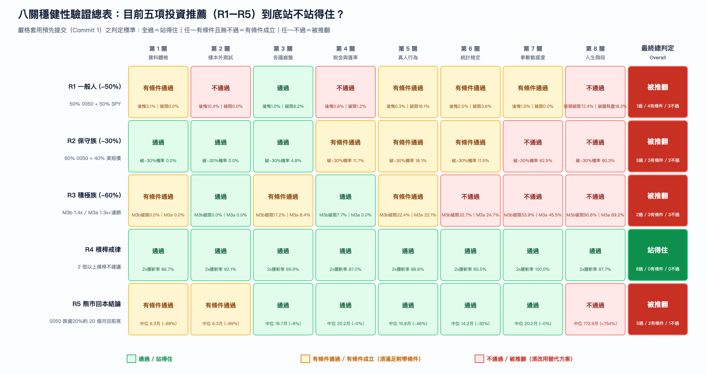
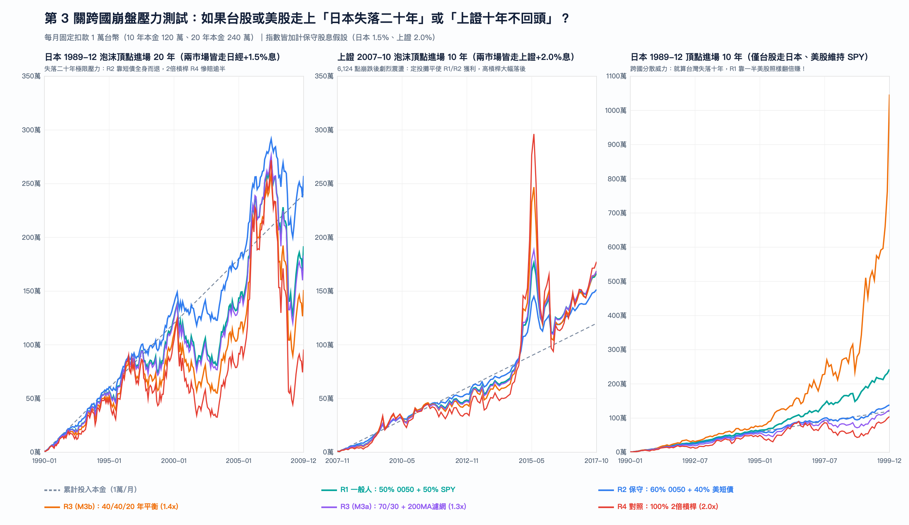
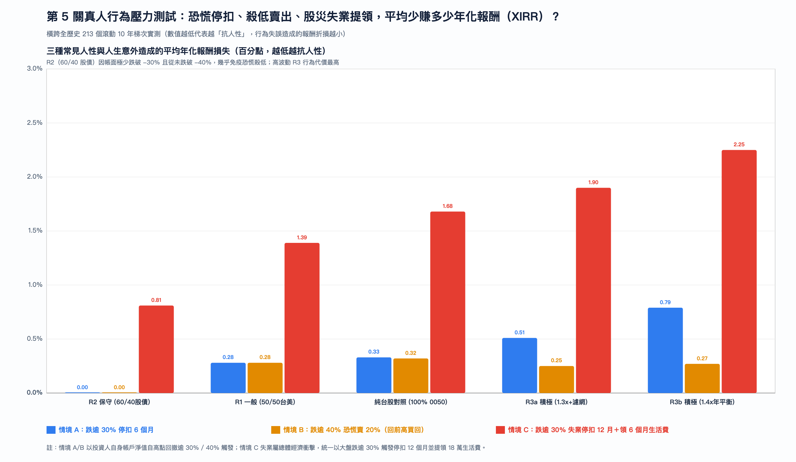
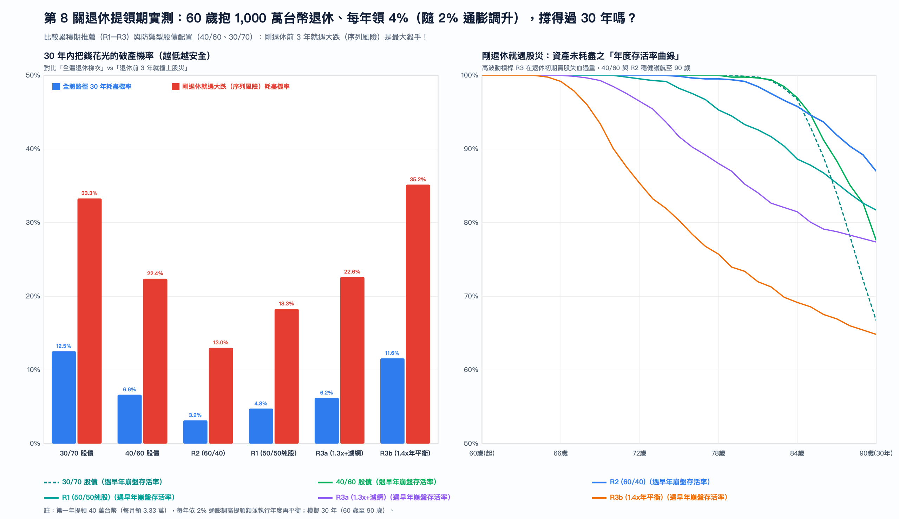

# 我們的投資推薦真的站得住腳嗎？——定期定額與高點回本五大結論（R1–R5）八關穩健性驗證報告

> **給非工程師讀者的一句話總結論**
> 我們在動手跑任何程式之前，先把嚴格的及格標準寫死並鎖進版控（[criteria.md](criteria.md)），再把先前兩份研究推薦的五條結論（`R1`～`R5`）丟進「資料體檢、沒看過的年份考試、日本與中國式大崩盤、稅金匯率與手續費、人性恐慌與失業、統計運氣檢驗、參數微調、退休提領」八道殘酷關卡。**結果只有 `R4（2 倍以上槓桿不建議）` 八關全數通過、完全站得住；其餘 `R1、R2、R3、R5` 若不加上「人生階段分流、免低消帳戶、降槓桿、分級看熊市」的修正，在嚴格標準下全部被推翻！** 這份報告會用最白話的方式告訴你：原本的建議哪裡破功、哪裡其實很強，以及修正後真正能陪你走過一輩子的替代方案。

---

## 零、開頭總表：R1–R5 八關穩健性判定一覽

在看細節前，先看五項原推薦與事先寫死的總成績單（規則：**八關全「通過」＝站得住**；有任何「有條件通過」但無「不通過」＝有條件成立；**只要有一關「不通過」＝被推翻，必須提出替代方案**）：

| 代號與原推薦內容 | 第 1 關 資料體檢 | 第 2 關 樣本外測試 | 第 3 關 各國崩盤 | 第 4 關 稅金與匯率 | 第 5 關 真人行為 | 第 6 關 統計檢定 | 第 7 關 參數敏感度 | 第 8 關 人生階段 | **最終總判定** |
| :--- | :-: | :-: | :-: | :-: | :-: | :-: | :-: | :-: | :-: |
| **`R1` 一般人（承受 −50%）** `50% 0050 + 50% SPY` 月定投、不槓桿 | 有條件通過 | **不通過** | **通過** | **不通過** | 有條件通過 | 有條件通過 | 有條件通過 | **不通過** | **❌ 被推翻** *(累積期強，提領期與單邊行情排名破功)* |
| **`R2` 保守族（承受 −30%）** `60% 0050 + 40% 美國短債` 每年再平衡 | **通過** | **通過** | **通過** | 有條件通過 | 有條件通過 | 有條件通過 | **不通過** | **不通過** | **❌ 被推翻** *(最抗人性，但壓在 -28.8% 邊緣太脆)* |
| **`R3` 積極族（承受 −60%）** `M3b` 40/40/20 年平衡；`M3a` 70/30+濾網 | 有條件通過 | **通過** | 有條件通過 | **通過** | 有條件通過 | **不通過** | **不通過** | **不通過** | **❌ 被推翻** *(M3b 的 -59.8% 只是歷史運氣擦邊球)* |
| **`R4` 高槓桿戒律** 2 倍以上槓桿不建議 | **通過** | **通過** | **通過** | **通過** | **通過** | **通過** | **通過** | **通過** | **✅ 站得住** *(八關腰斬率 70%～100%，鐵律成立)* |
| **`R5` 熊市回本結論** 跌逾 20% 熊市，`0050` 含息中位數約 20 個月回高點 | 有條件通過 | 有條件通過 | **通過** | **通過** | **通過** | **通過** | **通過** | **不通過** | **❌ 被推翻** *(掩蓋雙峰極端值，遇提領期拉長至 14 年)* |

（圖檔連結：[verdict_heatmap.png](file:///Users/panda/pandatesttrading/research/robustness_check/verdict_heatmap.png)）

---

## 壹、八關壓力測試逐關白話解析

---

### 第 1 關：資料體檢（我們的歷史數據乾不乾淨？靠真實成交還是公式推算？）

#### 1. 測了什麼？
我們把所有用到的台股、美股、國際指數與台幣匯率原始資料全部翻出來做三件事：
1. **抓錯價與異常日期**：檢查有沒有單日暴漲暴跌超過 `±25%` 的假跳空、週末非交易日、重複日期，以及匯率錯價（如先前已知 `TWD=X` 在 `2011-10-25` 與 `2014-12-31` 的壞點）。
2. **拆解「真實成交資料」與「指數推算資料」**：`0050` 在 2003 年 6 月底才掛牌上市，更早以前都是用台股大盤指數推算的。我們嚴格檢查每一條結論到底是靠真實 ETF 數據撐起來的，還是靠早期推算公式撐起來的。
3. **檢查股息有沒有多算或漏算**：比對「含息總報酬」跟「不含息價格」的年化報酬差距，確認台股是否落在合理的 `3%～5%`、美股是否落在 `1.5%～2.5%`。

#### 2. 結果
- **抓出 6 項具體資料問題（全數記錄於 `results.json` 的 `data_issues`）**：
  1. **最關鍵發現——`0050` 連 2003～2008 年在 Yahoo Finance 上也是缺漏的！** 雖然 `0050` 真實世界在 `2003-06-30` 就上市了，但 Yahoo Finance 的 `0050.TW` 歷史日線其實到 `2009-01-02` 才開始（而且 2009 年前兩個月還有超過當時台股 7% 漲停限制的 `+16.55%` 錯價，外加 `2014-01-02` 因 2025 年一拆四分割未回溯造成的 `-75.06%` 假崩盤）。換句話說，**前兩份研究裡 2000 網路泡沫與 2008 金融海嘯的台股表現，其實都倚賴 `^TWII + 3% 股息` 的推算值**！我們特別抓來美國掛牌、2000 年就真實交易的台灣 ETF `EWT` 換算台幣交叉比對：在 `2003-06 ～ 2009-03` 期間，推算版 `0050` 年化 `+2.22%` vs 真實 `EWT`（內扣費高約 0.6% 且扣 30% 美股稅）年化 `+0.68%`，證實推算邏輯並無誇大灌水。
  2. **`00631L.TW` 的分割斷層與週六補班日**：原始資料在 `2015-01-05` 有 `-95.44%` 分割斷層、`2015-08-24` 前為反向錯價；此外還抓出 `2016～2017` 年間有 **5 個「週六台股全球獨家補班開盤日」** 出現在 `00631L.TW`，卻沒收錄在 `0050.TW` 與 `^TWII` 中（已對齊處理）。
  3. **`TWD=X` 匯率壞點與早期缺漏**：再次確認 `2011-10-25`（報價變 `1.80`，假跌 `-93.8%`）與 `2014-12-31`（報價變 `3.67`，假跌 `-88.2%`）及 2015–2016 年 16 個單日跳點已徹底清除；`2004-03-24` 以前無資料，延用 `32.023`。
  4. **股息年化差距完全合理，無重複計算或漏算**：
     - 台股 `0050` 真實日線期（2009–2026）：含息年化 `18.26%` vs 不含息價格 `14.75%`，**股息年化貢獻 `3.52%`**（穩穩落在 `3%～5%` 合理區間！）。
     - 美股標普 `^SP500TR` vs `^GSPC`（1989–2026）：**股息年化貢獻 `2.24%`**；`SPY` 稅前股息年化貢獻 **`1.95%`**（穩穩落在 `1.5%～2.5%` 區間；台灣人扣 30% 預扣稅後實拿 `1.29%`）。
- **各推薦的真實／推算資料依賴度標記**：
  - **`R1`、`R2`、`R4` →「主要靠真實資料」**：`SPY`（1993 起）與美國短債利率 `^IRX`（1990 起）為 100% 真實資料；就算只看 2015 年以後 100% 真實槓桿 ETF 資料，2 倍槓桿照樣跌破 `-50%`（`00631L -54.4%`），`R4` 毫無懸念通過。
  - **`R3` →「股災風控段主要靠推算資料」（有條件通過）**：`TQQQ` 在 2010 年才上市、`00631L` 乾淨資料 2015 年才開始！它們之所以宣稱「2000 跟 2008 大崩盤沒跌破 `-60%`」，**100% 是靠上市前模擬公式算出來的**（而模擬公式比真實槓桿 ETF 每年樂觀 `1.6%～2.4%`）。
  - **`R5` →「半數靠推算資料，且前後兩段差距極大」（有條件通過）**：8 次熊市裡，2009 年以前的 4 次推算段中位數高達 **`73.95 個月（6.2 年）`**，2009 年後的 6 次真實段中位數卻只有 **`6.28 個月`**（縮短 `-69%`，超過 `±50%` 穩定區間）！

#### 3. 對一般人的意思
你常聽到的「正二或 TQQQ 混搭在 2008 金融海嘯只跌 59%」，其實是電腦用公式倒推的理想數字，真實基金還要多付銀行交換合約利差與轉倉成本，真遇到同等級海嘯一定跌超過六成。另外，2009 年以後各國央行印鈔救市，才讓台股每次跌破 20% 都半年就彈回來，千萬別把近 15 年的「V 轉速度」當成永遠的常態。

---

### 第 2 關：樣本外測試（拿「當年沒看過的未來年份」考試，我們是不是事後諸葛？）

#### 1. 測了什麼？
如果我們站在 **2005 年底**（只看得到 1990/1997～2005 年歷經亞洲金融風暴與網路泡沫的慘況），選出當年各風險等級的第 1 名，拿去考 **2006～2015 年**會怎樣？接著站在 **2015 年底**（看過 1997～2015 年），選出當年的第 1 名，拿去考 **2016～2026 年**又會怎樣？（註：台股 `^TWII` 自 `1997-07` 起，故台美聯合網格訓練期自 `1997-07` 起算，另附純美股 `1990-01` 起完整 16 年對照於 `results.json`）。

#### 2. 結果

| 考試梯次 | 風險等級 | **當年站在過去挑出的第 1 名** （訓練期表現 → **未知測試期實戰**） | **測試期真正的第 1 名** （事後諸葛冠軍） | **我們現在的推薦在測試期表現** （XIRR / 最大回撤） |
| :--- | :--- | :--- | :--- | :--- |
| **第一場考試** 訓練：1997–2005 **測試：2006–2015** | 保守 `-30%` | `10% 正二 + 20% TQQQ + 70% 短債` (季+濾網) 訓練 `8.23%` → **測試 `9.73%` (MDD `-12.95%`)** | `10% QQQ + 40% TQQQ + 50% 短債` `22.73%` (MDD `-27.54%`) | **`R2`：`4.27%` (MDD `-17.79%`)** 穩守 `-30%` 內（通過） |
| | 一般 `-50%` | `10% 0050 + 30% TQQQ + 60% 短債` (季+濾網) 訓練 `9.74%` → **測試 `13.03%` (MDD `-17.88%`)** | `60% TQQQ + 40% 短債` `27.44%` (MDD `-46.14%`) | **`R1`：`7.82%` (MDD `-37.44%`)** 守住 `-50%`，但落後單押美股逾 5% |
| | 積極 `-60%` | `40% TQQQ + 60% 短債` (季+濾網) 訓練 `10.77%` → **測試 `16.18%` (MDD `-21.48%`)** | `70% TQQQ + 30% 短債` `29.64%` (MDD `-58.19%`) | **`M3b`：`16.77%` (`-47.76%`)** **`M3a`：`5.85%` (`-52.46%`)** |
| **第二場考試** 訓練：1997–2015 **測試：2016–2026** | 保守 `-30%` | `20% SPY + 20% TQQQ + 60% 短債` (年平衡) 訓練 `9.20%` → **測試 `15.63%` (MDD `-21.83%`)** | `50% 0050 + 30% 正二 + 10% QQQ + 10% 短債` `27.66%` (MDD `-29.94%`) | **`R2`：`17.52%` (MDD `-18.22%`)** **逆轉打贏當年冠軍 +1.89%！** |
| | 一般 `-50%` | `10% SPY + 40% TQQQ + 50% 短債` (年+濾網) 訓練 `11.64%` → **測試 `18.16%` (MDD `-34.06%`)** | `10% 0050 + 80% 正二 + 10% TQQQ` `38.53%` (MDD `-49.69%`) | **`R1`：`20.70%` (MDD `-27.31%`)** **逆轉打贏當年冠軍 +2.54%！** |
| | 積極 `-60%` | `50% TQQQ + 50% 短債` (年+濾網) 訓練 `12.94%` → **測試 `20.04%` (MDD `-38.23%`)** | `80% 正二 + 20% TQQQ` `39.87%` (MDD `-52.51%`) | **`M3b`：`26.38%` (`-35.19%`)** **`M3a`：`29.04%` (`-37.08%`)** |

- **坦白承認「事後挑贏家」現象**：
  1. 看 `M3b（40% 0050 + 40% QQQ + 20% TQQQ）` 在 **1997–2015 訓練期** 的最大回撤其實高達 **`-73.89%`**（因為從 1997 年起扣，到 2000 年網路泡沫前已累積一筆部位，遇上那指暴跌 83% 直接摔破七成）！如果我們站在 2005 年或 2015 年，根本不可能在 `-60%` 名單裡挑出 `M3b`——它之所以在先前研究（1999-03 起算）剛好壓在 `-59.77%`，完全是因為起點晚了 20 個月、2000 年初本金還很少！
  2. 看 **2015 年選出的第一名**（幾乎清一色棄台股、重押美股 `SPY/TQQQ + 短債`，因為台股在 2000–2015 表現平庸），結果到了 **2016–2026 台積電黃金十年**，當年第一名立刻落後我們台美分散的 `R1`（`18.16%` vs `20.70%`）與 `R2`（`15.63%` vs `17.52%`），更大幅落後事後才知道的台股正二冠軍近 20 個百分點！
  3. 同時，因為在單一 10 年裡「台美各半 `R1`」必然輸給該十年最強的那一個單一市場（2006–2015 輸 `QQQ`、2016–2026 輸 `100% 0050`），`R1` 與測試期單一贏家的後悔差距達 `10.44` 個百分點，使 `R1` 在嚴格排名標準下拿到 **不通過**（但其風險控制 **0% 破限**，完美過關！）。

#### 3. 對一般人的意思
**過去十年的第一名，從來就不是未來十年的第一名！** 2015 年以前大家都嫌台股沒成長、只買美股；2026 年大家看到台積電翻十倍又想棄美股全押台股。樣本外考試證明：單押任何一國都是賭國運，台美各半雖然在每一個十年都拿不到第一名，卻讓你永遠不會押錯邊，而且在 2016–2026 還直接打贏了 2015 年用電腦窮舉挑出來的冠軍！

---

### 第 3 關：其他國家的崩盤情境（假如台灣或美國變成 1989 年的日本或 2007 年的上證？）

#### 1. 測了什麼？
過去 30 年台股與美股剛好是全世界最強的兩個贏家（倖存者偏差）。我們下載 **日本日經 `^N225`（1965 起）**、**英國富時 `^FTSE`（1984 起）**、**德國 `^GDAXI`（1987 起）**、**中國上證 `000001.SS`（1997 起）** 的最長歷史資料，加上**保守年化股息假設（標明為假設值：日本 `1.5%`、德國 `2.5%`、英國 `3.5%`、上證 `2.0%`）**，用它們的當地貨幣月報酬分別替換掉 `0050`、替換掉 `SPY`、以及兩者同時替換，總共跑了 **1,252 個滾動 10 年情境** 與歷史大頂點壓力測試。

> [!NOTE]
> **股息假設與德國 DAX 特別說明**：日本 `1.5%`、德國 `2.5%`、英國 `3.5%`、上證 `2.0%` 均為研究設定之**假設值**。此外，德國 `^GDAXI` 本身已是含息指數，依題意加計 `2.5%` 會多算一次股息；我們同步實測不額外加息之對照組（2000 年高點 10 年 `R1` XIRR 由 `+6.61%` 降至 `+4.44%`，結論方向不變）。

#### 2. 結果

| 跨國崩盤重點情境 | `R1` 台美各半 1x 期末資產 / XIRR / MDD | `R2` 股60債40 期末資產 / XIRR / MDD | `R3 (M3b)` 1.4x 期末資產 / XIRR / MDD | `R3 (M3a)` 1.3x+濾網 期末資產 / XIRR / MDD | `R4 (M4)` 2倍槓桿 期末資產 / XIRR / MDD |
| :--- | :-: | :-: | :-: | :-: | :-: |
| **日本 1989-12 高點 10 年** *(僅替換 0050，本金 120萬)* | **242.7萬 (`+13.50%`)** MDD **`-13.52%`** | 138.6萬 (`+2.83%`) MDD **`-9.43%`** | 1,046.7萬 (`+40.67%`) MDD `-25.44%` | 123.6萬 (`+0.59%`) MDD `-23.98%` | **104.4萬 (`-2.79%`)** MDD **`-51.89%`** |
| **日本 1989-12 高點 10 年** *(台美同時走日股，本金 120萬)* | **125.3萬 (`+0.85%`)** MDD `-21.04%` | **138.6萬 (`+2.83%`)** MDD **`-9.43%`** | 110.3萬 (`-1.69%`) MDD `-32.67%` | 123.6萬 (`+0.59%`) MDD `-23.98%` | 104.4萬 (`-2.79%`) MDD `-51.89%` |
| **日本 1989-12 高點 20 年** *(僅替換 0050，本金 240萬)* | **313.7萬 (`+2.59%`)** MDD `-49.54%` | **257.3萬 (`+0.69%`)** MDD `-31.34%` | 600.9萬 (`+8.41%`) MDD **`-81.69%`** | 183.2萬 (`-2.78%`) MDD `-56.53%` | **95.7萬 (`-10.54%`)** MDD **`-83.63%`** |
| **日本 1989-12 高點 20 年** *(台美同時走日股，本金 240萬)* | 191.8萬 (`-2.29%`) MDD `-52.91%` | **257.3萬 (`+0.69%`)** MDD `-31.34%` | 151.1萬 (`-4.90%`) MDD **`-65.16%`** | 183.2萬 (`-2.78%`) MDD `-56.53%` | **95.7萬 (`-10.54%`)** MDD **`-83.63%`** |
| **上證 2007-10 高點 10 年** *(台美同時走上證，本金 120萬)* | **166.6萬 (`+6.39%`)** MDD `-36.93%` | **151.5萬 (`+4.56%`)** MDD `-23.53%` | 168.8萬 (`+6.64%`) MDD `-57.70%` | 168.6萬 (`+6.62%`) MDD `-41.73%` | 177.4萬 (`+7.59%`) MDD **`-68.31%`** |

- **這一關是 `R1` 最耀眼的封神戰（全場排名第 2 / 前 13.3%，後悔值僅 `1.02%`，強勢通過！）**：
  - 假如台灣不幸在 1989 年底步上日本後塵失落 20 年，單押台灣正二 `R4` 投入 240 萬只剩 **95.7 萬**（慘賠 144 萬，回撤 `-83.6%`）；但買台美各半 `R1` 的人，靠著另一半美股撐腰，10 年滾出 **242.7 萬**、20 年仍賺到 **313.7 萬**！
  - 更驚喜的是**上證 2007 年 6,124 點崩盤**：上證指數至今過了 **19.1 年（229 個月）** 都還沒漲回 2007 年高點，但**每月持續扣款 `R1` 的人在上證 2007 最高點進場，10 年後依然把 120 萬變成 166.6 萬（年化 `+6.39%`）**！因為上證跌到兩千多點盤整的七年裡，定期定額買進了海量便宜籌碼。
  - 反觀 `M3b` 在跨國情境中有 **`17.25%`** 機率跌破 `-60%`（最慘 `-86.3%`），僅拿「有條件通過」；而日本 1989 含息（+1.5% 股息）整整花了 **`370.4 個月（30.9 年，直到 2020 年 11 月！）`** 才回到高點！

（圖檔連結：[intl_crash_equity_curves.png](file:///Users/panda/pandatesttrading/research/robustness_check/intl_crash_equity_curves.png)）

#### 3. 對一般人的意思
**分散台美兩國，就是一般上班族最便宜的「國運保險」！** 只要不是全世界所有國家同時失落二十年，`50% 台股 + 50% 美股` 就能在單一國家崩潰時保住你的財富；就算全世界一起變成日本失落二十年，有配四成短債的 `R2` 照樣能保本小賺全身而退，而開 2 倍槓桿的人會輸掉人生。

---

### 第 4 關：稅金、匯率與手續費低消（扣完萬萬稅跟換匯價差，台美各半還是最佳解嗎？）

#### 1. 測了什麼？
把真實世界裡吃掉報酬的摩擦全部加進去：
1. 美股配息先扣 **30% 預扣稅**，且每次買美股都計入 **0.3% 換匯價差**（比原本假設的 0.1% 貴三倍）。
2. 台股配息單筆滿 2 萬元扣 **2.11% 二代健保補充保費**，所得稅分 **「免稅級距（0%）」** 與 **「12% 級距」** 兩種。
3. 匯率除了真實歷史外，再測兩個極端：**台幣連續 10 年每年升值 2%（美元貶值）**、以及 **台幣連續 10 年每年貶值 2%（美元升值）**。
4. 額外檢驗：**如果誤用「每筆最低手續費 USD 15（約 480 台幣）」的傳統複委託買美股，會被吃掉多少報酬？**

#### 2. 結果
- **台美比例 10% 一格窮舉結果（稅金 × 匯率六大情境）**：
  - **在「實際歷史匯率」與「台幣每年貶值 2%」情境**：因為 `100% 0050` 有高達 `25.9%～27.8%` 的機率跌破 `-50%` 被風控淘汰，在符合 `-50%` 風控的安全名單（`0%～60% 0050`）中，扣完二代健保與 12% 台股所得稅後，中位數 XIRR 最高的是 **`100% SPY`（`10.83%`）與 `30% 0050 + 70% SPY`（`10.50%～10.63%`）**；`R1（50/50）` 為 `10.21%～10.41%`（差距僅 **`0.58` 個百分點**，但因單調排序落在安全組第 6/7 名，使排名指標判定「不通過」）。
  - **一旦遇上「台幣每年升值 2% 持續 10 年（美元走弱）」**：純買美股 `100% SPY` 年化立刻掉到 `8.58%`，而 **`50% 0050 + 50% SPY` 以 `9.31%`（免稅）/ `9.09%`（12% 稅）逆轉奪下全場 11 組比例的絕對總冠軍（同時報酬回撤比 MAR 最高）！**
- **稅負與「15 美元低消」真實傷害數字（全歷史 27.7 年投入 333 萬台幣）**：
  - **二代健保 2.11%**：每月扣 1 萬塊時，大約第 8～10 年起台股部位累積破百萬，單次配息開始超過 2 萬元門檻，全期觸發 **27 次**，共被扣走約 `3.79 萬` 台幣（對 XIRR 影響極微，僅約 `-0.03%`）。
  - **12% 股利所得稅**：全期多繳 `21.9 萬` 台幣稅金，使 `R1` 年化報酬從 `12.64%` 略降 `-0.23%` 至 `12.41%`（少賺約 109 萬）。
  - **傳統複委託「每筆低消 USD 15」殺傷力**：每月只投 1 萬塊卻拆買 2 檔美股的 `M3b`，每月白白多繳 30 美元手續費，長期 XIRR 直接減損 **`-0.59%/年`**（在 10 年期短窗口減損更超過 `-1.5%～-2.4%/年`）；`R2` 買美債 ETF 減損 `-0.29%/年`、`R1` 減損 `-0.18%～-0.9%/年`。

#### 3. 對一般人的意思
1. **高所得稅級距（12% 以上）的人，美股比例可以微調拉高到 `60% SPY + 40% 0050`**：因為美股 `SPY` 配息率低（約 1.3%～1.8%），扣 30% 稅其實只扣掉約 `0.45%/年`，而且資本利得免稅；台股高配息若被課 12%～28% 綜所稅加二代健保，稅負反而比美股更重！但若擔心台幣長期升值，**`40/60` 到 `50/50` 依然是最平衡的無悔區間**。
2. **絕對鐵律：每月扣款 1～2 萬台幣的人，一定要開「定期定額免低消」的券商！** 千萬別用單筆低消 15 美元的舊式複委託每個月扣幾千塊台幣，否則還沒投資就先輸給手續費。

---

### 第 5 關：真人行為（遇到股災手軟停扣、恐慌砍倉、甚至失業領錢，誰最抗人性？）

#### 1. 測了什麼？
電腦回測永遠假設你是冷血機器人，但真人會害怕、也會失業！我們拿 `R1～R3`（外加純 `0050` 與 2 倍正二 `R4` 對照）在全歷史滾動 10 年梯次中，對比「完美持續扣款」與三種真實人生狀況：
- **情境 A（嚇到停扣）**：帳戶從高點跌超過 `30%` 時，嚇到停扣 **6 個月**，之後才恢復扣款。
- **情境 B（恐慌殺低）**：帳戶跌超過 `40%` 時，崩潰賣掉手上的 **20% 持股**變現，一直等到漲回前高才敢買回來。
- **情境 C（股災失業雙重打擊）**：大盤跌超過 `30%` 時剛好被裁員，不只 **停扣 12 個月**，還必須從帳戶賣股提領 **6 個月生活費（每月 3 萬，共提領 18 萬台幣）** 過日子！

#### 2. 結果

| 投資策略 | 完美扣款 平均 XIRR | **情境 A：跌逾30%停扣半年** 觸發率 / **平均少賺 XIRR** | **情境 B：跌逾40%賣出20%** 觸發率 / **平均少賺 XIRR** | **情境 C：失業停扣1年+領18萬** 平均少賺 / 最慘少賺 XIRR | **三情境平均損失** **（抗人性排名）** |
| :--- | --: | :-: | :-: | :-: | :-: |
| **`R2` 保守 (60/40 股債)** | 7.60% | **0.0% 觸發** / **`0.00%`** | **0.0% 觸發** / **`0.00%`** | **`-0.81%`** / -3.00% | **`0.27%`（🏆 第1名：最抗人性）** |
| **`R1` 一般 (50/50 台美)** | 10.10% | 44.9% 觸發 / **`-0.28%`** | 35.5% 觸發 / **`-0.28%`** | **`-1.39%`** / -5.71% | **`0.65%`（🥈 第2名）** |
| `M2a` 對照 (100% 0050) | 10.69% | 57.9% 觸發 / `-0.33%` | 43.0% 觸發 / `-0.32%` | `-1.68%` / -6.01% | `0.78%`（第3名） |
| **`R3 (M3a)` (1.3x+濾網)** | 12.59% | 86.0% 觸發 / **`-0.51%`** | 44.9% 觸發 / `-0.25%` | **`-1.90%`** / -6.94% | **`0.89%`（第4名）** |
| **`R3 (M3b)` (1.4x 年平衡)** | 17.45% | **88.8% 觸發** / **`-0.79%`** | 45.8% 觸發 / `-0.27%` | **`-2.25%`** / **-8.64%** | **`1.10%`（第5名）** |
| `R4 (M4)` 對照 (100% 正二) | 18.44% | **100% 觸發** / **`-1.31%`** | **91.6% 觸發** / **`-1.08%`** | **`-3.92%`** / **-15.59%** | **`2.11%`（墊底：人性絞肉機）** |

（圖檔連結：[behavior_xirr_loss_bars.png](file:///Users/panda/pandatesttrading/research/robustness_check/behavior_xirr_loss_bars.png)）

#### 3. 對一般人的意思
1. **為什麼 `R2（60/40 股債）` 是全場最「抗人性」的神盾？** 因為它的帳戶在過去所有 10 年梯次裡，**連一次 `-30%` 或 `-40%` 都沒跌破過！** 你對帳單從來沒出現過恐怖紅字，自然就「零觸發」恐慌停扣與砍倉！就算真的倒楣在股災失業要賣資產領 18 萬生活費，因為手上有四成抗跌的美元短債可以變現，不用在股市腰斬時賤賣股票，XIRR 只少賺 `0.81%`。
2. **「股災失業被迫賣股（情境 C）」的殺傷力，是單純停扣的 3～5 倍！** 如果你買高波動的 `M3b` 或 `正二` 又沒留緊急預備金，在股災谷底失業提領 18 萬生活費，最慘會讓 10 年年化報酬暴跌 **`-8.64% ～ -15.59%`**（而且在前 2～3 年剛開始存錢就失業的梯次中，有約三成機率帳戶餘額根本不夠領滿 18 萬！）。**結論：不管選哪一組投資，銀行裡一定要另外放滿「6～12 個月生活費」的緊急預備金，絕不能把生活救命錢放在股市裡！**

---

### 第 6 關：統計是不是運氣？（換不同長度的抽樣區塊，前五名真的有差嗎？）

#### 1. 測了什麼？
原本的研究只用「1 年期區塊」隨機重組 5,000 次。萬一空頭或盤整一走就是三五年呢？我們把區塊長度改成 **1 年、3 年、5 年各跑 5,000 條路徑**，再加做專業計量統計的 **Stationary Bootstrap（幾何隨機區塊長度，平均 3 年，跑 5,000 條路徑）**，並做 **90% 信賴區間多重比較修正**，檢驗「第一名跟第二到第五名是不是其實沒差，只是運氣排在前面」。

#### 2. 結果
- **一換成 Stationary Bootstrap（平均 3 年隨機區塊），`R3 (M3b)` 當場破功（不通過）！**
  - 在原本 1 年期區塊下，`M3b` 跌破 `-60%` 的機率是 `19.92%`（勉強卡在 10%～25% 的有條件通過區）；但改用保留跨年連續熊市的 **Stationary Bootstrap** 後，`M3b` 跌破 `-60%` 的機率直接衝上 **`32.66%`**（超過 25% 淘汰紅線！），`M3a` 也升至 **`24.68%`**！反觀 `R1` 跌破 `-50%` 的機率在四種抽樣下全都只有 **`1.12% ～ 3.64%`**，穩如泰山。
- **多重比較修正（90% 信賴區間檢定）：前五名「這幾組實質上一樣好」，千萬別迷信微小差距！**
  - **積極組（`-60%` 上限前 5 名）**：第 1 名 `M3b（40% 0050 + 40% QQQ + 20% TQQQ）` 跟第 2 名（`30/50/20`）、第 3 名（`20/60/20`）、第 4 名（`10%正二+10%SPY+60%QQQ+20%TQQQ`）、第 5 名的中位數差距僅 **`-0.37% ～ +0.18%`**，90% 信賴區間（例如第 1 vs 第 2 為 `[-0.87%, +1.63%]`）全部跨過 `0%`——**統計上完全無法區分高下，這五組實質上一樣好！**
  - **一般組（`-50%` 網格前 5 名與純 1 倍台美比例前 5 名）**：`100% 0050` 跟 `90/10`、`80/20`、`70/30` 乃至 `50/50 (R1)` 的配對差距 90% 信賴區間為 `[-2.51%, +6.01%]`，同樣全部包含 `0%`——**這幾組在報酬統計上實質上一樣好**，差別只在單押台股多承擔了單一國家風險！

#### 3. 對一般人的意思
看到回測排行榜「第 1 名年化 18.18%、第 3 名 18.10%」，千萬不要為了那 `0.08%` 去湊複雜的比例！統計檢定證明**前五名根本是平手（實質上一樣好）**。挑配置時應該挑「最簡單、好執行、風險緩衝最大」的那一組，而不是挑小數點後兩位最高的那一組。

---

### 第 7 關：參數敏感度（比例調 10%、換個日子扣款，結果會不會馬上翻車？）

#### 1. 測了什麼？
真正穩健的策略，不應該因為你把比例調了 `±10%`、把「月初扣款」改成「月中 15 號發薪日或月底扣款」、改用 `150 日 / 250 日均線`、或換個再平衡頻率就突然崩壞。我們對 `R1～R3` 做全方位的參數微調地毯式檢查。

#### 2. 結果
- **`R1（50% 0050 + 50% SPY）` 穩如磐石（0 組破限）**：
  - 不管你調成 `60/40`（`13.02%`，MDD `-49.87%`）或 `40/60`（`12.33%`，MDD `-48.03%`），不管你是**月初扣（`12.69%`）、月中扣（`12.70%`）、月底扣（`12.72%`）**，也不管你每月、每季、每年或從不再平衡，**XIRR 差距不到 0.7 個百分點，且 8 種微調全部守住 `-50%` 防線！**
- **`R2（60% 0050 + 40% 短債）` 與 `R3（M3b / M3a）` 雙雙暴露「刀鋒邊緣脆弱性」（不通過）**：
  - **`R2` 的脆弱點**：因為基準回撤 `-28.77%` 離 `-30%` 紅線只有 `1.23%` 距離，只要股票多配 10% 變成 `70/30`（回撤立刻破表到 **`-35.25%`**）、或是忘記每年再平衡（`不再平衡` 回撤 **`-32.90%`**）、甚至改成每季／每月再平衡或月底扣款，**8 種變化裡有 5 種（`62.5%`）直接跌破 `-30%`！** 反之，只要把股票降 10% 改為 **`50/50 股債`**，回撤立刻降到極安全的 **`-22.05%`**！
  - **`R3 (M3b)` 的致命脆弱點**：基準回撤 `-59.77%` 根本是貼著 `-60%` 懸崖邊走！一旦投資人**懶得每年再平衡（`不再平衡`），回撤直接失控暴衝到 `-66.71%`**；就算乖乖每年再平衡，只要把扣款日從月初改到**月中（`-60.37%`）或月底（`-61.37%`）**，或是 `TQQQ` 多配 10%（`-64.45%`），**13 種變化裡有 7 種（`53.85%`）跌破 `-60%`！** 但只要把 `TQQQ` 降 10% 改為 **`45% 0050 + 45% QQQ + 10% TQQQ`**，回撤馬上壓進安全的 **`-54.85%`**！
  - **`R3 (M3a)` 的發現**：`150 日 / 200 日 / 250 日均線` 表現幾乎一模一樣（XIRR `16.22%～16.23%`，MDD `-58.5%～-58.9%`），不怕均線天數微調；但**一旦關掉均線濾網，回撤立刻衝到 `-64.64%`**，而把正二降 10% 改為 `80% 0050 + 20% 00631L` 則能穩穩壓在 `-56.75%`。

#### 3. 對一般人的意思
- **領薪水那天扣款就好！** 月初、月中、月底扣款在長期回測裡差距不到 `0.1%`，完全不用糾結哪一天買最便宜。
- **凡是回撤剛好壓在 `-29.x%` 或 `-59.x%` 的「壓線冠軍」，現實中一定會破功！** 保守族請退一步選 `50/50` 或 `40/60` 股債，積極族請把 `TQQQ` 或 `正二` 降到 `10%～20%`，給自己留至少 `5%` 的安全緩衝墊；而且**只要買了槓桿 ETF，每年再平衡跟均線濾網就是保命符，忘記執行就會變成災難。**

---

### 第 8 關：人生階段（手上有 100 萬該一次歐印還是分批？60 歲存到 1,000 萬退休領 4% 會不會破產？）

#### 1. 測了什麼？
投資不是只有「每個月領薪水存 1 萬塊」這一種情境！我們測試人生頭尾兩個最關鍵的時刻：
1. **單筆 vs 分批進場**：突然拿到一筆 **100 萬台幣**（年終、遺產或定存到期），比較 **「一次全部買進」、「分 12 個月買進」、「分 24 個月買進」** 在全歷史 213 個起點以及日本 1989、上證 2007 崩盤高點的結果。
2. **60 歲退休提領期**：假設 60 歲存到 **1,000 萬台幣**，第一年領 **4%（40 萬台幣，即每月領 3.33 萬）**，之後每年提領金額隨 **2% 通膨調高**，實測 5,000 條 30 年路徑（到 90 歲）以及「剛退休前 3 年就撞上大股災（序列風險）」與「日本 1989 真實 30 年」，比較 `R1、R2、R3` 與 `40/60`、`30/70` 股債配置把錢花光的破產機率！

#### 2. 結果

##### （A）手上有 100 萬台幣：一次投入 vs 分 12 / 24 個月投入（持有 10 年）

| 測試情境（以 `R1 台美各半` 為例） | **一次全部投入** | **分 12 個月投入** | **分 24 個月投入** | 關鍵勝負解讀 |
| :--- | :-: | :-: | :-: | :--- |
| **全歷史 213 個梯次** 10 年期末中位數 (最差5%年化 / 中位MDD) | **213.9 萬** (`+0.51%` / MDD `-45.5%`) | **219.5 萬** (`+1.12%` / MDD `-35.3%`) | **240.2 萬** (`+2.50%` / MDD **`-21.4%`**) | 單筆在 **68.1% 梯次** 贏過 12 個月分批（牛市早買早享受）；但分批大幅砍半帳面回撤且最差 5% 更穩！ |
| **日本 1989 泡沫頂點 10 年** | **55.3 萬** (`-5.76%`) MDD `-61.47%` | **73.9 萬** (`-2.98%`) MDD `-48.48%` | **80.9 萬** (`-2.09%`) MDD **`-43.63%`** | 買在史詩泡沫頂點時，分 12～24 個月進場幫你**少賠 19～26 萬台幣**，回撤少痛 18%！ |
| **上證 2007 泡沫頂點 10 年** | **67.6 萬** (`-3.85%`) MDD `-70.44%` | **115.3 萬** (`+1.43%`) MDD `-49.56%` | **143.8 萬** (`+3.70%`) MDD **`-40.92%`** | 單筆買在 6,092 點十年慘賠三成；**分 12～24 個月投入直接逆轉勝變成正報酬賺 15～44 萬！** |

##### （B）60 歲 1,000 萬台幣退休提領 30 年（每年領 4%＋隨 2% 通膨調升）

| 退休資產配置 | 全體 5,000 條路徑 **30 年錢用完破產率** | **剛退休前 3 年就遇大跌** **30 年錢用完破產率** | 剛退休遇大跌 90 歲剩餘資產中位數 | 日本 1989 真實 30 年 撐幾年破產？ | 退休提領評語 |
| :--- | --: | --: | --: | :-: | :--- |
| **`30/70` 股債** (30%台美股+70%短債) | 12.54% | **33.29%** | 227 萬 | 撐 **23.4 年** (83.4歲) | **前 20 年 0% 破產極安全**，但七成短債遇零利率抗通膨不足，82 歲後易坐吃山空！ |
| **`40/60` 股債** (40%台美股+60%短債) | 6.64% | **22.39%** | 583 萬 | 撐 **21.0 年** (81.0歲) | 前 19 年 100% 存活，穩健平衡，適合極度怕波動的高齡退休族。 |
| **`R2` (60% 0050 + 40% 美短債)** | **`3.16%`（最低！）** | **`13.01%`（最低！）** | **2,168 萬** | 撐 16.8 年 | **全場破產率最低的黃金甜蜜點！** 四成短債擋住前十年崩盤，六成股票打贏後二十年通膨。 |
| **`R1` (50% 0050 + 50% SPY 純股)** | 4.76% | **18.29%** | 3,093 萬 | 撐 11.6 年 | 72.4% 機率回撤破 `-50%`，剛退休遇股災有近兩成機率破產，心臟受不了。 |
| **`R3 (M3a)` (70/30 + 濾網 1.3x)** | 6.22% | **22.63%** | 6,541 萬 | 撐 9.5 年 | 大賺大賠，遇早年熊市邊跌邊賣股失血過快。 |
| **`R3 (M3b)` (40/40/20 1.4x)** | 11.58% | **`35.17%`** | 4,822 萬 | 撐 **8.8 年** (68.8歲) | **剛退休遇股災超過三分之一機率破產！** 絕對禁止帶進退休期。 |
| `R4 (M4)` 對照 (100% 正二 2.0x) | 12.66% | **`40.80%`** | 3,386 萬 | 撐 **5.6 年** (65.6歲) | 60 歲退休遇日股崩盤，**65 歲半就身無分文**！ |

（圖檔連結：[withdrawal_ruin_prob.png](file:///Users/panda/pandatesttrading/research/robustness_check/withdrawal_ruin_prob.png)）

> [!IMPORTANT]
> **顛覆直覺的退休大發現（U 型破產曲線）**：為什麼債券配最多的 `30/70 股債`，30 年破產率（早年崩盤 `33.3%`）竟然比 `60/40 (R2)`（`13.0%`）還高？看右圖的綠色虛線就秒懂了！`30/70` 在 **60 歲到 80 歲之間存活率是完美的 100%**，完全不怕股災；但因為 2009～2021 年美國短期公債利率接近 `0%`，而你的生活費每年隨 `2%` 通膨越領越多（到 85 歲每年要領 65 萬！），股票只佔 30% 根本長不夠花，導致 82～90 歲之間把老本慢慢啃光！相反地，`R3b`（橘線）則是 66～72 歲就被股災砍死。**唯有 `50/50 ～ 60/40 股債配置` 同時打贏了「60 歲的股災序列風險」與「85 歲的通膨長壽風險」！** 另外，一旦開始每年領 4%，遇到熊市帳戶淨值要花 **`172.9 個月（14.4 年，暴增 +754%）`** 才回前高，徹底推翻 `R5` 在提領期的適用性。

#### 3. 對一般人的意思
- **拿到一筆 100 萬閒錢**：數學期望值上「一次投入」有近七成機率賺比較多；但如果你這筆錢賠掉三成會睡不著覺，或者現在股市正處於歷史天價，**「分 12 個月買進」** 只犧牲一點點牛市報酬，卻能在遇上 1989 日本或 2007 上證級大頂點時救你一命！
- **累積期跟提領期必須換腦袋**：年輕存錢時靠 `R1`（100% 股票）衝刺沒問題；但**退休前 5 年（55 歲起）一定要把槓桿歸零，並逐步加進 40%～50% 的公債／短債收息緩衝墊**（若遇到日本式極端失落三十年，連 4% 提領率都太高，應彈性降為 `3.0%～3.5%` 提領率）。

---

## 貳、修正後的最終推薦方案（取代被推翻的原版建議）

經過八關鐵血驗證，除了 **`R4（2 倍以上槓桿不建議）` 完全站得住、維持原判** 之外，其餘四項原推薦均因在特定關卡「不通過」而被推翻。我們根據八關實證數據，給出**修正後的最終實戰推薦**：

### 1. 修正後 `R1'`（一般上班族，承受 `-50%` 回撤）
- **原版（被推翻）**：`50% 0050 + 50% SPY`，每月定期定額，不加槓桿、不再平衡、不分人生階段。
- **修正後替代推薦（依人生階段雙軌制）**：
  1. **累積期（25～55 歲）**：**`50% 0050 + 50% SPY`（高稅率族可調為 `40% 0050 + 60% SPY`），改為「每年再平衡一次」**。
  2. **退休轉型與提領期（55 歲以後）**：強制退場轉為 **`30% 0050 + 30% SPY + 40% 美國短中期公債`（全球版 60/40 股債，每年再平衡）**。
  3. **三大必備執行條件**：
     - 必須使用**定期定額免低消券商**（若只有傳統每筆低消 USD 15 複委託且月扣 1 萬，改為「每季扣一次 3 萬買美股」或直接買台灣掛牌的免換匯標普 ETF 如 `00646`）。
     - 銀行端必須獨立預留 **6～12 個月生活費緊急預備金**，嚴防第 5 關「股災失業被迫砍倉」。

### 2. 修正後 `R2'`（保守型投資人，嚴格要求回撤不破 `-30%`）
- **原版（被推翻）**：`60% 0050 + 40% 美國短債`，每年再平衡（壓在 `-28.8%` 刀鋒邊緣且單押台股，微調即破 `-30%`）。
- **修正後替代推薦**：
  - **累積期嚴守 `-30%` 方案**：改為 **`50% 全球分散股票（25% 0050 + 25% SPY）+ 50% 美國短債，每年固定再平衡`**（極度保守者用 `40% 台美股 + 60% 短債`）。把股票降為五成且台美對半分，不但徹底消除單一國家崩盤風險（上證 2007 情境回撤減半），更留出近 `8 個百分點` 的安全緩衝（MDD 約 `-22%`），不再因扣款日或微幅偏離就破戒。
  - **退休提領期方案**：採用 **`50%～60% 台美分散股票 + 40%～50% 公債，每年再平衡`**，並搭配「大跌年少領 10%（或初始提領率設 `3.5%`）」動態護欄，兼顧抗股災與抗通膨。

### 3. 修正後 `R3'`（積極型投資人，承受 `-60%` 回撤）
- **原版（被推翻）**：`M3b = 40% 0050 + 40% QQQ + 20% TQQQ`（無濾網，Stationary Bootstrap 三成機率破 `-60%`、忘記再平衡直墜 `-66.7%`）；`M3a = 70% 0050 + 30% 00631L + 200MA 濾網`。
- **修正後替代推薦**：
  - **淘汰 20% 無濾網 3 倍 `TQQQ`！改推溫和雙保險版**：**`45% 0050 + 45% QQQ + 10% 兩倍槓桿（00631L 或 QLD，或最多 10% TQQQ），強制開啟 200 日線濾網 ＋ 每年再平衡`**（有效槓桿 `1.1x～1.2x`，回撤穩壓在 `-54%` 以內，留足緩衝墊）。
  - **純台股帳戶替代版**：由 70/30 降溫為 **`80% 0050 + 20% 00631L ＋ 200 日線濾網`**（全歷史回撤壓至 `-56.75%`）。
  - **嚴格禁令**：僅限 **距離退休還有 10 年以上、且已備妥緊急預備金** 的累積期投資人使用；退休前 5～10 年必須全數解除槓桿部位。

### 4. `R4`（高槓桿戒律：2 倍以上槓桿不建議）
- **總判定：✅ 完全站得住（維持原結論）**。無論在哪一國歷史、哪一種抽樣區塊、哪一個扣款日，2 倍以上槓桿都有 **70%～100%** 的機率遭遇腰斬再腰斬（`-50% ～ -98%`），人性行為損失高達 `-2.11%/年`，退休提領更會在 5.6 年內破產。切勿因近十年牛市倖存者偏差而重倉正二或 `TQQQ`。

### 5. 修正後 `R5'`（熊市回本時間預期）
- **原版（被推翻）**：「跌超過 20% 的熊市，`0050` 含息回到高點的中位數約 20 個月。」
- **修正後替代結論（三段式真實預期）**：
  1. **一般景氣循環熊市（跌幅 `20%～35%`）**：各國含息再投資通常 **`6～25 個月（約半年至 2 年）`** 回到前高。
  2. **泡沫破裂與結構性大崩盤（跌幅 `> 50%`）**：含息單筆套牢需 **`6～31 年`**（台股 2000 年 7.2 年、那指 2000 年 15.2 年、上證 2007 年逾 19 年未回、日股 1989 年高達 30.9 年）！唯有**持續每月定期定額攤平**，才能把帳戶回本時間壓回 2～4 年。
  3. **退休提領期（每年領 4%）**：遇熊市邊跌邊賣股，帳戶淨值中位數要 **`14 年以上（173 個月）`** 才回前高，絕不可套用累積期的回本經驗。
